<p align="center">
  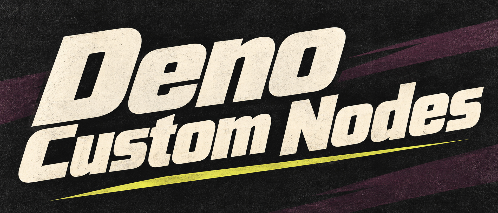
</p>

<p align="center">
  <a href="https://github.com/Deno2026/comfyui-deno-custom-nodes/releases/latest"></a>
  <a href="https://registry.comfy.org/publishers/deno2026/nodes/deno-custom-nodes"></a>
  <a href="https://github.com/Deno2026/comfyui-deno-custom-nodes/actions/workflows/ci.yml"></a>
  <a href="LICENSE"></a>
  <a href="https://www.youtube.com/@Denoise-AI"></a>
</p>

<p align="center">
  <b>Practical ComfyUI nodes for the whole production loop.</b><br>
  Prepare inputs, direct the model, compare results, finish the look, and keep large graphs readable.
</p>

<p align="center">
  English · <a href="docs/README.ko.md">한국어</a> · <a href="docs/README.ja.md">日本語</a> · <a href="docs/README.zh-CN.md">简体中文</a> · <a href="docs/README.es.md">Español</a> · <a href="docs/README.pt-PT.md">Português (PT)</a> · <a href="docs/README.pt-BR.md">Português (BR)</a> · <a href="docs/README.id.md">Bahasa Indonesia</a>
</p>

<p align="center">
  <a href="#quick-start">Quick Start</a> · <a href="#workflow-map">Workflow Map</a> · <a href="#web-tools">Web Tools</a> · <a href="#included-nodes">Node Reference</a> · <a href="#safety-and-privacy">Safety</a> · <a href="https://github.com/Deno2026/comfyui-deno-custom-nodes/releases/latest">Latest Release</a>
</p>

> [!NOTE]
> **New in v0.7.126:** [`(Deno) MiniMax H3 Tiled Sampler`](#deno-minimax-h3-tiled-sampler) finishes an upscaled MiniMax H3 video+audio latent in overlapping tiles, so a 16GB GPU can run the final high-resolution pass.
>
> **v0.7.125** tightened Local LLM server addresses, Easy Model Download Helper links, and Ideogram Director image saving. Node IDs, inputs, and saved workflows are unchanged. See the [CHANGELOG](CHANGELOG.md).

## Quick Start

Start with a working ComfyUI installation.

1. Open **ComfyUI Manager**, search for `Deno Custom Nodes`, and install the package.
2. Restart ComfyUI and refresh its browser page.
3. Double-click an empty area of the canvas, search for `(Deno) Resize Box`, and add it.
4. Add a standard `Load Image` node and choose an image. Connect it to Resize Box and connect Resize Box's `image` output to `Preview Image`. Choose a size and run the workflow to see your resized image.

This first example needs no generation model. Individual model and RTX nodes list their own requirements below. If you do not use Manager, see [manual installation](#install).

Most Deno nodes include a small green `i` button in the top-right corner for quick node info without leaving the canvas. When a newer Deno Custom Nodes version is available, the button turns yellow and shows a small `!` badge.

## Workflow Map

<p align="center">
  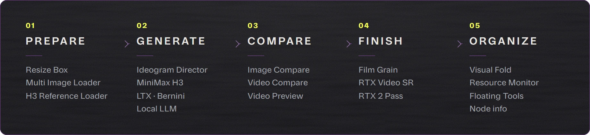
</p>

Every Deno node belongs to one step of a ComfyUI production loop. Start from the step you are working on.

### 01 · Prepare

Get every image, reference, and size right before the model runs.

<p align="center">
  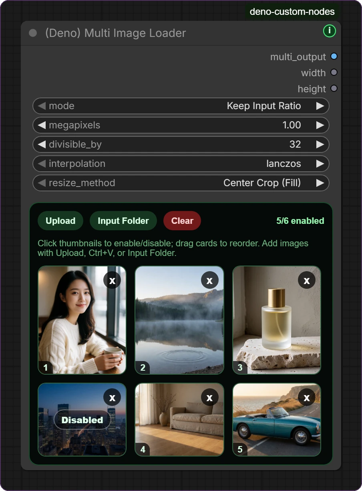&nbsp;&nbsp;
  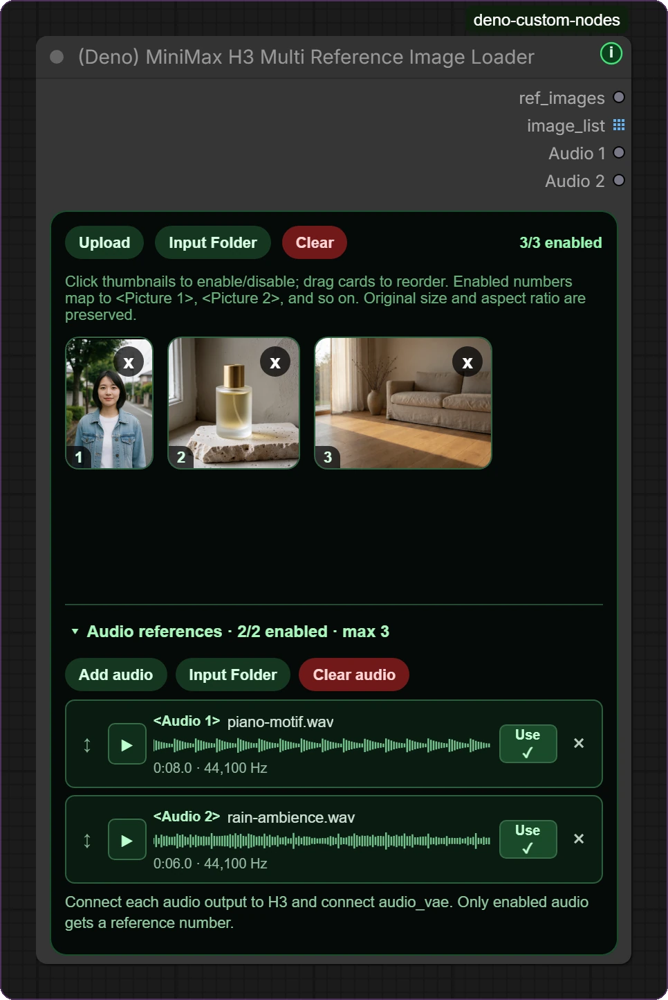
</p>

| Node | What it does | Needs |
| --- | --- | --- |
| [Resize Box](#deno-resize-box) | Ratio, megapixel, and crop resizing with a live, draggable crop preview | — |
| [Multi Image Loader](#deno-multi-image-loader) | One ordered gallery and one cable; click a card to skip it without deleting it | — |
| [Advanced Image Source Loader](#deno-advanced-image-source-loader) | Folder upload, chained batches, and mixed-size `image_list` output | — |
| [MiniMax H3 Multi Reference Image Loader](#deno-minimax-h3-multi-reference-image-loader) | Up to 9 images and 3 audio files, each kept at its own size | ComfyUI 0.30.0+ |

### 02 · Generate

Direct the model with layouts, references, prompts, and LoRAs that stay readable on the canvas.

<p align="center">
  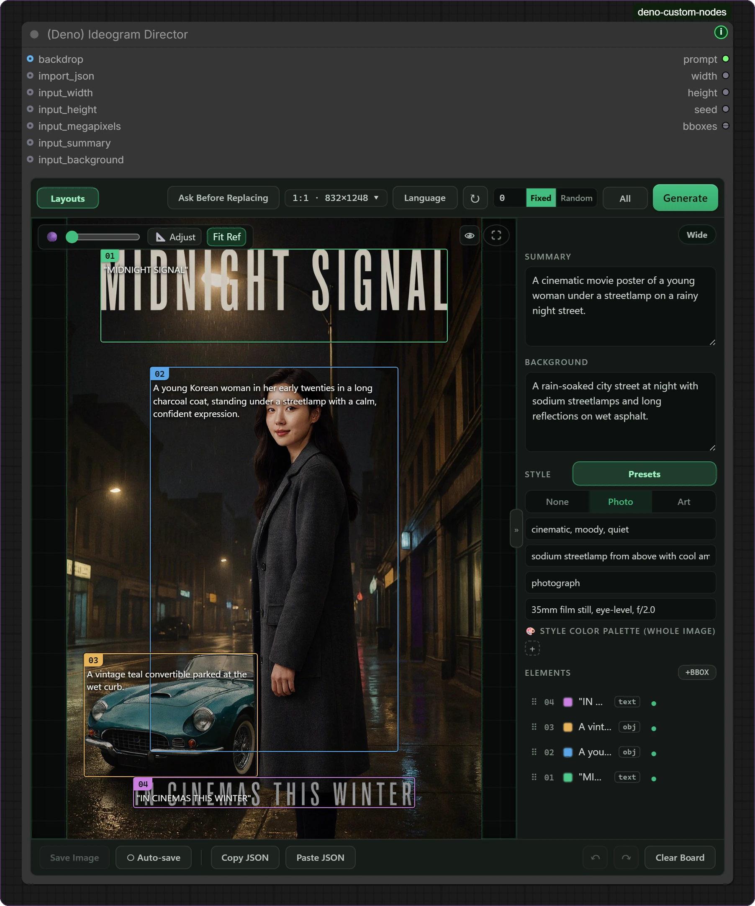
</p>

| Node | What it does | Needs |
| --- | --- | --- |
| [Ideogram Director](#deno-ideogram-director) | Draw bbox layouts and build model-ready Ideogram 4 JSON captions | An Ideogram 4 workflow |
| [MiniMax H3 Acc LoRA Loader](#deno-minimax-h3-acc-lora-loader) | Loads Alibaba's official 8-step H3 Acc-LoRAs without conversion | Official Acc-LoRA weights |
| [MiniMax H3 Tiled Sampler](#deno-minimax-h3-tiled-sampler) | Finishes upscaled H3 video in overlapping tiles on a 16GB GPU | ComfyUI 0.30.0+ with native H3 |
| [MiniMax H3 R2V Audio Reference workflow](#minimax-h3-r2v-audio-reference-workflow) | `(Deno) Audio Transcript` and `(Deno) Audio Analysis Finalizer` turn source audio into prompt direction | VideoHelperSuite, LM Studio |
| [LTX Model Loader](#deno-ltx-model-loader) | Checkpoint, KJ, and GGUF loading patterns in one compact node | KJNodes or ComfyUI-GGUF for those modes |
| [LTX Sequencer](#deno-ltx-sequencer) | Multi-image guide sequencing with per-image frame and strength | — |
| [LTX Multi LoRA Loader](#deno-ltx-multi-lora-loader) | Power-LoRA-style rows with separate video and audio strength | — |
| [LTX Prompt Guide](#deno-ltx-prompt-guide) | LTX prompt encoding with a minimum length from quoted dialogue | — |
| [LTX Tiled Spatial Upscaler](#deno-ltx-tiled-spatial-upscaler) | Upscales video latents in overlapping spatial tiles | An LTX latent upscaler |
| [LTX High resolution Tiled Sampler](#deno-ltx-high-resolution-tiled-sampler) | High-resolution LTX AV refinement through fused spatial tiles | — |
| [Bernini Prompt Guide](#deno-bernini-prompt-guide) | Instruction-style positive and negative prompts in one node | Native Bernini conditioning |
| [Multi LoRA Loader](#deno-multi-lora-loader) | Up to 64 LoRAs with per-slot toggles, strengths, and notes | — |
| [Easy Model Download Helper](#deno-easy-model-download-helper) | Official model links plus an exact target-path check | — |
| [Text Encoder Unload](#deno-text-encoder-unload) | An opt-in VRAM release point after prompt encoding | — |
| [Prompt Text](#deno-prompt-text) | A readable multiline STRING source for long prompts | — |
| [Local LLM Loader and Reviewer](#deno-local-llm-loader-and-deno-local-llm-reviewer) | Local LLM prompts from ComfyUI and review gates before saving | A local LLM server |

### 03 · Compare

See the difference on the canvas before you save anything.

<p align="center">
  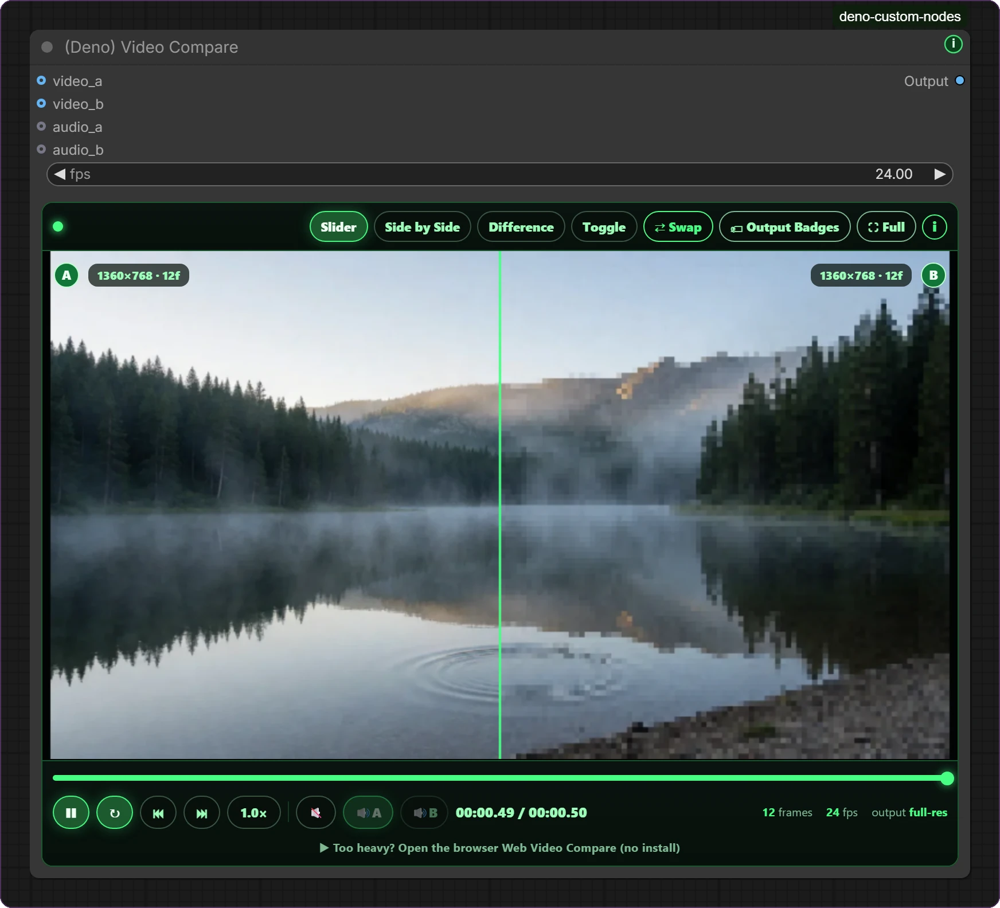&nbsp;&nbsp;
  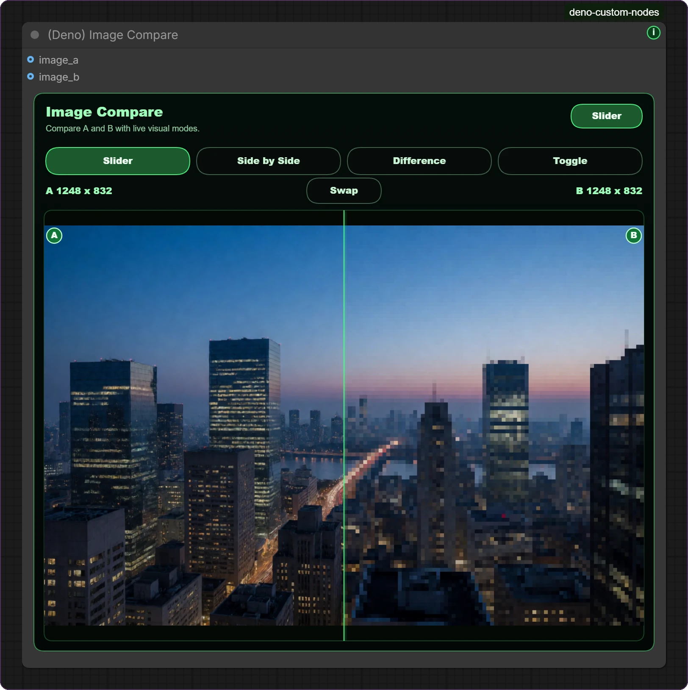
</p>

| Node | What it does | Needs |
| --- | --- | --- |
| [Image Compare](#deno-image-compare) | Slider, side-by-side, difference, and toggle views inside the node | — |
| [Video Compare](#deno-video-compare) | Frame-exact A/B video playback with audio and a lossless comparison output | — |
| [Video Preview](#deno-video-preview) | Inline, full-resolution H.264 preview at any point in the graph | PyAV (ships with current ComfyUI) |

### 04 · Finish

Set the final look and resolution.

<p align="center">
  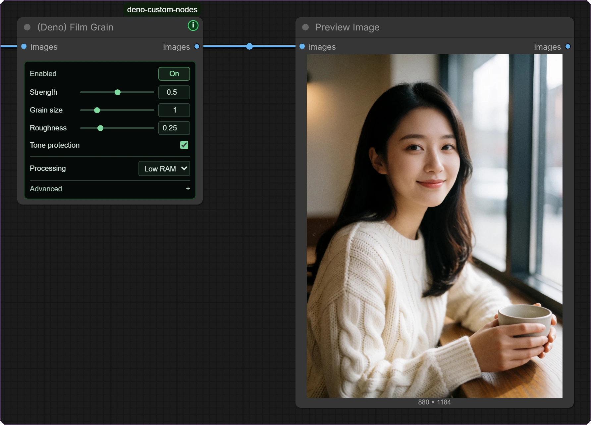&nbsp;&nbsp;
  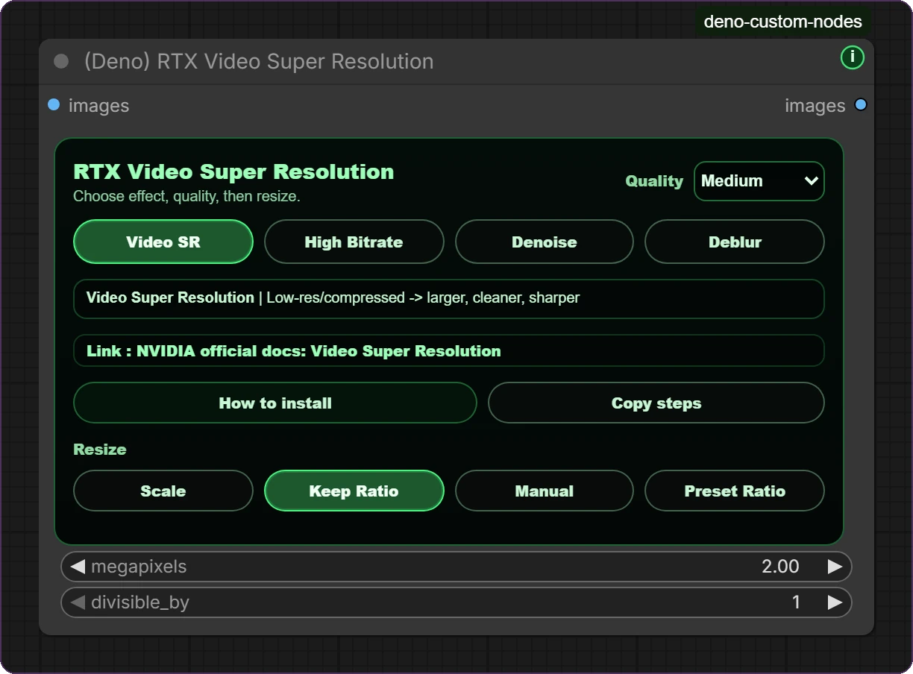
</p>

| Node | What it does | Needs |
| --- | --- | --- |
| [Film Grain](#deno-film-grain) | CPU film grain for photos and video, matched to resolution | — |
| [RTX Video Super Resolution](#deno-rtx-video-super-resolution) | NVIDIA VSR, High Bitrate, Denoise, and Deblur with clear resize choices | Windows, NVIDIA RTX, `nvidia-vfx` 0.2+ |
| [RTX Video Super Resolution (2 Pass)](#deno-rtx-video-super-resolution-2-pass) | A cleanup pass and an upscale pass for full video workflows | Windows, NVIDIA RTX, `nvidia-vfx` 0.2+ |

### 05 · Organize

Keep large graphs readable.

<p align="center">
  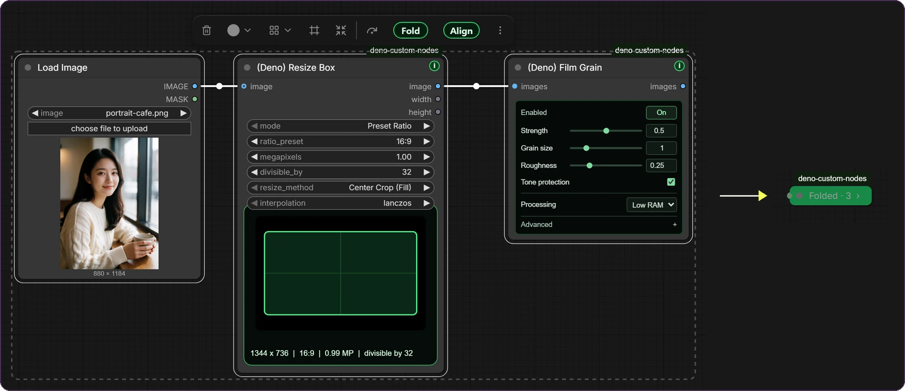
</p>

| Tool | What it does | Needs |
| --- | --- | --- |
| [Visual Fold](#deno-visual-fold) | Folds selected nodes or a group into one compact pill, without a subgraph | — |
| [Floating Tools](#deno-floating-tools) | Free VRAM, ComfyUI Stable update status, and GPT/Gemini-ready Error Help | Off by default |
| [Node info button](#node-info-button) | Quick help and update notes on each Deno node | — |

## Web Tools

Run these directly in your browser. Nothing to install.

- [Deno Video Compare](https://deno2026.github.io/comfyui-deno-custom-nodes/video-compare/) - compare two rendered videos with slider, side-by-side, difference, and toggle views, then save the comparison as MP4.
- [Deno Video to GIF/WebP](https://deno2026.github.io/comfyui-deno-custom-nodes/video-to-gif/) - trim, crop, resize, and export short clips as GIF or smaller WebP files.
- [Deno Discord Media Compressor](https://deno2026.github.io/comfyui-deno-custom-nodes/video-to-discord/) - compress videos or images for sharing on Discord, aiming for files below 10 MB when possible. The tool's interface is Korean-only.

## Included Nodes

The full reference, in workflow order. Each section starts with what the node does; open **Details** for edge cases and compatibility notes.

### 01 · Prepare

#### `(Deno) Resize Box`

Resolution helper and image resize node for ComfyUI.

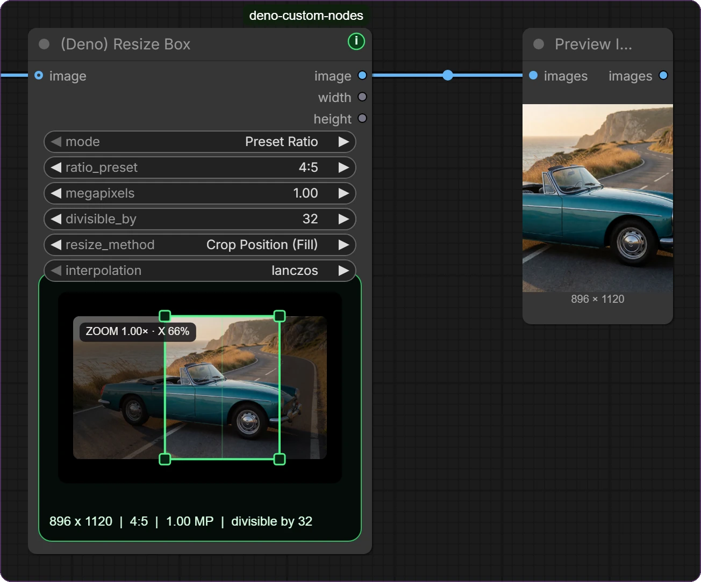

Main features:

- `Preset Ratio` and `Manual Input` modes
- common ratio presets
- megapixel-based size calculation
- `divisible_by` alignment
- `Center Crop (Fill)`, aspect-locked zoomable `Crop Position (Fill)`, and `Fit (Letterbox/Pillarbox)` resize modes
- `lanczos` default interpolation
- live ratio preview; `Crop Position (Fill)` shows the full connected source, lets you drag the crop box to reposition it, and lets you drag any corner to zoom while keeping the output ratio and megapixels fixed
- outputs: `image`, `width`, `height`

#### `(Deno) Multi Image Loader`

Multi-image loader designed for batch guide workflows. Inspired by the original workflow ideas from **WhatDreamsCost**, then adapted and refined for the Deno workflow style.


Main features:

- scrollable fixed-height gallery instead of endlessly growing node height
- drag reorder with stable placeholder insertion
- click thumbnails to disable/enable images without deleting them; only enabled images are output, numbered 1, 2, 3… in card order, with counts and numbers updating immediately
- disabled images and their positions remain saved with the workflow; enable at least one image to run
- upload button, drag-and-drop upload, and paste image support
- `Input Folder` browser for reusing existing ComfyUI `input` images
- `Keep Input Ratio`, `Preset Ratio`, or `Manual Input` size mode with ratio preset, megapixels, divisible-by sizing, or direct width/height control
- resize method and interpolation selection, with optional crop or fit resizing during export
- outputs: `multi_output`, `width`, `height`

<details>
<summary>Details</summary>

- input subfolder browsing with folder tiles, double-click navigation, and a `Parent` button
- nested input images can be added while preserving their ComfyUI subfolder paths
- external symlinks or junctions that leave ComfyUI's `input` folder are skipped for security; upload those images into `input` instead
- newest-first input image sorting based on file modified time
- responsive input-folder thumbnails for smoother browsing with many images

</details>

#### `(Deno) Advanced Image Source Loader`

Advanced image source loader for uploaded images, ComfyUI input folders, connected IMAGE batches, and mixed-size image-list output. The standard `(Deno) Multi Image Loader` remains the simpler recommended option for normal ComfyUI `input` folder workflows.

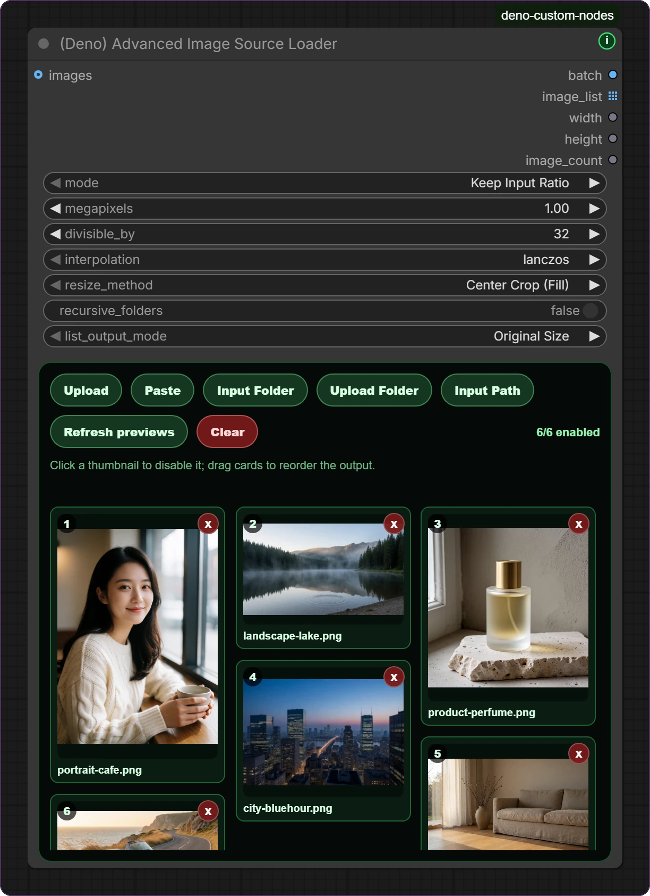

Main features:

- keeps the familiar Deno image-loader gallery workflow
- supports existing ComfyUI `input` folder browsing and relative `Input Path` entries
- `Upload Folder` imports a browser-selected folder into ComfyUI input
- supports upload, drag-and-drop, paste, and browser folder upload where the browser allows it, plus a visible `Paste` button and normal Ctrl+V image paste
- click thumbnails to disable/enable sources without deleting them; only enabled cards receive sequential output numbers
- drag thumbnail cards to reorder the output sequence
- optional `images` input can chain an upstream image batch/list into the same output stream
- outputs a resized `batch` tensor for normal batch workflows and `image_list` for per-image list handling
- outputs: `batch`, `image_list`, `width`, `height`, `image_count`

<details>
<summary>Details</summary>

**Migration from 0.7.120 or earlier:** external folders and image URLs are no longer read or downloaded. Use `Upload` or `Upload Folder`, then replace each active legacy source with the uploaded input path. Saved sources, order, enabled states and connections are preserved. Disabled legacy sources do not block execution. `DENO_EXTERNAL_IMAGE_ROOTS` no longer grants access. Absolute saved paths inside ComfyUI input still execute; select their relative input path to restore thumbnails.

- supports folder tiles, nested-folder browsing, and a `Parent` button
- use `Refresh previews` to retry thumbnails without changing sources, enabled state, or order; hover a failed preview for help
- disabled sources stay readable and remain saved with the workflow until re-enabled or removed; toggling or reordering updates output numbers immediately
- the gallery follows the node's available height in both the classic canvas and Nodes 2.0
- thumbnails use a masonry-style flow so mixed portrait/landscape references are easier to scan
- `recursive_folders` option for loading nested folder images
- `Keep Input Ratio`, `Preset Ratio`, or `Manual Input` size mode with ratio preset, megapixels, divisible-by sizing, or direct width/height control
- resize method and interpolation selection, including center, top, or bottom crop fill modes
- `Original Size` list mode can preserve mixed source resolutions in `image_list`
- `Match Batch Size` list mode makes `image_list` match the resized batch dimensions

</details>

#### `(Deno) MiniMax H3 Multi Reference Image Loader`

Reference loader for MiniMax H3 workflows, with one-cable images and individual audio outputs.


Main features:

- the same upload, paste, drag-and-drop, Input Folder, card reorder, and clear workflow as `(Deno) Multi Image Loader`
- up to 9 ordered reference images through one dedicated socket
- keeps each decoded image's own dimensions and aspect ratio without resize, crop, pad, or letterbox processing
- displays each preview card at the source image's own aspect ratio, so mixed landscape and portrait references stay fully visible without preview cropping
- click thumbnails to disable/enable references; enabled cards are immediately renumbered to match `<Picture 1>`, `<Picture 2>`, and so on, and only those images reach both outputs
- disabled images stay saved in their card positions and still occupy one of the 9 gallery slots; enable at least one image or audio reference to run
- connects to the single `ref_images` input on `(Deno) MiniMax H3 Reference to Video`
- also exposes the same ordered sources as an `image_list` output that connects directly to `(Deno) Local LLM Loader`'s `image` input
- the H3 node keeps ComfyUI's native reference-video, paired-video-audio, and standalone-audio Autogrow inputs

The collapsible audio section below the image gallery accepts up to 3 audio files through `Add audio`, Input Folder, or file drop. Each file has a waveform, measured duration, preview playback, a separate Use toggle, reorder handle, and remove control. Playback does not change whether a file is used for generation. Video files are not accepted by this loader.

These two MiniMax H3 nodes require ComfyUI 0.30.0 or newer. See the portable [MiniMax H3 multi-reference workflow](docs/workflows/minimax-h3-multi-reference.json) for the complete native H3 pipeline with the two stock `Load Image` nodes replaced by the one-cable Deno loader.

<details>
<summary>Details</summary>

Each registered audio adds an individual `AUDIO` output after the two existing image outputs. Connect those outputs to `(Deno) MiniMax H3 Reference to Video`'s growing standalone-audio inputs and connect `audio_vae` to encode the sound. Only enabled audio cards receive `<Audio 1>`, `<Audio 2>`, and so on in card order. For example, with three registered files and the first two disabled, the third file is displayed and encoded as `<Audio 1>`. Disabled files and their cables remain saved; their ordinary downstream audio branches are skipped. Reordering keeps each cable attached to the same file, and removing a file removes only that file's audio cable. Audio-only loading is also supported.

The node grows automatically as audio files are added so every audio row stays visible without an internal scrollbar. Removing files or collapsing the audio section releases that space. Manually added height and width are preserved, and reopening an older compact workflow expands it enough to show its saved audio rows.

To keep the displayed tags and H3 references identical, connect all enabled audio outputs from one DENO loader to the same DENO H3 node. Turn off files you do not want to connect. When using these DENO audio outputs, other standalone-audio sources and reference-video soundtracks must be disconnected from that H3 node; the node explains a numbering conflict instead of silently assigning different tags. Existing workflows that use only other audio loaders retain their stock input behavior.

Audio files are read from ComfyUI's input folder. Supported extensions are WAV, MP3, FLAC, OGG/OGA, Opus, M4A, AAC, AIF and AIFF, subject to the installed PyAV decoder. Loading is bounded to 256 MiB per file, 128 MiB decoded PCM, and 30 seconds of CPU decoding. Preview failures have a Retry action and do not change the saved files or their connections.

The dedicated H3 socket is intentional: a normal ComfyUI `IMAGE` batch requires one shared width and height, so it cannot preserve mixed reference sizes. The additional `image_list` is a list output rather than a same-size batch, so the original dimensions, order, and aspect ratios remain separate when reused by list-aware nodes. MiniMax H3 may still downscale references during its normal `ref_image_size` processing while preserving their aspect ratio.

On ComfyUI builds that support optional H3 VAEs, `(Deno) MiniMax H3 Reference to Video` also accepts an unconnected `vae` or `audio_vae` input. Connecting both keeps the existing reference-encoding behavior.

- Without `vae`, reference images and videos still reach the text/vision encoder, but their VAE-encoded reference latents are omitted.
- Without `audio_vae`, the actual reference sound is not encoded. The text encoder retains labels such as `<Audio 1>`, not the audio waveform; connect `audio_vae` to reference a voice or sound. Omitting it does not disable generated audio.

Audio paired with a reference video (`ref_video_audio`) needs both `vae` and `audio_vae` connected to encode the reference video and its sound; standalone reference audio (`ref_audio`) needs only `audio_vae`.

These choices apply only to reference encoding in this node. Keep the VAEs needed by the downstream video and audio decoding nodes. Older ComfyUI builds whose native H3 node requires both VAEs still require both connections; update ComfyUI to use optional reference encoding.

</details>

### 02 · Generate

#### `(Deno) Ideogram Director`

Visual Ideogram 4 prompt builder for structured JSON captions and bbox layout work. [Watch the Ideogram Director workflow demo](https://youtu.be/Z8s27skkIDM).


The backdrop above is a local Ideogram 4 result generated from the same four boxes.

Main features:

- draw and edit bbox regions directly on the ComfyUI canvas
- temporarily disable individual bbox elements without deleting or reordering them
- double-click a bbox to edit beside the pointer, or repeatedly `Alt`+click an overlap to cycle through the boxes underneath
- import JSON prompts from a Local LLM Loader or other STRING source
- optionally connect Summary and Background STRING inputs to override those two board fields for a run; disconnected inputs continue to use the saved board text
- ask before replacing an existing board, or switch to always replace
- reject malformed JSON clearly instead of passing broken prompt text downstream
- style and layout preset galleries with lightweight preview thumbnails
- Language view for reading and editing board descriptions in your language while final output stays model-ready English. Literal TEXT box words such as signs, logos, and headlines are preserved exactly
- outputs: `prompt`, `width`, `height`, `seed`, `bboxes`

<details>
<summary>Details</summary>

The existing `bboxes` output connects to both standard `BBOX` consumers and `BOUNDING_BOX` inputs such as `Ideogram4_MultiLora_BoundingBoxNode_Fedor`; that node's region-row count follows the Director's active boxes without adding saved Director fields. Its current count-only synchronization does not track box identity, so review LoRA row assignments after deleting or reordering a middle box.

Translation uses only the built-in Google, MyMemory, and LibreTranslate services. See [file and translation access](docs/SECURITY_CONFIGURATION.md).

</details>

#### `(Deno) MiniMax H3 Acc LoRA Loader`

Directly loads Alibaba PAI's official [MiniMax-H3-Acc-LoRAs](https://huggingface.co/alibaba-pai/MiniMax-H3-Acc-LoRAs) without converting or duplicating the safetensors file.

1. Download the official FL2VA or Ref2VA `Acc-8Step.safetensors` file and place it in either the normal `ComfyUI/models/loras/` folder or the dedicated `ComfyUI/models/minimax_h3_acc_loras/` folder.
2. Connect a matching native MiniMax H3 diffusion model to `model`; full and Comfy-Org `*_pruned_*` variants are accepted.
3. Select the matching Acc-LoRA: FL2VA for FL2VA/T2VA, or Ref2VA for Ref2VA.
4. Connect this node's single `model` output to the normal guider path.
5. Build the sampling lane with stock ComfyUI nodes. The recommended starting point is `BasicScheduler: simple, steps: 8` and `KSamplerSelect: euler`, connected to `SamplerCustomAdvanced`.

LoRA weights and workflows are not bundled with Deno Custom Nodes. Download the weights from Alibaba and build or adapt your own native ComfyUI workflow.

<details>
<summary>Details</summary>

The node applies the static LoRA weights and the checkpoint's 32 time-dependent PDD output heads. At sampling time it reads the actual sigma boundaries supplied by ComfyUI and automatically fuses the PDD heads for those intervals. This keeps sampler, scheduler, and step controls in the normal ComfyUI nodes. The official 8-step Simple/Euler setup remains the recommended and trained configuration; users can select any Simple Scheduler step count from 4 through 12 without changing this loader, and other descending schedules or split sigma passes for latent-upscale workflows remain available for experimentation rather than guaranteed quality improvements. Keep the native MiniMax H3 video/audio sigma shifts at `12.0 / 3.0` and LoRA strength at `1.0`.

Full non-pruned models, including native ComfyUI INT8 variants, apply the complete adapter through ComfyUI's normal quantization-aware LoRA path. For a curve-pruned model, the loader looks for a matching non-pruned MiniMax H3 checkpoint already present under `models/diffusion_models/`, reads only its small FP32 time-embedder section, and derives an in-memory bridge that rebases all 50 full-width AdaLN LoRA updates onto the pruned 8-wide curve. It never loads the full checkpoint for this calculation. If no matching full checkpoint is installed, the loader remains usable in compatibility mode: it warns once, skips those 50 AdaLN updates, and still applies every other LoRA update and the PDD heads.

Standard active UI workflows saved with the v0.7.92-v0.7.94 three-output loader are migrated when loaded on the ComfyUI canvas. Existing model links stay in place, and the former sampler and sigmas links move to editable stock `KSamplerSelect: euler` and `BasicScheduler: simple, steps: 8` nodes. Save the UI workflow once after it opens. Current single-output workflows are not changed. Muted/bypassed nodes, unknown customized layouts, and malformed graphs are left untouched rather than guessed. Raw API prompt JSON does not run this frontend migration; export it again from the migrated UI workflow. If a file was already saved after its former sampler/sigmas links disappeared, reconnect those stock nodes manually.

</details>

#### `(Deno) MiniMax H3 Tiled Sampler`

Finishes an upscaled MiniMax H3 video+audio latent in overlapping tiles, so a 16GB GPU can run the final high-resolution pass. At every step all tiles read the same frame, their predictions are blended with cosine weights in the overlaps, and one shared update follows. The model loads once for all tiles, and the original audio latent passes through unchanged.

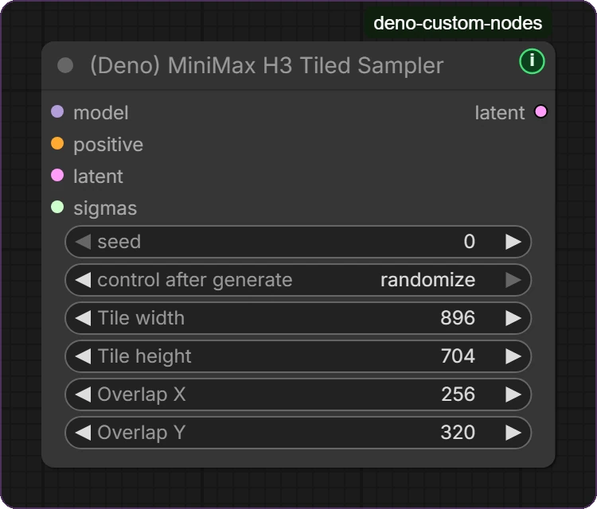

Typical place in a native H3 graph:

```text
First pass: SamplerCustomAdvanced with SplitSigmas high_sigmas
-> MiniMax H3 Latent Upscale With Model (ComfyUI 0.44.0+) or another H3 latent upscaler
-> (Deno) MiniMax H3 Tiled Sampler with SplitSigmas low_sigmas
-> VAE Decode for video, audio decode for sound
```

- `model`: the H3 model after LoRAs, sigma shift and any attention or memory nodes. H3-Optimizations sparse attention and memory optimization work in front of this node. ComfyUI's core `BlockSparseAttention` is rejected with a message for now.
- `positive`: the same positive conditioning as the first pass. R2V reference images stay global. Keyframe conditioning is cropped to each tile and prepared per tile. Regional conditioning and ControlNet are rejected.
- `latent`: the upscaled H3 latent, without a noise mask.
- `sigmas`: only the final 1-3 steps of the first-pass schedule, for example `SplitSigmas` `low_sigmas`. Other schedules are rejected with a hint.
- `seed`: noise that brings the upscaled latent back to the first of those sigmas.
- `Tile width`, `Tile height`, `Overlap X`, `Overlap Y`: pixel sizes in multiples of 32. Overlaps must be smaller than the tile. The tile count follows from the frame size. A tile at least as large as the frame runs it in one piece.

The defaults (896 x 704 tiles, at least 256 x 320 overlap) are the tested 16GB setting. On a 16GB GPU with 32GB system RAM, a 15-second 1920 x 1088 clip ran as 6 tiles, and its one final step took about 520 seconds. Larger tiles repeat less overlap work but need more VRAM. Sizes above these defaults have not been measured by DENO yet.

Each run prints the tile count, grid, sizes, per-tile seconds and PyTorch peak memory to the console and adds the same report to the node's output text, so you or an agent can choose the next sizes. Requires ComfyUI with native MiniMax H3 support (0.30.0 or newer); tested on ComfyUI 0.41.3 to 0.44.0.

#### MiniMax H3 R2V Audio Reference workflow

The [beginner audio-reference workflow](docs/workflows/minimax-h3-r2v-audio-reference.json) keeps ComfyUI's stock MiniMax H3 reference-audio path and adds an automatic prompt-direction lane:

- `(Deno) Audio Transcript` uses local OpenAI Whisper for lyrics or dialogue, segment timing, detected language, and a confidence summary. Optional user-entered lyrics remain the wording authority.
- `(Deno) Audio Analysis Finalizer` keeps only the documented acoustic-analysis fields from ComfyUI's `TextGenerate` result and can unload that CLIP model after the analysis.
- `(Deno) Local LLM Loader` receives the transcript and acoustic report through its optional `audio_context` STRING input. Raw AUDIO is not sent to the local LLM, and upstream analysis is treated as data rather than instructions.
- The selected source-audio section is both H3's `<Audio 1>` reference and the audio muxed into the final MP4. H3's internally generated audio is not decoded in this workflow.

Requirements:

- current ComfyUI Stable with MiniMax H3 and audio-capable `TextGenerate` support
- [ComfyUI-VideoHelperSuite](https://github.com/Kosinkadink/ComfyUI-VideoHelperSuite) for `Load Audio (Upload)`
- `gemma4_e4b_it_fp8_scaled.safetensors` in `ComfyUI/models/text_encoders/` for acoustic analysis
- LM Studio with `google/gemma-4-12b-qat` loaded and its Local Server running for the final prompt-director step

`openai-whisper` is installed as a node dependency. The selected Whisper checkpoint downloads from OpenAI on the first `(Deno) Audio Transcript` run, is checksum-validated by the official Whisper loader, and is cached under `ComfyUI/models/stt/whisper/`.

#### `(Deno) LTX Model Loader`

One compact loader for the common LTX 2.3 model-loading patterns.

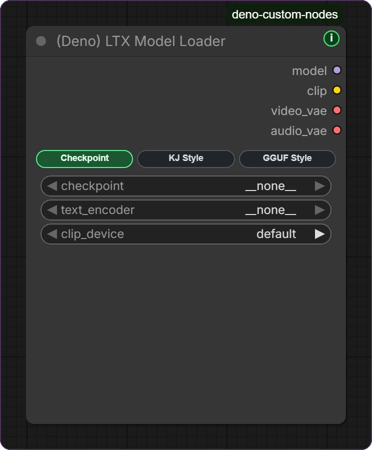

Main features:

- `Checkpoint Style`, `KJ Style`, and `GGUF Style` modes
- outputs: `model`, `clip`, `video_vae`, `audio_vae`
- uses ComfyUI's built-in checkpoint / diffusion / DualCLIP loading paths where possible
- uses KJNodes `VAELoaderKJ` for split video/audio VAE workflows
- uses ComfyUI-GGUF UNet loading for GGUF workflows; both packs are used only after ComfyUI has loaded them, and an installed but unloaded pack is reported clearly
- includes clearer dependency errors and an audio VAE compatibility fallback for mixed ComfyUI/KJNodes environments

#### `(Deno) LTX Sequencer`

LTX guide sequencer tuned for multi-image workflows. Inspired by **WhatDreamsCost**'s LTX workflow approach, with Deno-side adjustments focused on day-to-day usability.

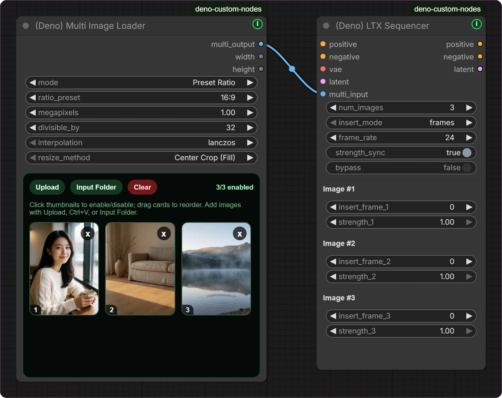

Main features:

- works with the batch output from `(Deno) Multi Image Loader`
- auto-fills `num_images` from the connected loader when possible
- keeps the existing sync-style workflow
- allows only `strength` values to break out into manual control when needed
- `bypass` switch passes `positive`, `negative`, and `latent` through unchanged for quick A/B tests

#### `(Deno) LTX Multi LoRA Loader`

Power-LoRA-style multi LoRA loader for LTX workflows.

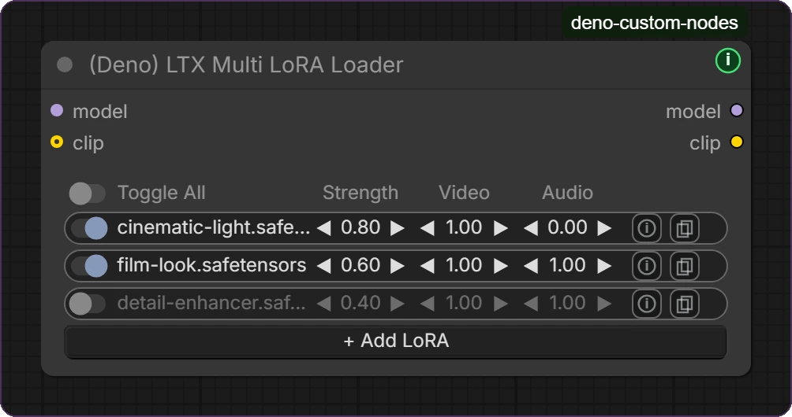

Main features:

- add multiple LoRAs in one compact node
- per-slot enable toggle
- per-slot `strength`, `video`, and `audio` strength controls
- per-slot trigger word and LoRA note editor
- copy saved trigger words from the LoRA row
- outputs patched `model` and `clip`
- designed to stay close to the familiar Power LoRA Loader workflow while adding LTX-friendly A/V controls and lightweight LoRA reference notes

#### `(Deno) LTX Prompt Guide`

Prompt helper that combines LTX prompt encoding, optional negative prompt handling, built-in LTX conditioning, and dialogue-length planning.

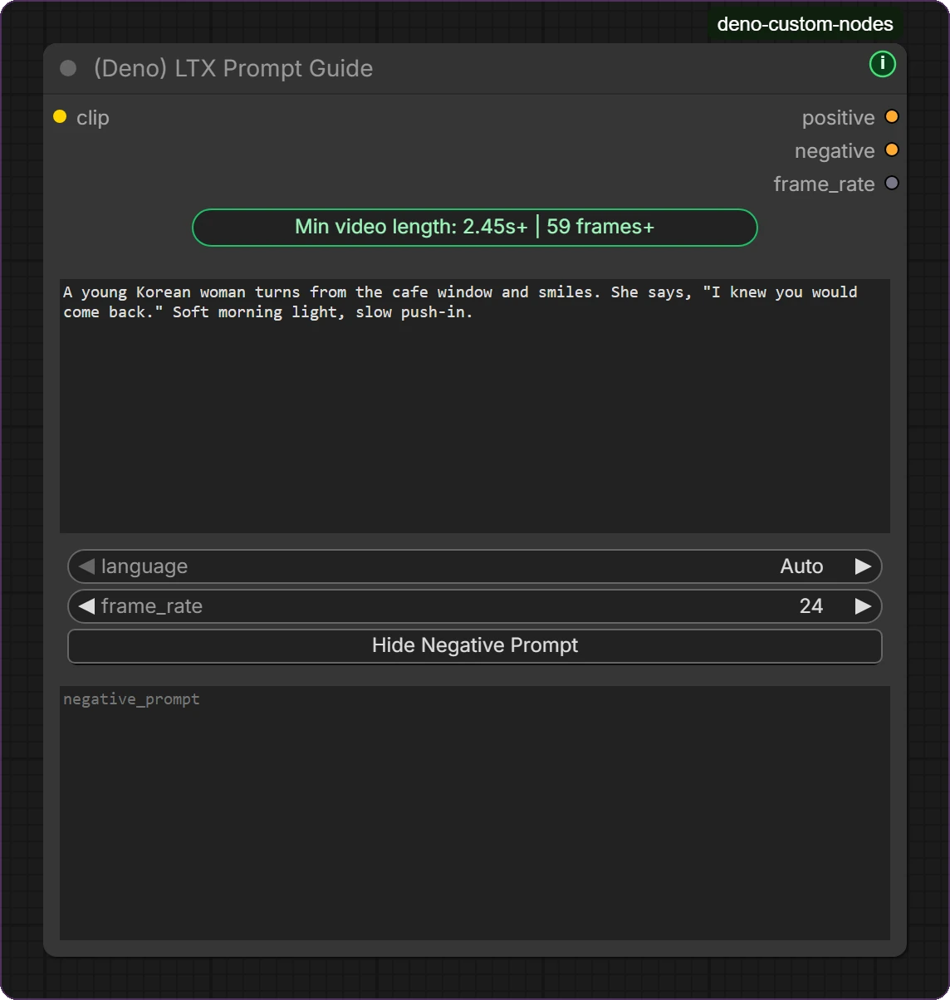

Main features:

- positive prompt text encoding
- optional collapsible negative prompt
- built-in LTX conditioning with `frame_rate`
- estimates minimum video length from quoted dialogue
- supports Auto, Korean, English, Japanese, and Chinese dialogue estimates
- outputs: `positive`, `negative`, `frame_rate`

#### `(Deno) LTX Tiled Spatial Upscaler`

Helper for high-resolution LTX video-latent second passes. It splits each frame into overlapping spatial tiles, runs the LTX latent spatial upscaler per tile, and blends the result back into one latent.

Use it on video-only LTX latents. If your workflow carries combined video/audio latents, separate the audio path first and rejoin it after the tiled video pass.

#### `(Deno) LTX High resolution Tiled Sampler`

Sampler for high-resolution LTX AV refinement passes. It keeps one global sampler trajectory while video predictions are evaluated through overlapping spatial tiles and fused before the sampler update.

The full audio latent is passed to every video tile as context, while the returned audio latent is kept unchanged in `freeze` mode.

#### `(Deno) Bernini Prompt Guide`

KJ-style Bernini prompt helper that combines positive and negative prompt encoding into one beginner-friendly node.

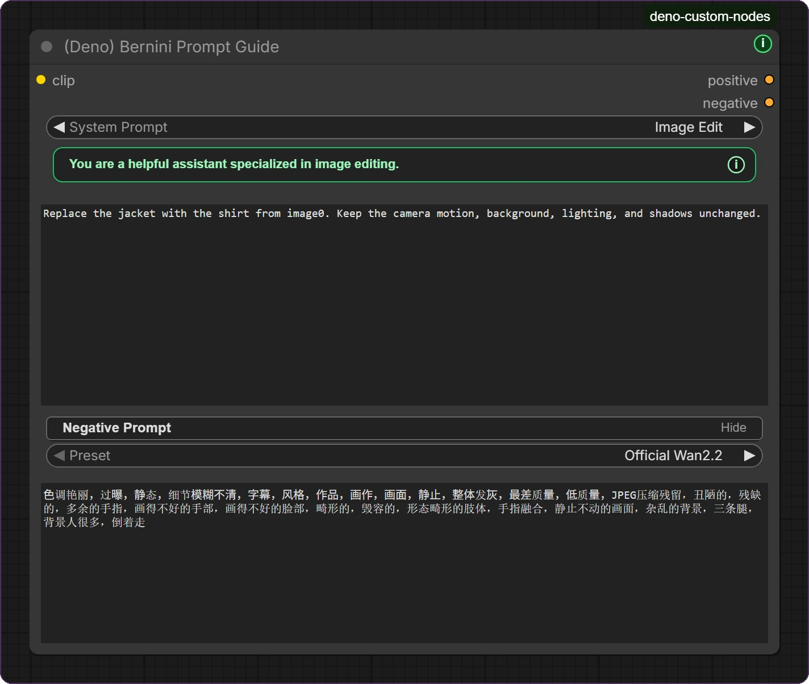

The `Official Wan2.2` negative preset shown above is written in Chinese.

Main features:

- `System Prompt` selector with readable modes such as `Text to Video`, `Image to Video`, and `Reference Video Edit`
- shows the active system prompt prefix directly on the top of the node
- writes prompts in instruction style, for example `Replace the jacket with the shirt from image0. Keep the camera motion, background, lighting, and shadows unchanged.`
- reference modes automatically add a short `image0`, `image1`, `image2` naming hint internally
- collapsible negative prompt section
- negative presets fill the visible negative prompt box; edit that box directly to change the final encoded negative prompt
- outputs: `positive`, `negative`

This node prepares text conditioning only. Connect its `positive` and `negative` outputs to ComfyUI Stable's native `(Bernini) Conditioning` node for Bernini visual/context-latent conditioning. Current ComfyUI includes the [merged native Bernini backend](https://github.com/Comfy-Org/ComfyUI/pull/14216), so the old preview-backend updater is no longer required; update ComfyUI Stable if the native conditioning node is missing.

#### `(Deno) Multi LoRA Loader`

General-purpose multi LoRA loader for ordinary ComfyUI diffusion workflows.

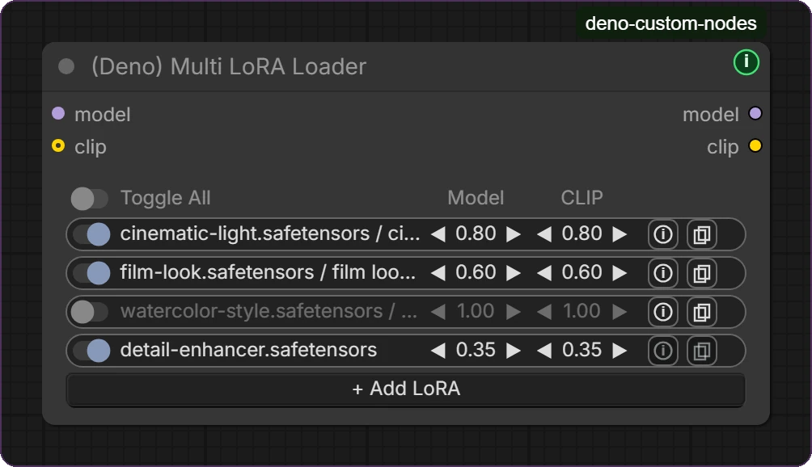

Apply up to 64 LoRAs to a connected `MODEL` and optional `CLIP`, enable or disable each saved slot without losing its selection, set separate model and CLIP strengths, keep trigger words and notes beside each LoRA, reorder slots, and pass the patched `model` and `clip` downstream. Use `+ Add LoRA` to add slots as needed. Existing eight-slot workflows and API prompts retain their saved selections, strengths, trigger words, notes, and connections.

#### `(Deno) Easy Model Download Helper`

Preset-based setup helper for recommended model file sets. The built-in presets cover the LTX 2.3 8GB VRAM GGUF starter set and the official LTX 2.5 Distilled INT8 two-stage model set.

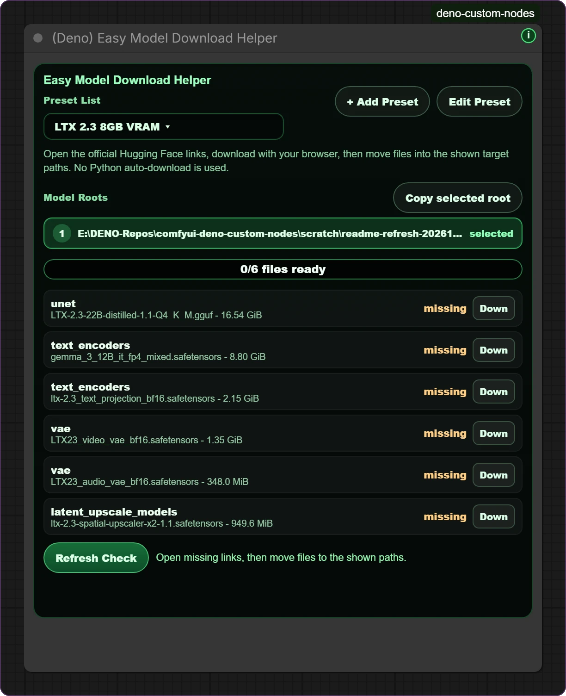

Main features:

- opens official model links in the browser instead of downloading files in Python
- includes the LTX 2.5 diffusion model, projected Gemma 4 text encoder, video and audio VAEs, and x2 spatial upscaler required by the two-stage workflow
- shows detected ComfyUI model roots and lets users copy the selected root
- supports saved creator presets inside the workflow and restores them from browser storage after a page reload
- supports Hugging Face direct links and Civitai page/download links without Python-side network requests
- checks ComfyUI-registered model folders, including custom folder names from `extra_model_paths`
- checks each preset's exact target path inside those registered model folders without scanning unrelated nested project folders
- shows target ComfyUI model subfolders so viewers know exactly where files should go

The LTX 2.5 repository requires a Hugging Face account and **Agree and Access** before its files can be downloaded. The helper does not bypass that gate or download files automatically. Review the [LTX-2 Community License](https://github.com/Lightricks/LTX-2/blob/main/LICENSE.md), request access on the [official LTX 2.5 repository](https://huggingface.co/Lightricks/LTX-2.5), then use the helper's browser links and move each downloaded file into the displayed ComfyUI model folder.

<details>
<summary>Creator preset link guide</summary>

- Hugging Face: right-click the small download icon next to the target file, choose `Copy link address`, then paste that direct file URL into the preset `URL` field.
- Civitai: copy the model page URL from the browser address bar, paste it into the preset `URL` field, then press the `Civitai` button in the editor to convert it to a direct browser download link. If the filename is not visible in the URL, enter the downloaded filename manually.
- For Civitai pages, do not copy the blue `Download` button link unless you intentionally want to provide a direct API download URL.
- `File name` is used only for the target-path check. It should match the downloaded file on disk, especially for Civitai/API links.

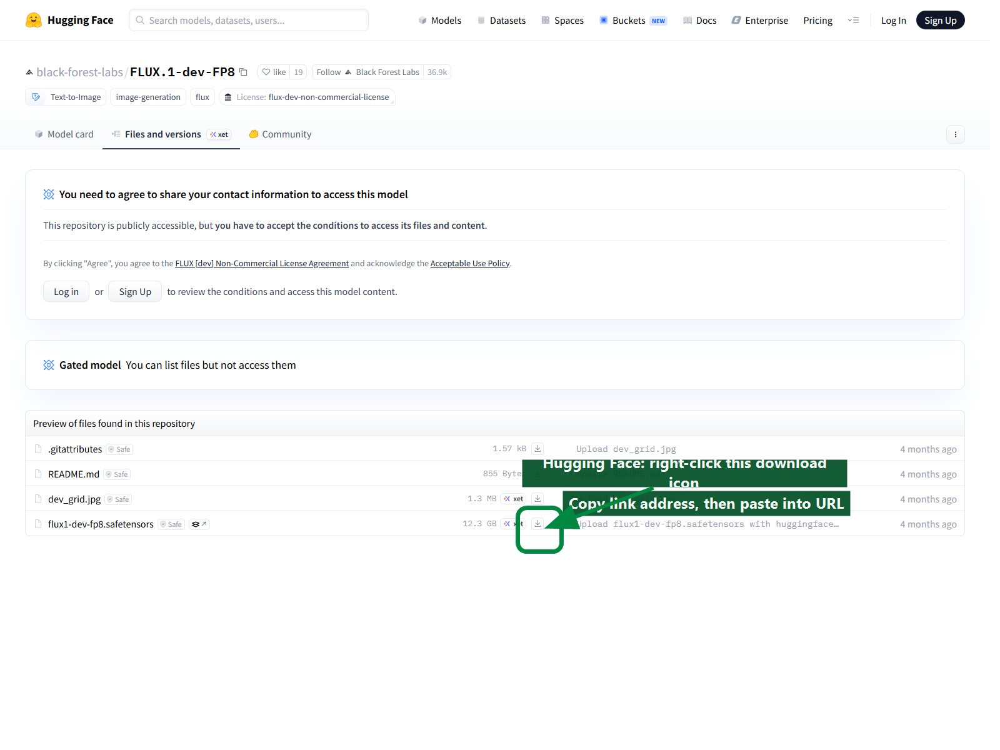

[Civitai model-page example (includes Chinese model text)](docs/images/easy-model-download-helper-civitai-link.png).

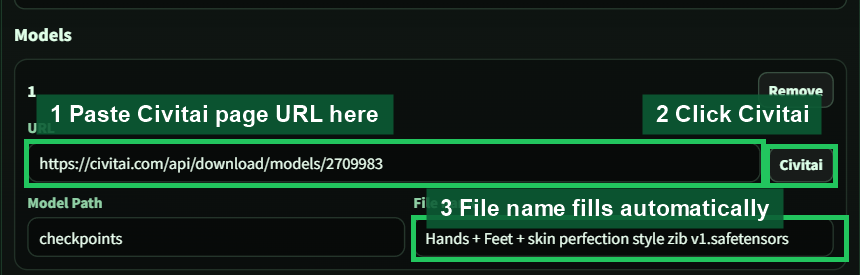

</details>

#### `(Deno) Text Encoder Unload`

An opt-in inline VRAM barrier for the common positive-only or positive/negative prompt flow.

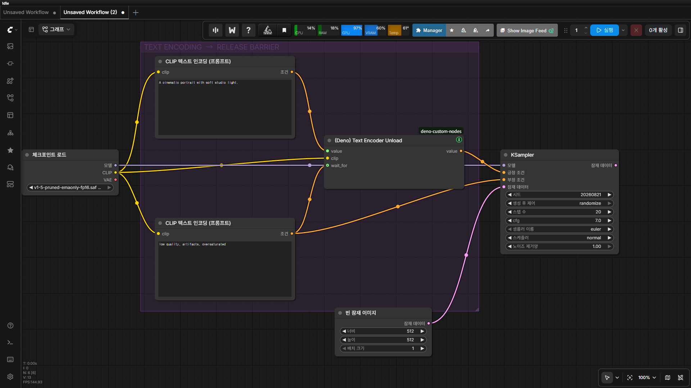

- connect positive conditioning through `Positive Conditioning`; it is required and passes through unchanged
- optionally connect an encoded negative prompt or `Conditioning Zero Out` through `Negative Conditioning`; it also passes through unchanged
- connect the exact `CLIP` used by the upstream text encoders to `Text Encoder (CLIP)`
- leave `Negative Conditioning` empty for a positive-only guider workflow
- unload only that CLIP/text encoder, its clones, and its managed components through ComfyUI model management; diffusion models, VAEs, and ControlNets are not globally unloaded
- follow normal ComfyUI input caching, so unchanged preview sampling can be reused while changed conditioning or CLIP paths still trigger the unload

<details>
<summary>Details</summary>

Dynamic VRAM moves weights according to memory pressure and may intentionally leave text-encoder pages resident. This node provides a deterministic opt-in release point, but it cannot make the whole process use `0 MiB`: CUDA context, conditioning tensors, other models, custom-node allocations, and other applications remain separate. It also does not improve sampling quality by itself; it creates VRAM headroom that can reduce model offloading or avoid an out-of-memory error. A later text encode must reload the model, and `--gpu-only` cannot move the encoder out of VRAM.

</details>

#### `(Deno) Prompt Text`

A small multiline STRING source for system prompts, user prompts, templates, or JSON text. Use it when a long reusable prompt should stay readable in its own node and connect into Ideogram Director, Local LLM Loader, or another STRING input without changing the text.

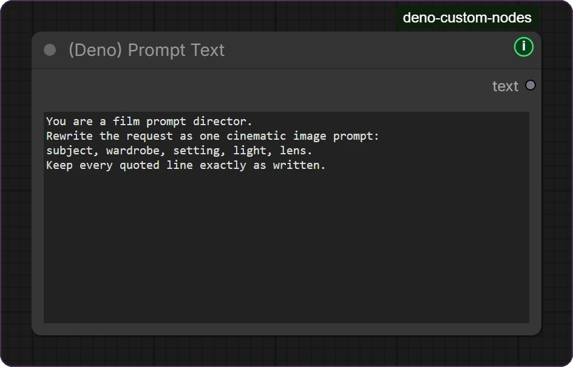

#### `(Deno) Local LLM Loader` and `(Deno) Local LLM Reviewer`

Local LLM workflow helpers for calling models that are already running on your PC and using text reviews to control what gets saved.

<p>
  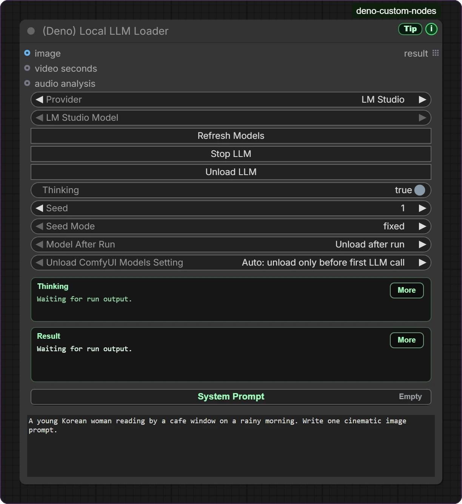&nbsp;&nbsp;
  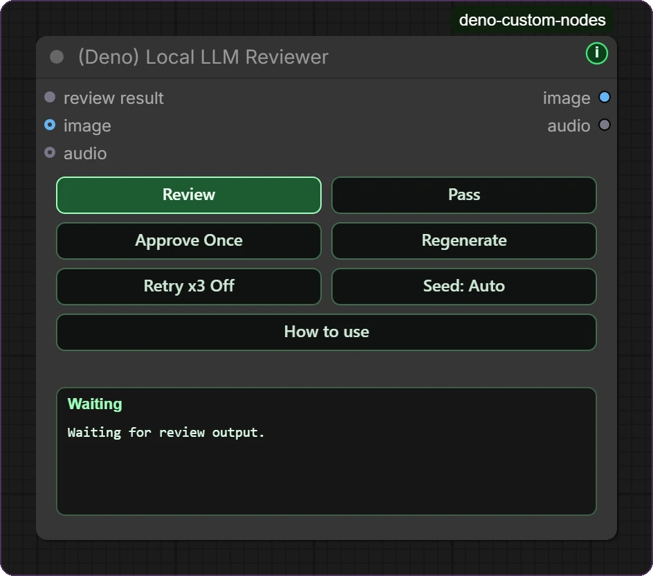
</p>

Main features:

- call local Ollama, LM Studio, llama.cpp, vLLM, Custom OpenAI-compatible, llama-swap, or Unsloth Studio models from ComfyUI
- localhost-by-default server safety: use `127.0.0.1` or `localhost`, or explicitly allow one private LAN `IP:port` with `DENO_LOCAL_LLM_ALLOWED_HOSTS`
- refresh provider-specific model lists from the node
- stop a running local LLM request before unloading the model
- connect prompt batches through one node run so the local model can stay loaded until the batch finishes
- optionally attach an IMAGE to a vision-capable local model call
- preview Thinking and Result text directly on the node
- embed the node's final Result in saved PNG/workflow metadata whenever the Local LLM node executes, so reopening the file restores it inside the node; Thinking/reasoning remains preview-only and is not persisted
- keep named System Prompt presets in ComfyUI user data so they survive browser-profile cleanup
- connect a positive FLOAT to `video seconds` to append a sentence such as `This is an 8-second video.` to each LLM user prompt without changing the saved Prompt text
- use `(Deno) Local LLM Reviewer` as a gate before Save nodes: pass or block IMAGE and AUDIO outputs from a review text result, approve the current reviewed result once, or rerun the path before the reviewer

<details>
<summary>Server addresses, API keys, and provider notes</summary>

The Custom, llama.cpp, vLLM, llama-swap, and Unsloth server fields accept only a server address and port with an optional `/v1`, for example `http://127.0.0.1:8000/v1`; queries and other paths are rejected with a hint. Refresh Models, Unload, and Stop for Ollama and LM Studio always use their fixed local servers, the same ones the node runs with. Server errors show the server's JSON error message instead of its raw response.

- keeps one detected-model selector across repeated refreshes and provider changes, and removes known duplicate selectors from older frontend sessions while preserving the selected model
- use llama-swap's live running-state and management APIs for manual or post-run unload; any configured llama-swap server timeout still owns automatic unloading
- use the `Unsloth` provider only with an Unsloth Studio server (default `http://127.0.0.1:8888/v1`); if an Unsloth GGUF is running inside LM Studio, select `LM Studio` instead
- list Unsloth Studio models, send OpenAI-compatible chat requests without tool-definition or tool-choice fields, and use Unsloth Studio's management API for manual or post-run unload; `Keep for minutes` does not schedule a timed Unsloth unload
- existing browser System Prompt presets can be imported once while the browser copy stays untouched as a backup
- see the actually applied System Prompt preset name on the node and in the editor; edited unmatched text is shown as `Custom`

API authentication is read from the environment of the ComfyUI host:

| Provider | API key environment variable |
| --- | --- |
| LM Studio | Optional `DENO_LOCAL_LLM_LM_STUDIO_API_KEY`; falls back to `DENO_LOCAL_LLM_API_KEY` when the dedicated key is unset |
| llama.cpp, vLLM, Custom, llama-swap | Optional `DENO_LOCAL_LLM_API_KEY` |
| Unsloth | Required `DENO_LOCAL_LLM_UNSLOTH_API_KEY`; the common key is not used |
| Ollama | The common key is not sent |

Set the appropriate variable before starting ComfyUI, and restart ComfyUI after changing it. The key is sent as a Bearer token for model discovery, chat, and provider-supported management requests, including LM Studio unload and llama-swap management. Optional providers keep working without an authentication header when no key is configured. Keys are never stored in workflows or PNG metadata.

For a Docker-hosted LLM server on the same PC, publish the server port on host loopback and use the corresponding local URL. Authentication does not change the localhost/private-LAN URL rules; use only a trusted server because the configured key is sent to the selected supported provider.

Remote LM Studio note: the dedicated `LM Studio` provider currently uses `http://127.0.0.1:1234/v1`. To call LM Studio on another PC that you own on the same trusted LAN, enable **Serve on Local Network** on that PC, set an exact allowlist before starting ComfyUI (for example `DENO_LOCAL_LLM_ALLOWED_HOSTS=192.168.1.50:1234`), restart ComfyUI, then select `Custom` and use `http://192.168.1.50:1234/v1` as the Custom Server URL. If that server requires authentication, also set `DENO_LOCAL_LLM_API_KEY` on the ComfyUI host before restarting. The allowlist accepts exact private IP-and-port pairs only and is never stored in workflows or PNG metadata. Custom does not use LM Studio-specific unload helpers, so restrict the server port to the ComfyUI PC with the host firewall and manage the remote model from LM Studio.

LM Studio compatibility note: if LM Studio rejects its optional reasoning-control field before any generated output starts, the node retries once without that field. The selected server and model then decide their default reasoning behavior; the Thinking toggle cannot force a reasoning mode that the server does not expose.

Audio note: the Local LLM Loader does not send raw AUDIO into a local model. Its optional `audio_context` STRING input can carry an upstream transcript and acoustic report as data while preserving the user's prompt. The Reviewer can gate AUDIO when another text-generation node, including ComfyUI audio-capable text generation, creates the review text.

</details>

### 03 · Compare

#### `(Deno) Image Compare`

Visual A/B comparison node for quickly checking two images on the ComfyUI canvas.


Main features:

- compares `image_a` and `image_b` directly inside the node
- modes: `Slider`, `Side by Side`, `Difference`, and `Toggle`
- hover-move slider interaction for fast before/after inspection
- visible A/B labels and a `Swap` button for checking either direction
- resizes the internal preview area with the node so portrait and landscape images stay readable
- visual-only node with no output connection, keeping the graph cleaner when the comparison is just for inspection

#### `(Deno) Video Compare`

Visual A/B comparison node for videos, built for checking upscale and FPS-interpolation results directly on the ComfyUI canvas.


Main features:

- `video_a` / `video_b` (IMAGE batches) and optional `audio_a` / `audio_b` (AUDIO, e.g. from VHS *Load Video*)
- modes: `Slider`, `Side by Side`, `Difference`, `Toggle` (freeze-frame A/B flip), plus `Swap`
- hover-move slider, click = play/pause, scrub bar, frame step, speed, loop; hover the preview to hear the selected side
- node resizes to the clip aspect; wheel and middle-drag are passed to the ComfyUI canvas
- `🏷 Output Badges` toggle: optionally adds A/B + resolution badges to the saved output (off by default; the in-node preview always shows them)
- `comparison`: full-resolution **lossless** IMAGE output of the chosen mode (Slider / Side by Side / Difference / Toggle), ready to wire into a save/encode node such as VHS *Video Combine* at the selected FPS. `Toggle` outputs the selected A/B side throughout the sequence.

Too heavy to run the node? Use the no-install browser tool: **https://deno2026.github.io/comfyui-deno-custom-nodes/video-compare/** (also linked at the bottom of the node).

<details>
<summary>Details and the browser tool</summary>

All compositing is pure tensor work, with no external encoder. The in-node player draws a downscaled WebP frame sequence on a `<canvas>` on a virtual clock (so A/B stay frame-exact) and plays audio via WebAudio; the files are written to ComfyUI's temp dir and served by the existing `/view` route, then auto-cleared on restart.

Shared timeline: input A's frame count and selected FPS define the duration (B is used if A is absent). Both preview sides and the saved output use this duration, including after `Swap`; B is sampled across its full sequence to match A's output frame count. An FPS-interpolation result can still look smoother in the preview at the same length.

In the browser tool, hover a loaded filename to see its full name. Choose **Side by Side**, then **Left / Right** or **Top / Bottom** to preview the combined layout. **Save MP4** exports both full videos as H.264 MP4 at 24, 30 (default), or 60 fps, using the current Swap order, Sync mode and selected A/B audio (or mute). Both videos are fitted to a common height for horizontal output, or common width for vertical output, preserving their proportions without cropping. Output uses A's full duration: Time sync holds B's last frame if B ends first; Ratio sync fits B's entire duration to A, including B audio when selected. Zoom and preview playback speed do not affect the saved video.

Saving runs locally in your browser; files are never uploaded. The video engine downloads about 30 MB on first use, so an internet connection is needed to prepare it. Large or long videos can take time and browser memory; **Cancel** stops the export, and a completed MP4 can be downloaded again from the save dialog.

</details>

#### `(Deno) Video Preview`

Drop-in, full-resolution preview for checking real encoded output at any point in a graph. It encodes the actual H.264 video at the original resolution in-process with PyAV (no external process is launched) using `+faststart` so the browser plays it inline reliably, then passes the images straight through, so you can insert it **inline at multiple sampling points** without branching the wire.

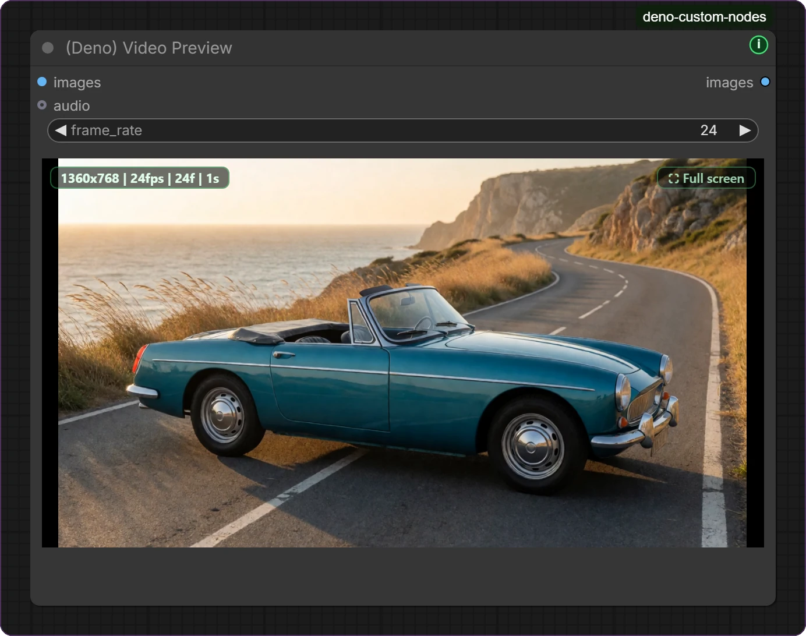

Main features:

- `images` (IMAGE batch) in, `images` straight-through out, `frame_rate`, and an optional `audio` input that is muxed into the preview as AAC (tolerant of dict / object / `(waveform, sr)` AUDIO and `[C,N]` / `[N,C]` shapes; if audio can't be used it is logged and the video still previews)
- clean auto-looping in-node player like the VHS preview: no control chrome, **hover to hear audio**, **click = play/pause**, a **Full screen** button, and the wheel is passed through to the ComfyUI canvas
- a compact top-left info badge shows the current preview's resolution, FPS, frame count, and duration
- the node fits the clip aspect and stays fitted as it is resized
- each node reuses one temp file, overwritten every run, so heavy iteration never piles up temp storage
- needs PyAV (`pip install av`); if it is missing the node shows a clear one-line install hint instead of failing the graph

### 04 · Finish

#### `(Deno) Film Grain`

Adds monochrome film grain to a photo or a decoded video `IMAGE` batch using CPU processing. No model or additional package installation is needed. The default blends fine and coarse grain at 75:25, softens extreme particles, and reduces grain near pure black and white. Only the grain pattern is blurred; image detail is preserved.


Connect it at the end of the image processing chain:

- Photo: final image / resize → **Film Grain** → **Save Image**.
- Native video: decoded frames / final resize → **Film Grain** → **Create Video** → **Save Video**. Keep the original audio and frame rate connected to Create Video.
- Video Helper Suite: decoded frames → **Film Grain** → **Video Combine**. Keep its audio and frame-rate settings.

The panel uses English controls and the compact green styling of the other Deno nodes, regardless of ComfyUI's locale. It shows **Strength**, **Grain size**, **Roughness**, **Tone protection** and one **Processing** choice. **Strength runs from 0 to 1**: the selected default `0.50` matches code amount `6`, while `1.00` matches amount `12`. **Low RAM** (default) processes one frame at a time, **Balanced** uses two, and **Faster** uses four. The grain output is identical; faster processing can use more temporary RAM.

<details>
<summary>Settings, resolution matching, and memory</summary>

**Frames at once** under **Advanced** provides the exact 1–4 value, including a preserved custom value of 3. Processing uses CPU and does not change upstream generation VRAM or split saved video into clips. The complete output frame batch still needs RAM; see the Processing tooltip. Seed and video chunk settings are also under Advanced.

Existing workflows retain their saved values and cables. A saved amount above the panel's new maximum remains intact until you deliberately adjust the slider. Connected parameter inputs control their respective settings; the panel disables those controls and keeps their native sockets visible.

New nodes default to **Advanced → Grain scale → Match resolution**. Grain size is relative to the frame: the node creates the original grain on an aspect-matched grid with a **1536px shorter edge** (the selected 2752×1536 reference), then resamples only that monochrome grain to the input size. Strength and the fine/coarse mix are unchanged. At 2752×1536 the result is exactly the original preset. Existing saved workflows retain **Fixed pixels** and their previous result; choose Match resolution to enable the new behavior. Older API prompts that omit `grain_scale_mode` also retain the pixel-based result.

The reference pattern is filtered when sampled into smaller frames, rather than amplified back to the same per-pixel variance. This keeps particle size and visible strength more consistent when different resolutions are viewed at the same display size. Very fine grain, codec compression and playback scaling can still differ; identical appearance in every player is not guaranteed. Extremely stretched inputs whose reference grid exceeds 16,777,216 pixels fail before allocating it and can use Fixed pixels instead.

| Setting | Default | Effect |
| --- | --- | --- |
| `enabled` | on | Off passes through the original input without copying. |
| `amount` | `6` | Stored/API strength in 8-bit brightness units. Panel strength `0.5` = amount `6`, `1` = amount `12`; `0` passes through. The larger backend range retains older workflows. |
| `grain_size` | `1` | Relative fine/coarse size in Match resolution; original `0.45 / 1.15 px` sigma at the 1536px reference. Fixed pixels uses these sigmas at the input resolution. |
| `roughness` | `0.25` | Coarse grain proportion; default fine/coarse mix `75:25`. |
| `tone_weighted` | on | Emphasizes darker midtones and protects the brightest and darkest ends. |
| `temporal_mode` | `changing` | Varies the pattern per frame. `fixed` repeats a pattern for comparison. |
| `seed` | `2026100701` | Reproduces the same pattern and frame sequence. |
| `frame_offset` | `0` | First frame's global index when processing video chunks separately. |
| `processing_batch_size` | `1` | Frames processed together on CPU, from 1 to 4. 1 minimizes temporary RAM. |
| `grain_scale_mode` | `resolution` for new nodes | Match resolution samples the reference grain into the frame. `pixels` preserves the original pixel-based grain; omission in old API prompts uses `pixels`. |

To compare settings with the same pattern across runs, keep `seed` unchanged and set ComfyUI's seed **control after generate** to `fixed`.

Scratch memory is limited to the selected processing group (1–4 frames), and enabled output is stored on CPU rather than allocating a second full batch in VRAM. Match resolution also needs the reference grain grid, so lower-resolution frames can use more temporary RAM than Fixed pixels; Low RAM keeps this work to one frame at a time. **The complete output IMAGE batch still requires RAM**, in addition to the upstream input and ComfyUI caches. For float32 RGB, this output uses `frames × width × height × 12` bytes: about **23.7 MiB per 1080p frame**, or **2.78 GiB for 120 frames**. This node does not stream an entire video file or remove upstream cache memory; use shorter batches for long or high-resolution clips. Disabled/zero-strength runs return the same input object.

Size, channel count and dtype are preserved; RGBA alpha is unchanged. The node operates on pixels, while Save Image/Save Video retain responsibility for workflow metadata, encoding and file creation. A native `VIDEO` socket connects after Create Video, not directly to this node. Video compression may soften fine grain or increase the saved file size.

</details>

#### `(Deno) RTX Video Super Resolution`

Optional Windows/NVIDIA RTX Video Super Resolution helper node for users who want to try NVIDIA VFX inside ComfyUI without manually hunting for the right Python environment.


This node is intentionally separate from the core Deno nodes. It only imports NVIDIA VFX during upscale execution, so normal Deno node installs do not require NVIDIA VFX. ComfyUI Manager installs the node pack without auto-installing NVIDIA VFX.

| If your image is... | Use |
| --- | --- |
| small, low-res, or compressed | `VSR` |
| already clean, but needs a larger sharper output | `High Bitrate` |
| noisy or grainy | `Denoise` |
| soft, out of focus, or mildly blurred | `Deblur` |

Beginner install flow:

1. Install or update `deno-custom-nodes`, then start ComfyUI.
2. Add `(Deno) RTX Video Super Resolution` and run it once with an image.
3. Click the node's `How to install` button if NVIDIA VFX is missing or you want to update an older installation.
4. Close every ComfyUI window/process before running the installer.
5. Follow the visual web install guide: download the ZIP from that page, move it into `ComfyUI\custom_nodes\deno-custom-nodes\tools`, choose `Extract All` with the destination set to that `tools` folder itself, and run `tools\install_rtx_vfx.bat`. If Windows created an `install_rtx_vfx_bat` subfolder, move both `install_rtx_vfx.bat` and `README_RTX_VFX_EASY_INSTALL.md` directly into `tools` before running the BAT.
6. If the BAT asks `Install RTX VFX here?`, type `Y` only when the shown Windows path is inside the ComfyUI app you just closed. If it looks wrong, type `N` and stop.
7. Wait for the green `INSTALL COMPLETE` message.
8. Restart ComfyUI completely, then use `(Deno) RTX Video Super Resolution` again.

For the full beginner-friendly visual walkthrough, open the [Deno RTX VFX install page](https://deno2026.github.io/comfyui-deno-custom-nodes/rtx-vfx-install/).
If a tutorial video tells you to open the `tools` folder after installing from ComfyUI Manager, open `tools/OPEN_INSTALL_GUIDE.txt`; it points to the same current install page.

<details>
<summary>Runtime requirements, upgrades, and all features</summary>

Recommended NVIDIA runtime: `nvidia-vfx 0.2.0.0` or later (VFX SDK 1.3); the current installer requires at least this version. In our Windows comparison, `0.2.0.0` avoided the repeated accumulation of NVIDIA update-check processes seen with `0.1.0.1`. This is a result from the tested environment, not a guarantee for every PC.

For the current runtime, use Windows 10/11 x64, a supported NVIDIA RTX GPU, and Python 3.10 or later. CUDA 13 or later PyTorch is recommended, matching the [current Comfy Org NVIDIA nodes](https://github.com/Comfy-Org/ComfyUI_Nvidia_VFX_Nodes#requirements). NVIDIA's x64 Windows driver minimum is 570.65 (595 for TCC devices). The installer checks the NVIDIA effect in your actual ComfyUI environment and does not automatically replace PyTorch or update your driver; follow its instructions if verification fails. The NVIDIA package includes its VFX runtime, so you do not need a separate VFX SDK installer or CUDA Toolkit for this install.

Already using `nvidia-vfx 0.1.x`? Updating DENO Custom Nodes alone does not update this optional NVIDIA library. Fully close ComfyUI and rerun the latest installer from the same guide above. Existing workflow connections and settings stay the same, but NVIDIA processing results can differ after the library upgrade. Keep your previous environment if you need to reproduce an earlier render exactly.

Official NVIDIA references:

- [Video Super Resolution filter](https://docs.nvidia.com/maxine/vfx/latest/Filters/VideoSuperResolution.html)
- [NVIDIA VFX Python bindings](https://docs.nvidia.com/maxine/vfx-python/latest/index.html)
- [Current NVIDIA package requirements and release history](https://pypi.org/project/nvidia-vfx/)
- [Current VFX SDK Windows requirements](https://docs.nvidia.com/maxine/vfx/latest/WindowsVFXSDK/GetStartedonWindows.html)
- [VideoSuperRes Python API](https://docs.nvidia.com/maxine/vfx-python/latest/api.html)

Main features:

- uses NVIDIA's official `nvidia-vfx` / `nvvfx.VideoSuperRes` package path
- links from the node UI to NVIDIA's official Video Super Resolution documentation
- shows a compact RTX panel with effect buttons, a separate quality selector, a mode-coach line, and only the resize controls that apply to the selected effect
- single-pass and 2-pass RTX panels pass mouse-wheel scrolling through to the ComfyUI canvas, so normal canvas zoom still works while the pointer is over the node
- installer targets the Python used by the current ComfyUI install
- installer refuses to continue if ComfyUI is still running with that Python
- installer asks before installing into the detected Python
- installer stops if no NVIDIA GPU is detected unless the user explicitly overrides the check
- installer reinstalls `nvidia-vfx >= 0.2.0.0` cleanly when the user confirms the target Python, including upgrades from older `0.1.x` installations
- installer first verifies the normal `nvvfx` package path used by the current ComfyUI Python
- installer uses the ASCII Windows runtime fallback only when the normal `nvvfx` path fails verification
- node startup prefers the recorded ASCII fallback path only when that fallback was actually selected
- if another NVIDIA VFX native module is already loaded from a conflicting path, the node stops and asks for a full ComfyUI restart instead of trying to reload the native extension
- installer verifies that NVIDIA's `VideoSuperRes` effect can actually be created after install
- if NVIDIA VFX reports an unsupported runtime feature, the node shows a readable GPU/driver/runtime-path message instead of a raw stack trace
- if NVIDIA Broadcast/NGX VFX DLLs from another RTX node are already loaded, the node reports that native runtime conflict separately from GPU/driver support
- if another Broadcast-based RTX node works while Deno fails, treat it as a native runtime conflict, not proof that the Deno install is broken
- keeps the installer BAT and ZIP on GitHub instead of inside the Manager package, while the node UI provides a `How to install` button that opens the visual web install page plus a `Copy steps` helper
- keeps a small `tools/OPEN_INSTALL_GUIDE.txt` file in Manager installs so the `tools` folder still exists for users following older tutorial videos
- exposes four clear effect buttons: Video SR, High Bitrate, Denoise, and Deblur
- shows a compact mode coach line that explains the selected effect in plain language
- keeps Low, Medium, High, and Ultra quality as a separate selector
- for Video SR and High Bitrate, supports `Scale`, `Keep Ratio`, `Manual`, and `Preset Ratio` resize choices
- `Keep Ratio` and `Preset Ratio` use target megapixels; `Manual` uses width and height
- exposes `divisible_by` alignment for resizable modes, with `1` as the default so standard video sizes such as 1920x1080 stay exact
- higher alignment values such as `32` remain available when a workflow specifically needs forced multiple-of-N output
- shows `Center Crop (Fill)` / `Fit (Letterbox/Pillarbox)` when a manual, preset-ratio, or aligned keep-ratio resize can change aspect ratio
- `Denoise` and `Deblur` keep the original size and hide resize controls, matching NVIDIA's same-size VSR modes
- Easy Upscale outputs: `images`
- The node shows controls only. Connect its `images` output to Preview Image or Image Compare to view the processed result.

</details>

#### `(Deno) RTX Video Super Resolution (2 Pass)`

Two-pass RTX finishing node for full video workflows. It can run an optional same-size `Denoise` or `Deblur` pass first, then an optional `VSR` or `High Bitrate` upscale pass.

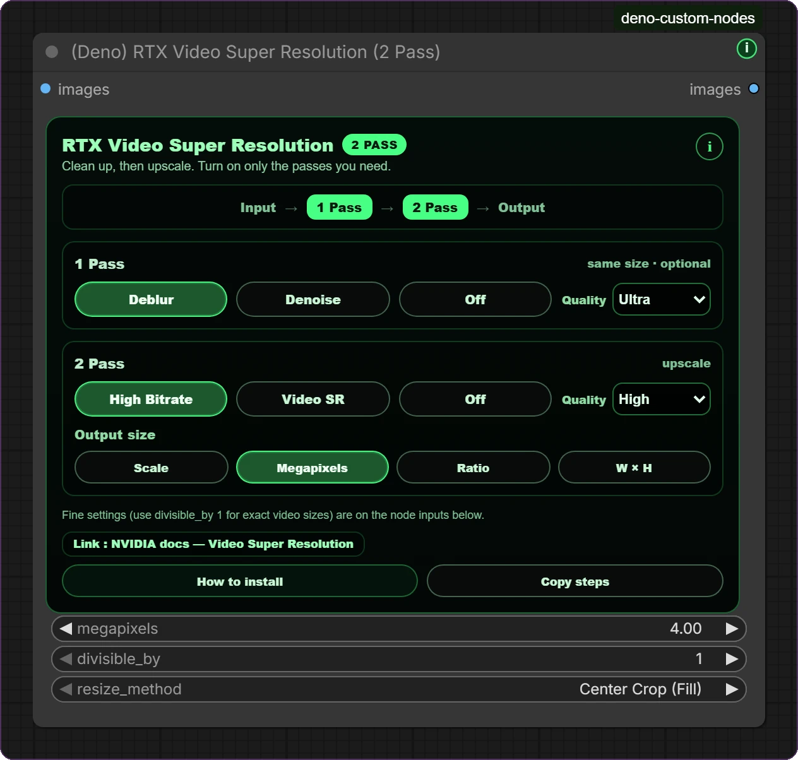

Example workflow: [RTX 2-pass upscale workflow](docs/workflows/deno-rtx-lowram-metabatch.json)

Main features:

- includes both `Low System Memory` and `High System Memory` lanes in the example workflow
- the low-memory lane uses VHS Meta Batch so longer videos can be processed in smaller frame chunks
- uses `VHS_VideoInfoSource` to carry the source FPS into `VHS_VideoCombine`
- preserves source audio through the VHS load/combine path
- useful when finishing actual encoded video outputs, not just testing a single image batch
- outputs: `images`

### 05 · Organize

#### Deno Visual Fold

Deno Visual Fold is a visual-only cleanup helper for large ComfyUI graphs. It is enabled automatically when the latest Deno Custom Nodes package is installed or updated.


Select two or more nodes and the native ComfyUI selection toolbar shows a readable green `Fold` badge. Click it to collapse the selected nodes into one compact visual group; use `Unfold` to restore them.

You can also select one normal ComfyUI group and use `Fold Group` to collapse the nodes inside that group while keeping the workflow logic untouched. When two or more groups are selected, the same toolbar adds readable `Align` badges for left/right/top/bottom alignment and horizontal/vertical spacing.

This is different from ComfyUI Subgraph. Subgraph moves nodes into a child graph, which can be powerful, but it may not be ideal when a workflow depends on keeping `Get` / `Set` nodes or parent-child graph structure visible in the main graph. Visual Fold is meant for simple visual organization only. It does not turn the selected nodes into a subgraph or change the workflow logic.

#### Deno Floating Tools

Deno Floating Tools is an optional helper under `Settings > DENO > Tools`. It is off by default.

When enabled, it adds a small draggable Deno icon to the ComfyUI screen. The panel can free ComfyUI VRAM through ComfyUI's built-in memory cleanup endpoint, show read-only current/latest status for the ComfyUI Stable core release, and open an Error Help report when a run fails.

Error Help creates a GPT/Gemini-ready report with the current workflow, Python executable and environment type, package versions, GPU details, recent traceback/log context, and custom node summary. It is read-only, opens a report window first, and copies only when you click `Copy Report`. Common secrets such as tokens, cookies, passwords, private keys, and URL credentials are masked before copy.

Floating Tools does not install, update, restart, repair, or modify workflows. It hooks into ComfyUI's request functions only while the tools are switched on.

#### Node info button

Most Deno nodes carry a small green `i` button in the top-right corner. Click it for the node's purpose, key settings, and the current release notes without leaving the canvas. When a newer Deno Custom Nodes version is available, the button turns yellow and shows a small `!` badge.

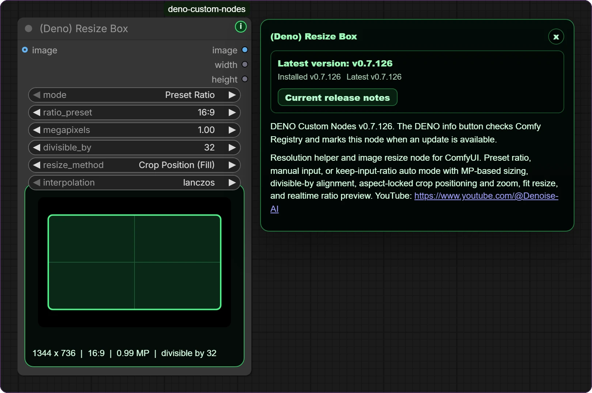

## Safety and Privacy

Deno Custom Nodes keeps file, network, and secret handling narrow by default.

- **Files:** image loaders read only ComfyUI's `input` folder. Upload external images before reopening workflows that used external paths or URLs. Ideogram Director's Save Image copies only image files.
- **Local LLM:** servers are localhost by default. A private LAN server works only through an exact `DENO_LOCAL_LLM_ALLOWED_HOSTS` allowlist, and API keys are read from the ComfyUI host environment, never stored in workflows or PNG metadata.
- **Translation:** Ideogram translation uses only the built-in Google, MyMemory, and LibreTranslate services.
- **Model links:** Easy Model Download Helper opens official web links in your browser and never downloads files in Python.
- **Reports:** Error Help is read-only, shows the report before copying, and masks common secrets such as tokens, cookies, passwords, and private keys.

See [file and translation access](docs/SECURITY_CONFIGURATION.md) for the exact rules.

## Why This Exists

These nodes are built to reduce repeated setup friction in actual ComfyUI production work. The goal is not to chase huge feature lists. The goal is to make the workflows people repeat every day feel faster, cleaner, and easier to teach.

## Search Tips

- In ComfyUI Manager or Registry, search for `Deno Custom Nodes`.
- On the canvas, search for `(Deno)` or the node name, such as `Resize Box`.
- Use the [Workflow Map](#workflow-map) to find the tool and its requirements.

## Install

For the recommended Manager installation, follow [Quick Start](#quick-start).

<details>
<summary>Manual installation and updates</summary>

For a manual install, clone inside your `custom_nodes` folder and install dependencies with the same Python executable that starts ComfyUI:

```bash
git clone https://github.com/Deno2026/comfyui-deno-custom-nodes.git
cd comfyui-deno-custom-nodes
python -m pip install -r requirements.txt
```

For a manual update, run `git pull --ff-only`, reinstall `requirements.txt` with that same Python, and restart ComfyUI. Manager/Registry installs handle the package dependencies automatically.

</details>

## License

Deno-owned nodes, docs, examples, workflows, and project-local assets in this repo are released under GNU GPL v3.0 (`GPL-3.0-only`). You may use, study, modify, and redistribute them, including commercially, under the [GPL-3.0 terms](LICENSE). Distributed modified versions must follow GPL-3.0 and preserve the required license and copyright notices.

Third-party models, checkpoints, LoRAs, libraries, tools, and services keep their own licenses and terms. Check the applicable license before using, sharing, or selling outputs from a specific model or asset.

## Release Notes

See the [latest release](https://github.com/Deno2026/comfyui-deno-custom-nodes/releases/latest) and [CHANGELOG.md](CHANGELOG.md) for updates.

## Links

- YouTube: https://www.youtube.com/@Denoise-AI
- GitHub: https://github.com/Deno2026/comfyui-deno-custom-nodes
- Registry: https://registry.comfy.org/publishers/deno2026/nodes/deno-custom-nodes
