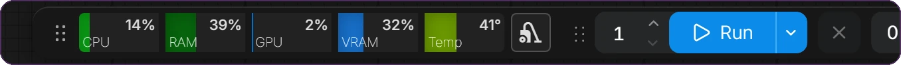

<p align="center">
  
</p>

<p align="center">
  <a href="https://github.com/Deno2026/comfyui-deno-custom-nodes/releases/latest"></a>
  <a href="https://registry.comfy.org/publishers/deno2026/nodes/deno-custom-nodes"></a>
  <a href="https://github.com/Deno2026/comfyui-deno-custom-nodes/actions/workflows/ci.yml"></a>
  <a href="../LICENSE"></a>
  <a href="https://www.youtube.com/@Denoise-AI"></a>
</p>

<p align="center">
  <b>Nós práticos do ComfyUI para todo o ciclo de produção.</b><br>
  Prepare entradas, dirija o modelo, compare resultados, finalize o visual e mantenha grafos grandes legíveis.
</p>

<p align="center">
  <a href="../README.md">English</a> · <a href="README.ko.md">한국어</a> · <a href="README.ja.md">日本語</a> · <a href="README.zh-CN.md">简体中文</a> · <a href="README.es.md">Español</a> · <a href="README.pt-PT.md">Português (PT)</a> · Português (BR) · <a href="README.id.md">Bahasa Indonesia</a>
</p>

<p align="center">
  <a href="#início-rápido">Início rápido</a> · <a href="#mapa-de-workflows">Mapa de workflows</a> · <a href="#ferramentas-web">Ferramentas web</a> · <a href="#nós-incluídos">Referência dos nós</a> · <a href="#segurança-e-privacidade">Segurança</a> · <a href="https://github.com/Deno2026/comfyui-deno-custom-nodes/releases/latest">Última versão</a>
</p>

> [!NOTE]
> **Novidade na v0.7.126:** o [`(Deno) MiniMax H3 Tiled Sampler`](#deno-minimax-h3-tiled-sampler) finaliza um latent de vídeo+áudio MiniMax H3 ampliado em tiles sobrepostos, para que uma GPU de 16GB consiga executar a passagem final em alta resolução.
>
> A **v0.7.125** restringiu os endereços de servidor do Local LLM, os links do Easy Model Download Helper e o salvamento de imagens do Ideogram Director. IDs de nós, entradas e workflows salvos não mudaram. Veja o [CHANGELOG](../CHANGELOG.md).

## Início rápido

Comece com uma instalação do ComfyUI que já funcione.

1. Abra o **ComfyUI Manager**, pesquise `Deno Custom Nodes` e instale o pacote.
2. Reinicie o ComfyUI e atualize a página dele no navegador.
3. Clique duas vezes em uma área vazia do canvas, pesquise `(Deno) Resize Box` e adicione o nó.
4. Adicione um nó padrão `Load Image` e escolha uma imagem. Conecte-o ao Resize Box e conecte a saída `image` do Resize Box a `Preview Image`. Escolha um tamanho e execute o workflow para ver a imagem redimensionada.

Este primeiro exemplo não precisa de nenhum modelo de geração. Cada nó de modelo e de RTX lista abaixo seus próprios requisitos. Se você não usa o Manager, veja a [instalação manual](#instalação).

A maioria dos nós Deno tem um pequeno botão verde `i` no canto superior direito, para ver informações rápidas do nó sem sair do canvas. Quando há uma versão mais nova do Deno Custom Nodes, o botão fica amarelo e mostra um pequeno selo `!`.

## Mapa de workflows

<p align="center">
  
</p>

Todo nó Deno pertence a uma etapa do ciclo de produção do ComfyUI. Comece pela etapa em que você está trabalhando.

### 01 · Preparar

Deixe cada imagem, referência e tamanho certos antes de o modelo rodar.

<p align="center">
  &nbsp;&nbsp;
  
</p>

| Nó | O que faz | Requisitos |
| --- | --- | --- |
| [Resize Box](#deno-resize-box) | Redimensionamento por proporção, megapixels e recorte, com uma prévia de recorte ao vivo e arrastável | — |
| [Multi Image Loader](#deno-multi-image-loader) | Uma galeria ordenada e um só cabo; clique em um cartão para ignorá-lo sem apagá-lo | — |
| [Advanced Image Source Loader](#deno-advanced-image-source-loader) | Upload de pasta, lotes encadeados e saída `image_list` com tamanhos mistos | — |
| [MiniMax H3 Multi Reference Image Loader](#deno-minimax-h3-multi-reference-image-loader) | Até 9 imagens e 3 arquivos de áudio, cada um mantido no seu próprio tamanho | ComfyUI 0.30.0+ |

### 02 · Gerar

Dirija o modelo com layouts, referências, prompts e LoRAs que continuam legíveis no canvas.

<p align="center">
  
</p>

| Nó | O que faz | Requisitos |
| --- | --- | --- |
| [Ideogram Director](#deno-ideogram-director) | Desenha layouts bbox e monta captions JSON do Ideogram 4 prontas para o modelo | Um workflow do Ideogram 4 |
| [MiniMax H3 Acc LoRA Loader](#deno-minimax-h3-acc-lora-loader) | Carrega os Acc-LoRAs oficiais de 8 passos do H3 da Alibaba sem conversão | Pesos oficiais do Acc-LoRA |
| [MiniMax H3 Tiled Sampler](#deno-minimax-h3-tiled-sampler) | Finaliza vídeo H3 ampliado em tiles sobrepostos em uma GPU de 16GB | ComfyUI 0.30.0+ com H3 nativo |
| [MiniMax H3 R2V Audio Reference workflow](#minimax-h3-r2v-audio-reference-workflow) | `(Deno) Audio Transcript` e `(Deno) Audio Analysis Finalizer` transformam o áudio de origem em direção para o prompt | VideoHelperSuite, LM Studio |
| [LTX Model Loader](#deno-ltx-model-loader) | Padrões de carregamento Checkpoint, KJ e GGUF em um só nó compacto | KJNodes ou ComfyUI-GGUF para esses modos |
| [LTX Sequencer](#deno-ltx-sequencer) | Sequenciamento de guias com várias imagens, com frame e strength por imagem | — |
| [LTX Multi LoRA Loader](#deno-ltx-multi-lora-loader) | Linhas no estilo Power-LoRA com strength separado para vídeo e áudio | — |
| [LTX Prompt Guide](#deno-ltx-prompt-guide) | Codificação de prompt LTX com duração mínima calculada a partir do diálogo entre aspas | — |
| [LTX Tiled Spatial Upscaler](#deno-ltx-tiled-spatial-upscaler) | Amplia latents de vídeo em tiles espaciais sobrepostos | Um upscaler de latent LTX |
| [LTX High resolution Tiled Sampler](#deno-ltx-high-resolution-tiled-sampler) | Refinamento LTX AV em alta resolução por tiles espaciais fundidos | — |
| [Bernini Prompt Guide](#deno-bernini-prompt-guide) | Prompts positive e negative em estilo de instrução em um só nó | Conditioning Bernini nativo |
| [Multi LoRA Loader](#deno-multi-lora-loader) | Até 64 LoRAs com ativação, strengths e notas por slot | — |
| [Easy Model Download Helper](#deno-easy-model-download-helper) | Links oficiais de modelos e verificação exata do caminho de destino | — |
| [Text Encoder Unload](#deno-text-encoder-unload) | Um ponto opcional de liberação de VRAM depois da codificação do prompt | — |
| [Prompt Text](#deno-prompt-text) | Uma fonte STRING multilinha e legível para prompts longos | — |
| [Local LLM Loader e Reviewer](#deno-local-llm-loader-and-deno-local-llm-reviewer) | Prompts com LLM local a partir do ComfyUI e portões de revisão antes de salvar | Um servidor de LLM local |

### 03 · Comparar

Veja a diferença no canvas antes de salvar qualquer coisa.

<p align="center">
  &nbsp;&nbsp;
  
</p>

| Nó | O que faz | Requisitos |
| --- | --- | --- |
| [Image Compare](#deno-image-compare) | Visualizações slider, lado a lado, diferença e toggle dentro do nó | — |
| [Video Compare](#deno-video-compare) | Reprodução A/B de vídeo com precisão de frame, com áudio e uma saída de comparação sem perdas | — |
| [Video Preview](#deno-video-preview) | Prévia H.264 inline em resolução completa em qualquer ponto do grafo | PyAV (já incluído no ComfyUI atual) |

### 04 · Finalizar

Defina o visual e a resolução finais.

<p align="center">
  &nbsp;&nbsp;
  
</p>

| Nó | O que faz | Requisitos |
| --- | --- | --- |
| [Film Grain](#deno-film-grain) | Grão de filme na CPU para fotos e vídeo, ajustado à resolução | — |
| [RTX Video Super Resolution](#deno-rtx-video-super-resolution) | NVIDIA VSR, High Bitrate, Denoise e Deblur com opções claras de redimensionamento | Windows, NVIDIA RTX, `nvidia-vfx` 0.2+ |
| [RTX Video Super Resolution (2 Pass)](#deno-rtx-video-super-resolution-2-pass) | Uma passagem de limpeza e uma de ampliação para workflows de vídeo completos | Windows, NVIDIA RTX, `nvidia-vfx` 0.2+ |

### 05 · Organizar

Mantenha grafos grandes legíveis e a sua máquina visível.

<p align="center">
  
</p>

<p align="center">
  
</p>

| Ferramenta | O que faz | Requisitos |
| --- | --- | --- |
| [Visual Fold](#deno-visual-fold) | Dobra nós selecionados ou um grupo em uma única pílula compacta, sem subgraph | — |
| [Resource Monitor](#deno-resource-monitor) | Medidores de CPU, RAM, GPU, VRAM e temperatura, mais limpeza de modelos, na barra superior | NVIDIA NVML para as leituras da GPU |
| [Floating Tools](#deno-floating-tools) | Liberar VRAM, status de atualização do ComfyUI Stable e Error Help pronto para GPT/Gemini | Desativado por padrão |
| [Node info button](#node-info-button) | Ajuda rápida e notas de atualização em cada nó Deno | — |

## Ferramentas web

Use direto no navegador. Não há nada para instalar.

- [Deno Video Compare](https://deno2026.github.io/comfyui-deno-custom-nodes/video-compare/) - compare dois vídeos renderizados com slider, lado a lado, diferença e toggle, e salve a comparação como MP4.
- [Deno Video to GIF/WebP](https://deno2026.github.io/comfyui-deno-custom-nodes/video-to-gif/) - corte, recorte, redimensione e exporte clipes curtos como GIF ou WebP menor.
- [Deno Discord Media Compressor](https://deno2026.github.io/comfyui-deno-custom-nodes/video-to-discord/) - comprime vídeos ou imagens para compartilhar no Discord, buscando arquivos abaixo de 10 MB quando possível. A interface da ferramenta está disponível apenas em coreano.

## Nós incluídos

A referência completa, na ordem do workflow. Cada seção começa com o que o nó faz; abra **Detalhes** para ver casos especiais e notas de compatibilidade.

### 01 · Preparar

#### `(Deno) Resize Box`

Nó de ajuda de resolução e redimensionamento de imagem para o ComfyUI.


Principais recursos:

- modos `Preset Ratio` e `Manual Input`
- presets de proporção comuns
- cálculo de tamanho por megapixels
- alinhamento `divisible_by`
- modos de redimensionamento `Center Crop (Fill)`, `Crop Position (Fill)` com zoom e proporção travada, e `Fit (Letterbox/Pillarbox)`
- interpolação `lanczos` por padrão
- prévia de proporção ao vivo; `Crop Position (Fill)` mostra toda a origem conectada, permite arrastar o quadro de recorte para reposicioná-lo e arrastar qualquer canto para dar zoom, mantendo fixos a proporção e os megapixels de saída
- saídas: `image`, `width`, `height`

#### `(Deno) Multi Image Loader`

Carregador de várias imagens pensado para workflows de guia em lote. Inspirado nas ideias originais de workflow de **WhatDreamsCost**, depois adaptado e refinado para o estilo de workflow do Deno.


Principais recursos:

- galeria rolável de altura fixa, em vez de um nó cuja altura cresce sem parar
- reordenação por arrastar, com inserção estável do marcador
- clique nas miniaturas para desativar/ativar imagens sem apagá-las; só as imagens ativas são enviadas à saída, numeradas 1, 2, 3… na ordem dos cartões, com contagens e números atualizados na hora
- as imagens desativadas e suas posições continuam salvas no workflow; ative ao menos uma imagem para executar
- botão de upload, upload por arrastar e soltar e suporte a colar imagem
- navegador `Input Folder` para reutilizar imagens que já estão em `input` no ComfyUI
- modo de tamanho `Keep Input Ratio`, `Preset Ratio` ou `Manual Input`, com preset de proporção, megapixels, tamanho divisível por N ou controle direto de largura/altura
- escolha de método de redimensionamento e de interpolação, com recorte ou ajuste opcional durante a exportação
- saídas: `multi_output`, `width`, `height`

<details>
<summary>Detalhes</summary>

- navegação por subpastas de input, com cartões de pasta, navegação por clique duplo e um botão `Parent`
- imagens de input aninhadas podem ser adicionadas preservando seus caminhos de subpasta do ComfyUI
- symlinks ou junctions externos que saem da pasta `input` do ComfyUI são ignorados por segurança; envie essas imagens para `input`
- ordenação das imagens de input da mais nova para a mais antiga, pela data de modificação do arquivo
- miniaturas responsivas na pasta de input para uma navegação mais fluida com muitas imagens

</details>

#### `(Deno) Advanced Image Source Loader`

Carregador avançado de origens de imagem para imagens enviadas, pastas `input` do ComfyUI, lotes IMAGE conectados e saída de lista de imagens com tamanhos mistos. O `(Deno) Multi Image Loader` padrão continua sendo a opção mais simples e recomendada para workflows normais com a pasta `input` do ComfyUI.


Principais recursos:

- mantém o fluxo familiar de galeria dos carregadores de imagem do Deno
- aceita a navegação pelas pastas `input` já existentes do ComfyUI e entradas relativas em `Input Path`
- `Upload Folder` importa para o input do ComfyUI uma pasta escolhida no navegador
- aceita upload, arrastar e soltar, colar e upload de pasta pelo navegador onde ele permitir, além de um botão `Paste` visível e do Ctrl+V normal para imagens
- clique nas miniaturas para desativar/ativar origens sem apagá-las; só os cartões ativos recebem números de saída sequenciais
- arraste os cartões de miniatura para reordenar a sequência de saída
- a entrada opcional `images` pode encadear um lote/lista de imagens anterior no mesmo fluxo de saída
- gera um tensor `batch` redimensionado para workflows normais em lote e `image_list` para tratamento imagem por imagem
- saídas: `batch`, `image_list`, `width`, `height`, `image_count`

<details>
<summary>Detalhes</summary>

**Migração da versão 0.7.120 ou anterior:** pastas externas e URLs de imagem não são mais lidas nem baixadas. Use `Upload` ou `Upload Folder` e depois substitua cada origem legada ativa pelo caminho de input enviado. Origens salvas, ordem, estados de ativação e conexões são preservados. Origens legadas desativadas não impedem a execução. `DENO_EXTERNAL_IMAGE_ROOTS` não concede mais acesso. Caminhos absolutos salvos dentro do input do ComfyUI ainda são executados; selecione o caminho relativo em input para restaurar as miniaturas.

- aceita cartões de pasta, navegação por pastas aninhadas e um botão `Parent`
- use `Refresh previews` para tentar de novo as miniaturas sem alterar origens, estado de ativação nem ordem; passe o mouse sobre uma prévia com falha para ver a ajuda
- as origens desativadas continuam legíveis e salvas no workflow até serem reativadas ou removidas; ativar/desativar ou reordenar atualiza os números de saída na hora
- a galeria acompanha a altura disponível do nó, tanto no canvas clássico quanto no Nodes 2.0
- as miniaturas usam um fluxo em estilo masonry, o que facilita percorrer referências mistas em retrato e paisagem
- opção `recursive_folders` para carregar imagens de pastas aninhadas
- modo de tamanho `Keep Input Ratio`, `Preset Ratio` ou `Manual Input`, com preset de proporção, megapixels, tamanho divisível por N ou controle direto de largura/altura
- escolha de método de redimensionamento e de interpolação, incluindo modos de preenchimento com recorte central, superior ou inferior
- o modo de lista `Original Size` pode preservar resoluções de origem mistas em `image_list`
- o modo de lista `Match Batch Size` faz `image_list` ter as mesmas dimensões do lote redimensionado

</details>

#### `(Deno) MiniMax H3 Multi Reference Image Loader`

Carregador de referências para workflows MiniMax H3, com imagens em um só cabo e saídas de áudio individuais.


Principais recursos:

- o mesmo fluxo de upload, colar, arrastar e soltar, Input Folder, reordenação de cartões e limpeza do `(Deno) Multi Image Loader`
- até 9 imagens de referência ordenadas por um único socket dedicado
- mantém as dimensões e a proporção de cada imagem decodificada, sem processamento de resize, crop, pad ou letterbox
- exibe cada cartão de prévia na proporção própria da imagem de origem, para que referências mistas em paisagem e retrato fiquem totalmente visíveis, sem recorte na prévia
- clique nas miniaturas para desativar/ativar referências; os cartões ativos são renumerados na hora para corresponder a `<Picture 1>`, `<Picture 2>` e assim por diante, e só essas imagens chegam às duas saídas
- as imagens desativadas continuam salvas nas posições dos cartões e ainda ocupam um dos 9 slots da galeria; ative ao menos uma imagem ou referência de áudio para executar
- conecta-se à única entrada `ref_images` de `(Deno) MiniMax H3 Reference to Video`
- também expõe as mesmas origens ordenadas como uma saída `image_list`, que se conecta direto à entrada `image` do `(Deno) Local LLM Loader`
- o nó H3 mantém as entradas Autogrow nativas do ComfyUI para vídeo de referência, áudio associado ao vídeo e áudio independente

A seção de áudio recolhível, abaixo da galeria de imagens, aceita até 3 arquivos de áudio por `Add audio`, Input Folder ou soltando arquivos. Cada arquivo tem forma de onda, duração medida, reprodução de prévia, um toggle Use separado, alça de reordenação e controle de remoção. A reprodução não muda se o arquivo é usado na geração. Este carregador não aceita arquivos de vídeo.

Estes dois nós MiniMax H3 exigem ComfyUI 0.30.0 ou mais recente. Veja o [workflow MiniMax H3 com várias referências](workflows/minimax-h3-multi-reference.json), portátil, com o pipeline H3 nativo completo, em que os dois nós padrão `Load Image` foram trocados pelo carregador Deno de um só cabo.

<details>
<summary>Detalhes</summary>

Cada áudio registrado adiciona uma saída `AUDIO` individual depois das duas saídas de imagem existentes. Conecte essas saídas às entradas de áudio independente crescentes de `(Deno) MiniMax H3 Reference to Video` e conecte `audio_vae` para codificar o som. Só os cartões de áudio ativos recebem `<Audio 1>`, `<Audio 2>` e assim por diante, na ordem dos cartões. Por exemplo, com três arquivos registrados e os dois primeiros desativados, o terceiro arquivo é exibido e codificado como `<Audio 1>`. Os arquivos desativados e seus cabos continuam salvos; os ramos de áudio comuns a jusante deles são ignorados. Reordenar mantém cada cabo ligado ao mesmo arquivo, e remover um arquivo remove apenas o cabo de áudio desse arquivo. O carregamento somente de áudio também é aceito.

O nó cresce automaticamente à medida que arquivos de áudio são adicionados, para que todas as linhas de áudio fiquem visíveis sem barra de rolagem interna. Remover arquivos ou recolher a seção de áudio libera esse espaço. A altura e a largura adicionadas manualmente são preservadas, e ao reabrir um workflow antigo e compacto o nó se expande o suficiente para mostrar as linhas de áudio salvas.

Para manter as tags exibidas e as referências do H3 idênticas, conecte todas as saídas de áudio ativas de um mesmo carregador DENO ao mesmo nó DENO H3. Desative os arquivos que você não quer conectar. Ao usar estas saídas de áudio do DENO, outras fontes de áudio independente e trilhas sonoras de vídeo de referência precisam estar desconectadas desse nó H3; o nó explica o conflito de numeração em vez de atribuir tags diferentes em silêncio. Workflows existentes que usam só outros carregadores de áudio mantêm o comportamento de entrada padrão.

Os arquivos de áudio são lidos da pasta input do ComfyUI. As extensões aceitas são WAV, MP3, FLAC, OGG/OGA, Opus, M4A, AAC, AIF e AIFF, conforme o decodificador PyAV instalado. O carregamento é limitado a 256 MiB por arquivo, 128 MiB de PCM decodificado e 30 segundos de decodificação na CPU. Falhas de prévia têm uma ação Retry e não alteram os arquivos salvos nem suas conexões.

O socket H3 dedicado é intencional: um lote `IMAGE` normal do ComfyUI exige a mesma largura e altura para todas as imagens, então não consegue preservar tamanhos de referência mistos. O `image_list` adicional é uma saída em lista, e não um lote de tamanho único, de modo que as dimensões originais, a ordem e as proporções continuam separadas quando reutilizados por nós que aceitam listas. O MiniMax H3 ainda pode reduzir as referências no seu processamento normal de `ref_image_size`, preservando a proporção.

Em versões do ComfyUI que aceitam VAEs H3 opcionais, `(Deno) MiniMax H3 Reference to Video` também aceita uma entrada `vae` ou `audio_vae` sem conexão. Conectar os dois mantém o comportamento atual de codificação das referências.

- Sem `vae`, imagens e vídeos de referência ainda chegam ao codificador de texto/visão, mas seus latents de referência codificados pelo VAE são omitidos.
- Sem `audio_vae`, o som de referência real não é codificado. O codificador de texto mantém rótulos como `<Audio 1>`, não a forma de onda do áudio; conecte `audio_vae` para referenciar uma voz ou um som. Omiti-lo não desativa o áudio gerado.

O áudio associado a um vídeo de referência (`ref_video_audio`) precisa de `vae` e `audio_vae` conectados para codificar o vídeo de referência e o seu som; o áudio de referência independente (`ref_audio`) precisa apenas de `audio_vae`.

Estas opções valem só para a codificação de referências neste nó. Mantenha os VAEs de que os nós de decodificação de vídeo e áudio a jusante precisam. Versões mais antigas do ComfyUI cujo nó H3 nativo exige os dois VAEs continuam exigindo as duas conexões; atualize o ComfyUI para usar a codificação opcional de referências.

</details>

### 02 · Gerar

#### `(Deno) Ideogram Director`

Construtor visual de prompts para Ideogram 4, para captions JSON estruturadas e trabalho com layouts bbox. [Assista à demonstração do workflow do Ideogram Director](https://youtu.be/Z8s27skkIDM).


O fundo acima é um resultado local do Ideogram 4 gerado a partir das mesmas quatro caixas.

Principais recursos:

- desenhe e edite regiões bbox direto no canvas do ComfyUI
- desative temporariamente elementos bbox individuais sem apagá-los nem reordená-los
- clique duas vezes em uma bbox para editar ao lado do ponteiro, ou use `Alt`+clique repetidamente em uma sobreposição para percorrer as caixas que estão por baixo
- importe prompts JSON de um Local LLM Loader ou de outra fonte STRING
- opcionalmente, conecte as entradas STRING Summary e Background para substituir esses dois campos do board em uma execução; entradas desconectadas continuam usando o texto salvo no board
- pergunta antes de substituir um board existente, ou troque para substituir sempre
- rejeita JSON malformado com clareza, em vez de passar texto de prompt quebrado adiante
- galerias de presets de estilo e de layout com miniaturas de prévia leves
- Language view para ler e editar as descrições do board no seu idioma, enquanto a saída final continua em inglês pronto para o modelo. As palavras literais das caixas TEXT, como placas, logos e títulos, são preservadas exatamente
- saídas: `prompt`, `width`, `height`, `seed`, `bboxes`

<details>
<summary>Detalhes</summary>

A saída `bboxes` existente se conecta tanto a consumidores `BBOX` padrão quanto a entradas `BOUNDING_BOX`, como `Ideogram4_MultiLora_BoundingBoxNode_Fedor`; o número de linhas de região desse nó acompanha as caixas ativas do Director sem acrescentar campos salvos ao Director. A sincronização atual, que só conta caixas, não acompanha a identidade delas; revise as atribuições de LoRA por linha depois de apagar ou reordenar uma caixa do meio.

A tradução usa apenas os serviços integrados Google, MyMemory e LibreTranslate. Veja [acesso a arquivos e à tradução](SECURITY_CONFIGURATION.md).

</details>

#### `(Deno) MiniMax H3 Acc LoRA Loader`

Carrega diretamente os [MiniMax-H3-Acc-LoRAs](https://huggingface.co/alibaba-pai/MiniMax-H3-Acc-LoRAs) oficiais da Alibaba PAI, sem converter nem duplicar o arquivo safetensors.

1. Baixe o arquivo oficial `Acc-8Step.safetensors` de FL2VA ou Ref2VA e coloque-o na pasta normal `ComfyUI/models/loras/` ou na pasta dedicada `ComfyUI/models/minimax_h3_acc_loras/`.
2. Conecte a `model` um modelo de difusão nativo MiniMax H3 compatível; são aceitas as variantes completas e as `*_pruned_*` da Comfy-Org.
3. Selecione o Acc-LoRA correspondente: FL2VA para FL2VA/T2VA, ou Ref2VA para Ref2VA.
4. Conecte a única saída `model` deste nó ao caminho normal do guider.
5. Monte a linha de amostragem com nós padrão do ComfyUI. O ponto de partida recomendado é `BasicScheduler: simple, steps: 8` e `KSamplerSelect: euler`, conectados a `SamplerCustomAdvanced`.

Os pesos LoRA e os workflows não acompanham o Deno Custom Nodes. Baixe os pesos da Alibaba e monte ou adapte o seu próprio workflow nativo do ComfyUI.

<details>
<summary>Detalhes</summary>

O nó aplica os pesos LoRA estáticos e as 32 cabeças de saída PDD dependentes do tempo do checkpoint. Durante a amostragem, ele lê os limites reais de sigma fornecidos pelo ComfyUI e funde automaticamente as cabeças PDD para esses intervalos. Assim, os controles de sampler, scheduler e passos ficam nos nós normais do ComfyUI. A configuração oficial de 8 passos com Simple/Euler continua sendo a recomendada e a treinada; é possível escolher qualquer número de passos de 4 a 12 no Simple Scheduler sem mudar este loader, e outros schedules decrescentes ou passagens de sigma divididas para workflows de ampliação de latent continuam disponíveis para experimentação, sem garantia de melhoria de qualidade. Mantenha os deslocamentos de sigma nativos de vídeo/áudio do MiniMax H3 em `12.0 / 3.0` e a strength do LoRA em `1.0`.

Os modelos completos sem poda, incluindo as variantes INT8 nativas do ComfyUI, aplicam o adaptador completo pelo caminho normal de LoRA do ComfyUI compatível com quantização. Para um modelo curve-pruned, o loader procura um checkpoint MiniMax H3 completo, sem poda, já presente em `models/diffusion_models/`, lê apenas a pequena seção FP32 do time-embedder e deriva em memória uma ponte que reajusta todas as 50 atualizações AdaLN LoRA de largura completa para a curva podada de largura 8. Ele nunca carrega o checkpoint completo para esse cálculo. Se não houver um checkpoint completo compatível instalado, o loader continua utilizável em modo de compatibilidade: avisa uma vez, ignora essas 50 atualizações AdaLN e ainda aplica todas as outras atualizações do LoRA e as cabeças PDD.

Os workflows de UI ativos padrão salvos com o loader de três saídas das versões v0.7.92-v0.7.94 são migrados ao serem carregados no canvas do ComfyUI. As conexões de modelo existentes continuam no lugar, e as antigas conexões de sampler e sigmas passam para nós padrão editáveis `KSamplerSelect: euler` e `BasicScheduler: simple, steps: 8`. Salve o workflow de UI uma vez depois que ele abrir. Os workflows atuais de uma só saída não são alterados. Nós silenciados/em bypass, layouts personalizados desconhecidos e grafos malformados são deixados intactos, sem adivinhação. O JSON de prompt de API bruto não executa essa migração do frontend; exporte-o de novo a partir do workflow de UI migrado. Se um arquivo já foi salvo depois que as antigas conexões de sampler/sigmas sumiram, reconecte esses nós padrão manualmente.

</details>

#### `(Deno) MiniMax H3 Tiled Sampler`

Finaliza um latent de vídeo+áudio MiniMax H3 ampliado em tiles sobrepostos, para que uma GPU de 16GB consiga executar a passagem final em alta resolução. A cada passo, todos os tiles leem o mesmo frame, suas predições são combinadas com pesos em cosseno nas sobreposições e segue-se uma única atualização compartilhada. O modelo é carregado uma vez para todos os tiles, e o latent de áudio original passa sem alteração.


Posição típica em um grafo H3 nativo:

```text
First pass: SamplerCustomAdvanced with SplitSigmas high_sigmas
-> MiniMax H3 Latent Upscale With Model (ComfyUI 0.44.0+) or another H3 latent upscaler
-> (Deno) MiniMax H3 Tiled Sampler with SplitSigmas low_sigmas
-> VAE Decode for video, audio decode for sound
```

- `model`: o modelo H3 depois dos LoRAs, do sigma shift e de quaisquer nós de atenção ou de memória. A atenção esparsa e a otimização de memória do H3-Optimizations funcionam antes deste nó. O `BlockSparseAttention` do núcleo do ComfyUI é rejeitado, por ora, com uma mensagem.
- `positive`: o mesmo conditioning positive da primeira passagem. As imagens de referência do R2V continuam globais. O conditioning de keyframe é recortado para cada tile e preparado por tile. O conditioning regional e o ControlNet são rejeitados.
- `latent`: o latent H3 ampliado, sem máscara de ruído.
- `sigmas`: apenas os últimos 1-3 passos do schedule da primeira passagem, por exemplo `low_sigmas` de `SplitSigmas`. Outros schedules são rejeitados com uma dica.
- `seed`: o ruído que leva o latent ampliado de volta ao primeiro desses sigmas.
- `Tile width`, `Tile height`, `Overlap X`, `Overlap Y`: tamanhos em pixels, em múltiplos de 32. As sobreposições precisam ser menores que o tile. O número de tiles resulta do tamanho do frame. Um tile igual ou maior que o frame o executa de uma só vez.

Os padrões (tiles de 896 x 704, com sobreposição de pelo menos 256 x 320) são a configuração de 16GB testada. Em uma GPU de 16GB com 32GB de RAM do sistema, um clipe de 15 segundos em 1920 x 1088 rodou em 6 tiles, e o seu único passo final levou cerca de 520 segundos. Tiles maiores repetem menos trabalho de sobreposição, mas exigem mais VRAM. O DENO ainda não mediu tamanhos acima destes padrões.

Cada execução imprime no console a contagem de tiles, a grade, os tamanhos, os segundos por tile e o pico de memória do PyTorch, e acrescenta o mesmo relatório ao texto de saída do nó, para que você ou um agente possam escolher os próximos tamanhos. Exige um ComfyUI com suporte nativo ao MiniMax H3 (0.30.0 ou mais recente); testado do ComfyUI 0.41.3 ao 0.44.0.

#### MiniMax H3 R2V Audio Reference workflow

O [workflow de referência de áudio para iniciantes](workflows/minimax-h3-r2v-audio-reference.json) mantém o caminho de áudio de referência nativo do MiniMax H3 no ComfyUI e acrescenta uma linha automática de direção de prompt:

- `(Deno) Audio Transcript` usa o OpenAI Whisper local para letras ou diálogos, tempos por segmento, idioma detectado e um resumo de confiança. Letras opcionais digitadas pelo usuário continuam sendo a autoridade sobre as palavras.
- `(Deno) Audio Analysis Finalizer` mantém apenas os campos documentados de análise acústica do resultado do `TextGenerate` do ComfyUI e pode descarregar o modelo CLIP depois da análise.
- `(Deno) Local LLM Loader` recebe a transcrição e o relatório acústico pela entrada STRING opcional `audio_context`. O AUDIO bruto não é enviado ao LLM local, e a análise anterior é tratada como dados, não como instruções.
- A seção escolhida do áudio de origem é, ao mesmo tempo, a referência `<Audio 1>` do H3 e o áudio mixado no MP4 final. O áudio gerado internamente pelo H3 não é decodificado neste workflow.

Requisitos:

- ComfyUI Stable atual, com MiniMax H3 e suporte a `TextGenerate` com áudio
- [ComfyUI-VideoHelperSuite](https://github.com/Kosinkadink/ComfyUI-VideoHelperSuite) para `Load Audio (Upload)`
- `gemma4_e4b_it_fp8_scaled.safetensors` em `ComfyUI/models/text_encoders/` para a análise acústica
- LM Studio com `google/gemma-4-12b-qat` carregado e o Local Server em execução para a etapa final de direção do prompt

`openai-whisper` é instalado como dependência do nó. O checkpoint Whisper escolhido é baixado da OpenAI na primeira execução de `(Deno) Audio Transcript`, é validado por checksum pelo loader oficial do Whisper e fica em cache em `ComfyUI/models/stt/whisper/`.

#### `(Deno) LTX Model Loader`

Um carregador compacto para os padrões comuns de carregamento de modelos do LTX 2.3.


Principais recursos:

- modos `Checkpoint Style`, `KJ Style` e `GGUF Style`
- saídas: `model`, `clip`, `video_vae`, `audio_vae`
- usa, sempre que possível, os caminhos nativos de carregamento de checkpoint / diffusion / DualCLIP do ComfyUI
- usa o `VAELoaderKJ` do KJNodes para workflows com VAEs de vídeo/áudio separados
- usa o carregamento de UNet do ComfyUI-GGUF para workflows GGUF; os dois pacotes só são usados depois que o ComfyUI os carregou, e um pacote instalado mas não carregado é informado com clareza
- inclui erros de dependência mais claros e um fallback de compatibilidade do VAE de áudio para ambientes mistos de ComfyUI/KJNodes

#### `(Deno) LTX Sequencer`

Sequenciador de guias LTX ajustado para workflows com várias imagens. Inspirado na abordagem de workflow LTX de **WhatDreamsCost**, com ajustes do Deno voltados para a usabilidade no dia a dia.


Principais recursos:

- funciona com a saída batch de `(Deno) Multi Image Loader`
- preenche `num_images` automaticamente a partir do carregador conectado, quando possível
- mantém o fluxo existente no estilo sync
- permite que só os valores de `strength` passem para controle manual quando necessário
- o interruptor `bypass` repassa `positive`, `negative` e `latent` sem alteração, para testes A/B rápidos

#### `(Deno) LTX Multi LoRA Loader`

Carregador multi LoRA no estilo Power-LoRA para workflows LTX.


Principais recursos:

- adicione vários LoRAs em um só nó compacto
- ativação por slot
- controles de `strength`, `video` e `audio` por slot
- editor de trigger word e de nota do LoRA por slot
- copie as trigger words salvas a partir da linha do LoRA
- saídas `model` e `clip` corrigidos
- feito para ficar próximo do fluxo familiar do Power LoRA Loader, acrescentando controles A/V adequados ao LTX e notas leves de referência dos LoRAs

#### `(Deno) LTX Prompt Guide`

Assistente de prompt que combina codificação de prompt LTX, tratamento opcional de prompt negative, conditioning LTX integrado e planejamento da duração do diálogo.


Principais recursos:

- codificação do texto do prompt positive
- prompt negative opcional e recolhível
- conditioning LTX integrado com `frame_rate`
- estima a duração mínima do vídeo a partir do diálogo entre aspas
- aceita estimativas de diálogo em Auto, coreano, inglês, japonês e chinês
- saídas: `positive`, `negative`, `frame_rate`

#### `(Deno) LTX Tiled Spatial Upscaler`

Auxiliar para segundas passagens em alta resolução com video latents LTX. Ele divide cada frame em tiles espaciais sobrepostos, executa o upscaler espacial de latent do LTX em cada tile e combina o resultado de volta em um único latent.

Use-o em latents LTX somente de vídeo. Se o seu workflow carrega latents combinados de vídeo/áudio, separe antes o caminho do áudio e junte-o de novo depois da passagem de vídeo em tiles.

#### `(Deno) LTX High resolution Tiled Sampler`

Sampler para passagens de refinamento LTX AV em alta resolução. Ele mantém uma única trajetória global do sampler enquanto as predições de vídeo são avaliadas em tiles espaciais sobrepostos e fundidas antes da atualização do sampler.

O latent de áudio completo é passado a cada tile de vídeo como contexto, enquanto o latent de áudio devolvido permanece inalterado no modo `freeze`.

#### `(Deno) Bernini Prompt Guide`

Assistente de prompts Bernini no estilo KJ, que combina a codificação de prompts positive e negative em um só nó amigável para iniciantes.


O preset negative `Official Wan2.2` mostrado acima está escrito em chinês.

Principais recursos:

- seletor `System Prompt` com modos legíveis, como `Text to Video`, `Image to Video` e `Reference Video Edit`
- mostra o prefixo do system prompt ativo direto no topo do nó
- escreve os prompts em estilo de instrução, por exemplo `Replace the jacket with the shirt from image0. Keep the camera motion, background, lighting, and shadows unchanged.`
- os modos de referência acrescentam automaticamente, por dentro, uma dica curta de nomes `image0`, `image1`, `image2`
- seção de prompt negative recolhível
- os presets negative preenchem a caixa visível do prompt negative; edite essa caixa diretamente para mudar o prompt negative final codificado
- saídas: `positive`, `negative`

Este nó prepara apenas o conditioning de texto. Conecte as saídas `positive` e `negative` ao nó nativo `(Bernini) Conditioning` do ComfyUI Stable para o conditioning visual/de context-latent do Bernini. O ComfyUI atual inclui o [backend Bernini nativo já integrado](https://github.com/Comfy-Org/ComfyUI/pull/14216), então o antigo atualizador do backend de prévia não é mais necessário; atualize o ComfyUI Stable se o nó de conditioning nativo estiver faltando.

#### `(Deno) Multi LoRA Loader`

Carregador multi LoRA de uso geral para workflows comuns de difusão no ComfyUI.


Aplique até 64 LoRAs a um `MODEL` conectado e a um `CLIP` opcional, ative ou desative cada slot salvo sem perder a seleção, defina strengths separados de model e de CLIP, guarde trigger words e notas ao lado de cada LoRA, reordene os slots e envie adiante o `model` e o `clip` corrigidos. Use `+ Add LoRA` para adicionar slots conforme a necessidade. Workflows e prompts de API existentes com oito slots mantêm as seleções, strengths, trigger words, notas e conexões salvas.

#### `(Deno) Easy Model Download Helper`

Assistente de configuração baseado em presets para conjuntos recomendados de arquivos de modelo. Os presets incluídos cobrem o conjunto inicial GGUF do LTX 2.3 para 8GB de VRAM e o conjunto oficial de duas etapas LTX 2.5 Distilled INT8.


Principais recursos:

- abre links oficiais de modelos no navegador, em vez de baixar arquivos em Python
- inclui o modelo de difusão LTX 2.5, o codificador de texto Gemma 4 com projeção, os VAEs de vídeo e áudio e o upscaler espacial x2 exigidos pelo workflow de duas etapas
- mostra as raízes de modelos do ComfyUI detectadas e permite copiar a raiz selecionada
- aceita presets de criador salvos no workflow e os restaura do armazenamento do navegador depois de recarregar a página
- aceita links diretos do Hugging Face e links de página/download do Civitai, sem requisições de rede feitas pelo Python
- verifica as pastas de modelos registradas no ComfyUI, incluindo nomes de pasta personalizados de `extra_model_paths`
- verifica o caminho de destino exato de cada preset dentro dessas pastas de modelos registradas, sem varrer pastas de projeto aninhadas não relacionadas
- mostra as subpastas de modelos do ComfyUI de destino, para que fique claro onde cada arquivo deve ficar

O repositório do LTX 2.5 exige uma conta no Hugging Face e **Agree and Access** antes de os arquivos poderem ser baixados. O assistente não contorna essa etapa nem baixa arquivos automaticamente. Leia a [LTX-2 Community License](https://github.com/Lightricks/LTX-2/blob/main/LICENSE.md), peça acesso no [repositório oficial do LTX 2.5](https://huggingface.co/Lightricks/LTX-2.5) e depois use os links de navegador do assistente e mova cada arquivo baixado para a pasta de modelos do ComfyUI mostrada.

<details>
<summary>Guia de links dos presets de criador</summary>

- Hugging Face: clique com o botão direito no pequeno ícone de download ao lado do arquivo de destino, escolha `Copy link address` e cole esse URL direto do arquivo no campo `URL` do preset.
- Civitai: copie o URL da página do modelo na barra de endereços do navegador, cole-o no campo `URL` do preset e depois pressione o botão `Civitai` no editor para convertê-lo em um link de download direto pelo navegador. Se o nome do arquivo não estiver visível no URL, digite manualmente o nome do arquivo baixado.
- Em páginas do Civitai, não copie o link do botão azul `Download`, a menos que você queira intencionalmente fornecer um URL de download direto pela API.
- `File name` é usado apenas na verificação do caminho de destino. Ele deve corresponder ao arquivo baixado no disco, especialmente para links do Civitai/API.


[Exemplo de página de modelo do Civitai (inclui texto de modelo em chinês)](images/easy-model-download-helper-civitai-link.png).


</details>

#### `(Deno) Text Encoder Unload`

Uma barreira opcional de VRAM inline para o fluxo comum de prompt somente positive ou positive/negative.


- conecte o conditioning positive por `Positive Conditioning`; ele é obrigatório e passa sem alteração
- opcionalmente, conecte um prompt negative codificado ou `Conditioning Zero Out` por `Negative Conditioning`; ele também passa sem alteração
- conecte o `CLIP` exato usado pelos codificadores de texto anteriores a `Text Encoder (CLIP)`
- deixe `Negative Conditioning` vazio para um workflow de guider somente positive
- descarrega apenas esse CLIP/codificador de texto, seus clones e seus componentes gerenciados pelo gerenciamento de modelos do ComfyUI; modelos de difusão, VAEs e ControlNets não são descarregados globalmente
- segue o cache normal de entradas do ComfyUI, de modo que uma amostragem de prévia sem mudanças pode ser reaproveitada, enquanto caminhos de conditioning ou de CLIP alterados ainda disparam o descarregamento

<details>
<summary>Detalhes</summary>

O Dynamic VRAM move pesos conforme a pressão de memória e pode deixar de propósito páginas do codificador de texto residentes. Este nó oferece um ponto de liberação determinístico e opcional, mas não consegue fazer o processo inteiro usar `0 MiB`: o contexto CUDA, os tensores de conditioning, outros modelos, as alocações de custom nodes e outros aplicativos continuam à parte. Ele também não melhora sozinho a qualidade da amostragem; cria folga de VRAM que pode reduzir o offload de modelos ou evitar um erro de falta de memória. Uma codificação de texto posterior precisa recarregar o modelo, e `--gpu-only` não consegue tirar o codificador da VRAM.

</details>

#### `(Deno) Prompt Text`

Uma pequena fonte STRING multilinha para system prompts, user prompts, templates ou texto JSON. Use quando um prompt longo e reutilizável deve ficar legível em seu próprio nó e se conectar ao Ideogram Director, ao Local LLM Loader ou a outra entrada STRING sem alterar o texto.


#### `(Deno) Local LLM Loader` and `(Deno) Local LLM Reviewer`

Auxiliares de workflow com LLM local, para chamar modelos que já estão rodando no seu PC e usar revisões de texto para controlar o que é salvo.

<p>
  &nbsp;&nbsp;
  
</p>

Principais recursos:

- chame, a partir do ComfyUI, modelos locais Ollama, LM Studio, llama.cpp, vLLM, Custom compatível com OpenAI, llama-swap ou Unsloth Studio
- segurança de servidor com localhost por padrão: use `127.0.0.1` ou `localhost`, ou permita explicitamente um único `IP:port` privado da LAN com `DENO_LOCAL_LLM_ALLOWED_HOSTS`
- atualize pelo nó as listas de modelos específicas de cada provider
- interrompa uma requisição de LLM local em andamento antes de descarregar o modelo
- conecte lotes de prompts por uma única execução do nó, para que o modelo local fique carregado até o lote terminar
- opcionalmente, anexe uma IMAGE a uma chamada de modelo local com visão
- veja o texto de Thinking e de Result direto no nó
- incorpore o Result final do nó nos metadados do PNG/workflow salvos sempre que o nó Local LLM for executado, para que reabrir o arquivo o restaure dentro do nó; o Thinking/raciocínio continua só na prévia e não é persistido
- mantenha presets de System Prompt nomeados nos dados de usuário do ComfyUI, para que sobrevivam à limpeza do perfil do navegador
- conecte um FLOAT positivo a `video seconds` para acrescentar uma frase como `This is an 8-second video.` a cada user prompt do LLM, sem mudar o texto salvo em Prompt
- use `(Deno) Local LLM Reviewer` como portão antes dos nós Save: deixe passar ou bloqueie saídas IMAGE e AUDIO a partir do texto de uma revisão, aprove uma vez o resultado revisado atual ou execute de novo o caminho anterior ao reviewer

<details>
<summary>Endereços de servidor, chaves de API e notas sobre providers</summary>

Os campos de servidor de Custom, llama.cpp, vLLM, llama-swap e Unsloth aceitam apenas um endereço de servidor e porta com um `/v1` opcional, por exemplo `http://127.0.0.1:8000/v1`; consultas e outros caminhos são rejeitados com uma dica. Refresh Models, Unload e Stop do Ollama e do LM Studio sempre usam seus servidores locais fixos, os mesmos com que o nó executa. Os erros do servidor mostram a mensagem de erro JSON do servidor, em vez da resposta bruta.

- mantém um único seletor de modelo detectado em atualizações repetidas e trocas de provider, e remove seletores duplicados conhecidos de sessões antigas do frontend, preservando o modelo selecionado
- use as APIs de estado de execução ao vivo e de gerenciamento do llama-swap para descarregar manualmente ou após a execução; qualquer timeout de servidor do llama-swap configurado continua responsável pelo descarregamento automático
- use o provider `Unsloth` apenas com um servidor Unsloth Studio (padrão `http://127.0.0.1:8888/v1`); se um GGUF da Unsloth estiver rodando dentro do LM Studio, selecione `LM Studio`
- liste modelos do Unsloth Studio, envie requisições de chat compatíveis com OpenAI sem campos de definição de ferramentas nem de escolha de ferramenta, e use a API de gerenciamento do Unsloth Studio para descarregar manualmente ou após a execução; `Keep for minutes` não agenda um descarregamento temporizado do Unsloth
- os presets de System Prompt existentes no navegador podem ser importados uma vez, e a cópia do navegador fica intacta como backup
- veja o nome do preset de System Prompt realmente aplicado no nó e no editor; um texto editado sem correspondência aparece como `Custom`

A autenticação da API é lida do ambiente do host do ComfyUI:

| Provider | Variável de ambiente da chave de API |
| --- | --- |
| LM Studio | `DENO_LOCAL_LLM_LM_STUDIO_API_KEY` opcional; usa `DENO_LOCAL_LLM_API_KEY` quando a chave dedicada não está definida |
| llama.cpp, vLLM, Custom, llama-swap | `DENO_LOCAL_LLM_API_KEY` opcional |
| Unsloth | `DENO_LOCAL_LLM_UNSLOTH_API_KEY` obrigatória; a chave comum não é usada |
| Ollama | A chave comum não é enviada |

Defina a variável apropriada antes de iniciar o ComfyUI e reinicie o ComfyUI depois de alterá-la. A chave é enviada como token Bearer na descoberta de modelos, no chat e nas requisições de gerenciamento aceitas pelo provider, incluindo o unload do LM Studio e o gerenciamento do llama-swap. Providers opcionais continuam funcionando sem cabeçalho de autenticação quando nenhuma chave está configurada. As chaves nunca são armazenadas em workflows nem em metadados de PNG.

Para um servidor de LLM hospedado em Docker no mesmo PC, publique a porta do servidor no loopback do host e use a URL local correspondente. A autenticação não muda as regras de URL de localhost/LAN privada; use apenas um servidor confiável, porque a chave configurada é enviada ao provider compatível selecionado.

Nota sobre LM Studio remoto: o provider dedicado `LM Studio` usa atualmente `http://127.0.0.1:1234/v1`. Para chamar o LM Studio em outro PC seu, na mesma LAN confiável, ative **Serve on Local Network** nesse PC, defina uma allowlist exata antes de iniciar o ComfyUI (por exemplo `DENO_LOCAL_LLM_ALLOWED_HOSTS=192.168.1.50:1234`), reinicie o ComfyUI, selecione `Custom` e use `http://192.168.1.50:1234/v1` como Custom Server URL. Se esse servidor exigir autenticação, defina também `DENO_LOCAL_LLM_API_KEY` no host do ComfyUI antes de reiniciar. A allowlist aceita apenas pares exatos de IP privado e porta e nunca é armazenada em workflows nem em metadados de PNG. O Custom não usa os auxiliares de unload específicos do LM Studio, então restrinja a porta do servidor ao PC do ComfyUI com o firewall do host e gerencie o modelo remoto pelo LM Studio.

Nota de compatibilidade do LM Studio: se o LM Studio rejeitar o campo opcional de controle de raciocínio antes de qualquer saída gerada começar, o nó tenta de novo uma vez sem esse campo. O servidor e o modelo selecionados passam então a decidir o comportamento de raciocínio padrão; o toggle Thinking não consegue forçar um modo de raciocínio que o servidor não expõe.

Nota de áudio: o Local LLM Loader não envia AUDIO bruto a um modelo local. Sua entrada STRING opcional `audio_context` pode levar uma transcrição e um relatório acústico anteriores como dados, preservando o prompt do usuário. O Reviewer pode controlar AUDIO quando outro nó de geração de texto, incluindo a geração de texto com áudio do ComfyUI, cria o texto da revisão.

</details>

### 03 · Comparar

#### `(Deno) Image Compare`

Nó de comparação visual A/B para conferir rapidamente duas imagens no canvas do ComfyUI.


Principais recursos:

- compara `image_a` e `image_b` direto dentro do nó
- modos: `Slider`, `Side by Side`, `Difference` e `Toggle`
- interação de slider ao passar o mouse, para inspeção rápida de antes/depois
- etiquetas A/B visíveis e um botão `Swap` para conferir nas duas direções
- redimensiona a área de prévia interna junto com o nó, para que imagens em retrato e paisagem continuem legíveis
- nó somente visual, sem conexão de saída, o que deixa o grafo mais limpo quando a comparação serve só para inspeção

#### `(Deno) Video Compare`

Nó de comparação visual A/B para vídeos, feito para conferir resultados de upscale e de interpolação de FPS direto no canvas do ComfyUI.


Principais recursos:

- `video_a` / `video_b` (lotes IMAGE) e `audio_a` / `audio_b` opcionais (AUDIO, por exemplo do VHS *Load Video*)
- modos: `Slider`, `Side by Side`, `Difference`, `Toggle` (alternância A/B em frame congelado), além de `Swap`
- slider ao passar o mouse, clique = play/pause, barra de scrub, avanço por frame, velocidade, loop; passe o mouse sobre a prévia para ouvir o lado selecionado
- o nó se ajusta à proporção do clipe; a roda do mouse e o arrastar com o botão do meio são repassados ao canvas do ComfyUI
- toggle `🏷 Output Badges`: opcionalmente adiciona badges A/B + resolução à saída salva (desligado por padrão; a prévia no nó sempre os mostra)
- `comparison`: saída IMAGE **sem perdas** em resolução completa do modo escolhido (Slider / Side by Side / Difference / Toggle), pronta para ligar a um nó de salvar/codificar, como o VHS *Video Combine*, no FPS selecionado. `Toggle` envia o lado A/B selecionado durante toda a sequência.

Pesado demais para rodar o nó? Use a ferramenta de navegador, sem instalação: **https://deno2026.github.io/comfyui-deno-custom-nodes/video-compare/** (também linkada no rodapé do nó).

<details>
<summary>Detalhes e a ferramenta de navegador</summary>

Toda a composição é feita só com operações de tensor, sem codificador externo. O player no nó desenha uma sequência de frames WebP reduzidos em um `<canvas>`, com um relógio virtual (assim A/B ficam exatos por frame), e reproduz o áudio por WebAudio; os arquivos são gravados no diretório temporário do ComfyUI, servidos pela rota `/view` existente e limpos automaticamente ao reiniciar.

Linha do tempo compartilhada: a contagem de frames da entrada A e o FPS selecionado definem a duração (B é usado se A estiver ausente). Os dois lados da prévia e a saída salva usam essa duração, inclusive depois de `Swap`; B é amostrado ao longo de toda a sua sequência para igualar a contagem de frames de saída de A. Um resultado de interpolação de FPS ainda pode parecer mais suave na prévia com a mesma duração.

Na ferramenta de navegador, passe o mouse sobre o nome de um arquivo carregado para ver o nome completo. Escolha **Side by Side**, depois **Left / Right** ou **Top / Bottom**, para ver o layout combinado na prévia. **Save MP4** exporta os dois vídeos completos como MP4 H.264 a 24, 30 (padrão) ou 60 fps, usando a ordem atual de Swap, o modo Sync e o áudio A/B selecionado (ou mudo). Os dois vídeos são ajustados a uma altura comum na saída horizontal, ou a uma largura comum na saída vertical, preservando suas proporções sem recorte. A saída usa a duração completa de A: o Time sync mantém o último frame de B se B terminar primeiro; o Ratio sync ajusta toda a duração de B à de A, incluindo o áudio de B quando selecionado. O zoom e a velocidade de reprodução da prévia não afetam o vídeo salvo.

O salvamento roda localmente no seu navegador; os arquivos nunca são enviados. O motor de vídeo baixa cerca de 30 MB no primeiro uso, então é preciso conexão com a internet para prepará-lo. Vídeos grandes ou longos podem levar tempo e memória do navegador; **Cancel** interrompe a exportação, e um MP4 concluído pode ser baixado de novo pela janela de salvamento.

</details>

#### `(Deno) Video Preview`

Prévia direta, em resolução completa, para conferir a saída codificada real em qualquer ponto de um grafo. Ela codifica o vídeo H.264 real na resolução original, no próprio processo, com PyAV (nenhum processo externo é iniciado), usando `+faststart` para que o navegador o reproduza inline de forma confiável, e depois repassa as imagens direto, para que você possa inseri-la **inline em vários pontos de amostragem** sem ramificar o cabo.


Principais recursos:

- `images` (lote IMAGE) na entrada, `images` repassadas direto na saída, `frame_rate` e uma entrada opcional `audio`, mixada na prévia como AAC (tolera AUDIO em dict / objeto / `(waveform, sr)` e formatos `[C,N]` / `[N,C]`; se o áudio não puder ser usado, isso é registrado no log e o vídeo ainda é exibido)
- player limpo, com loop automático no nó, como a prévia do VHS: sem controles na tela, **passe o mouse para ouvir o áudio**, **clique = play/pause**, um botão **Full screen**, e a roda do mouse é repassada ao canvas do ComfyUI
- um badge de informações compacto no canto superior esquerdo mostra a resolução, o FPS, a contagem de frames e a duração da prévia atual
- o nó se ajusta à proporção do clipe e continua ajustado quando é redimensionado
- cada nó reutiliza um único arquivo temporário, sobrescrito a cada execução, de modo que a iteração intensa nunca acumula armazenamento temporário
- precisa do PyAV (`pip install av`); se ele estiver ausente, o nó mostra uma dica de instalação clara de uma linha, em vez de fazer o grafo falhar

### 04 · Finalizar

#### `(Deno) Film Grain`

Adiciona grão de filme monocromático a uma foto ou a um lote `IMAGE` de vídeo decodificado, usando processamento na CPU. Não precisa de modelo nem de instalação de pacotes adicionais. O padrão mistura grão fino e grosso em 75:25, suaviza partículas extremas e reduz o grão perto do preto e do branco puros. Só o padrão do grão é desfocado; o detalhe da imagem é preservado.


Conecte-o no fim da cadeia de processamento de imagem:

- Foto: imagem final / resize → **Film Grain** → **Save Image**.
- Vídeo nativo: frames decodificados / resize final → **Film Grain** → **Create Video** → **Save Video**. Mantenha o áudio original e a taxa de frames conectados ao Create Video.
- Video Helper Suite: frames decodificados → **Film Grain** → **Video Combine**. Mantenha suas configurações de áudio e de taxa de frames.

O painel usa controles em inglês e o estilo verde compacto dos outros nós Deno, independentemente do idioma do ComfyUI. Ele mostra **Strength**, **Grain size**, **Roughness**, **Tone protection** e uma opção **Processing**. **Strength vai de 0 a 1**: o padrão selecionado `0.50` corresponde ao valor de código `6`, e `1.00` corresponde ao valor `12`. **Low RAM** (padrão) processa um frame por vez, **Balanced** usa dois e **Faster** usa quatro. A saída do grão é idêntica; um processamento mais rápido pode usar mais RAM temporária.

<details>
<summary>Configurações, ajuste à resolução e memória</summary>

**Frames at once**, em **Advanced**, oferece o valor exato de 1 a 4, incluindo um valor personalizado preservado de 3. O processamento usa a CPU e não altera a VRAM da geração anterior nem divide o vídeo salvo em clipes. O lote completo de frames de saída ainda precisa de RAM; veja o tooltip de Processing. As configurações de seed e de chunk de vídeo também ficam em Advanced.

Workflows existentes mantêm seus valores e cabos salvos. Um valor de amount salvo acima do novo máximo do painel permanece intacto até você ajustar o slider deliberadamente. Entradas de parâmetros conectadas controlam suas respectivas configurações; o painel desativa esses controles e mantém visíveis os sockets nativos deles.

Os novos nós usam por padrão **Advanced → Grain scale → Match resolution**. O Grain size é relativo ao frame: o nó cria o grão original em uma grade com a proporção do frame e **lado menor de 1536px** (a referência selecionada de 2752×1536) e depois reamostra apenas esse grão monocromático para o tamanho da entrada. A strength e a mistura fino/grosso não mudam. Em 2752×1536 o resultado é exatamente o preset original. Os workflows salvos existentes mantêm **Fixed pixels** e o resultado anterior; escolha Match resolution para ativar o novo comportamento. Prompts de API mais antigos que omitem `grain_scale_mode` também mantêm o resultado baseado em pixels.

O padrão de referência é filtrado ao ser amostrado em frames menores, em vez de ser amplificado de volta à mesma variância por pixel. Isso mantém o tamanho da partícula e a strength visível mais consistentes quando resoluções diferentes são vistas no mesmo tamanho de exibição. Grão muito fino, compressão de codec e escala de reprodução ainda podem diferir; não se garante a mesma aparência em todos os players. Entradas extremamente esticadas, cuja grade de referência exceda 16.777.216 pixels, falham antes de alocá-la e podem usar Fixed pixels.

| Configuração | Padrão | Efeito |
| --- | --- | --- |
| `enabled` | on | Desligado, repassa a entrada original sem copiá-la. |
| `amount` | `6` | Strength armazenada/da API em unidades de brilho de 8 bits. Strength do painel `0.5` = amount `6`, `1` = amount `12`; `0` repassa sem alterar. O intervalo maior do backend mantém os workflows mais antigos. |
| `grain_size` | `1` | Tamanho fino/grosso relativo em Match resolution; sigma original `0.45 / 1.15 px` na referência de 1536px. Fixed pixels usa esses sigmas na resolução da entrada. |
| `roughness` | `0.25` | Proporção do grão grosso; mistura fino/grosso padrão `75:25`. |
| `tone_weighted` | on | Dá ênfase aos meios-tons mais escuros e protege os extremos mais claro e mais escuro. |
| `temporal_mode` | `changing` | Varia o padrão a cada frame. `fixed` repete um padrão para comparação. |
| `seed` | `2026100701` | Reproduz o mesmo padrão e a mesma sequência de frames. |
| `frame_offset` | `0` | Índice global do primeiro frame ao processar chunks de vídeo separadamente. |
| `processing_batch_size` | `1` | Frames processados juntos na CPU, de 1 a 4. 1 minimiza a RAM temporária. |
| `grain_scale_mode` | `resolution` para nós novos | Match resolution amostra o grão de referência dentro do frame. `pixels` preserva o grão original baseado em pixels; a omissão em prompts de API antigos usa `pixels`. |

Para comparar configurações com o mesmo padrão entre execuções, mantenha `seed` inalterada e defina o **control after generate** do seed do ComfyUI como `fixed`.

A memória temporária fica limitada ao grupo de processamento selecionado (1–4 frames), e a saída ativada é guardada na CPU, em vez de alocar um segundo lote completo na VRAM. O Match resolution também precisa da grade de grão de referência, então frames de resolução menor podem usar mais RAM temporária que o Fixed pixels; o Low RAM limita esse trabalho a um frame por vez. **O lote IMAGE de saída completo ainda exige RAM**, além da entrada anterior e dos caches do ComfyUI. Em float32 RGB, essa saída usa `frames × width × height × 12` bytes: cerca de **23,7 MiB por frame 1080p**, ou **2,78 GiB para 120 frames**. Este nó não faz streaming de um arquivo de vídeo inteiro nem remove a memória do cache anterior; use lotes mais curtos para clipes longos ou de alta resolução. Execuções desativadas ou com strength zero devolvem o mesmo objeto de entrada.

Tamanho, número de canais e dtype são preservados; o alfa de RGBA não muda. O nó opera sobre pixels, enquanto Save Image/Save Video continuam responsáveis pelos metadados do workflow, pela codificação e pela criação do arquivo. Um socket `VIDEO` nativo se conecta depois de Create Video, não direto a este nó. A compressão de vídeo pode suavizar o grão fino ou aumentar o tamanho do arquivo salvo.

</details>

#### `(Deno) RTX Video Super Resolution`

Nó auxiliar opcional de RTX Video Super Resolution para Windows/NVIDIA RTX, para quem quer testar o NVIDIA VFX dentro do ComfyUI sem precisar procurar manualmente o ambiente Python certo.


Este nó é intencionalmente separado dos nós principais do Deno. Ele só importa o NVIDIA VFX durante a execução do upscale, então instalações normais dos nós Deno não exigem o NVIDIA VFX. O ComfyUI Manager instala o pacote de nós sem instalar o NVIDIA VFX automaticamente.

| Se a sua imagem for... | Use |
| --- | --- |
| pequena, de baixa resolução ou comprimida | `VSR` |
| já limpa, mas precisa de uma saída maior e mais nítida | `High Bitrate` |
| com ruído ou granulada | `Denoise` |
| macia, fora de foco ou levemente borrada | `Deblur` |

Fluxo de instalação para iniciantes:

1. Instale ou atualize `deno-custom-nodes` e inicie o ComfyUI.
2. Adicione `(Deno) RTX Video Super Resolution` e execute-o uma vez com uma imagem.
3. Clique no botão `How to install` do nó se o NVIDIA VFX estiver ausente ou se você quiser atualizar uma instalação mais antiga.
4. Feche todas as janelas/processos do ComfyUI antes de executar o instalador.
5. Siga o guia visual de instalação na web: baixe o ZIP dessa página, mova-o para `ComfyUI\custom_nodes\deno-custom-nodes\tools`, escolha `Extract All` com o destino definido como a própria pasta `tools` e execute `tools\install_rtx_vfx.bat`. Se o Windows criou uma subpasta `install_rtx_vfx_bat`, mova `install_rtx_vfx.bat` e `README_RTX_VFX_EASY_INSTALL.md` direto para `tools` antes de executar o BAT.
6. Se o BAT perguntar `Install RTX VFX here?`, digite `Y` somente quando o caminho do Windows mostrado estiver dentro do aplicativo ComfyUI que você acabou de fechar. Se parecer errado, digite `N` e pare.
7. Aguarde a mensagem verde `INSTALL COMPLETE`.
8. Reinicie o ComfyUI por completo e use `(Deno) RTX Video Super Resolution` de novo.

Para o passo a passo visual completo, amigável para iniciantes, abra a [página de instalação do Deno RTX VFX](https://deno2026.github.io/comfyui-deno-custom-nodes/rtx-vfx-install/).
Se um vídeo tutorial mandar abrir a pasta `tools` depois de instalar pelo ComfyUI Manager, abra `tools/OPEN_INSTALL_GUIDE.txt`; ele aponta para a mesma página de instalação atual.

<details>
<summary>Requisitos de runtime, atualizações e todos os recursos</summary>

Runtime NVIDIA recomendado: `nvidia-vfx 0.2.0.0` ou posterior (VFX SDK 1.3); o instalador atual exige pelo menos essa versão. Na nossa comparação no Windows, a `0.2.0.0` evitou o acúmulo repetido de processos de verificação de atualização da NVIDIA visto com a `0.1.0.1`. Este é um resultado do ambiente testado, não uma garantia para todos os PCs.

Para o runtime atual, use Windows 10/11 x64, uma GPU NVIDIA RTX compatível e Python 3.10 ou posterior. Recomenda-se PyTorch com CUDA 13 ou posterior, como nos [nós NVIDIA atuais da Comfy Org](https://github.com/Comfy-Org/ComfyUI_Nvidia_VFX_Nodes#requirements). O mínimo de driver da NVIDIA para Windows x64 é 570.65 (595 para dispositivos TCC). O instalador verifica o efeito da NVIDIA no seu ambiente ComfyUI real e não substitui o PyTorch nem atualiza o driver automaticamente; siga as instruções dele se a verificação falhar. O pacote da NVIDIA inclui seu runtime VFX, então você não precisa de um instalador separado do VFX SDK nem do CUDA Toolkit para esta instalação.

Já usa `nvidia-vfx 0.1.x`? Atualizar apenas o DENO Custom Nodes não atualiza esta biblioteca opcional da NVIDIA. Feche o ComfyUI por completo e execute de novo o instalador mais recente, do mesmo guia acima. As conexões e configurações dos workflows existentes continuam as mesmas, mas os resultados do processamento da NVIDIA podem diferir depois da atualização da biblioteca. Mantenha seu ambiente anterior se precisar reproduzir exatamente um render anterior.

Referências oficiais da NVIDIA:

- [Filtro Video Super Resolution](https://docs.nvidia.com/maxine/vfx/latest/Filters/VideoSuperResolution.html)
- [Bindings Python do NVIDIA VFX](https://docs.nvidia.com/maxine/vfx-python/latest/index.html)
- [Requisitos atuais do pacote NVIDIA e histórico de versões](https://pypi.org/project/nvidia-vfx/)
- [Requisitos atuais do VFX SDK para Windows](https://docs.nvidia.com/maxine/vfx/latest/WindowsVFXSDK/GetStartedonWindows.html)
- [API Python do VideoSuperRes](https://docs.nvidia.com/maxine/vfx-python/latest/api.html)

Principais recursos:

- usa o caminho oficial do pacote `nvidia-vfx` / `nvvfx.VideoSuperRes` da NVIDIA
- links na interface do nó para a documentação oficial de Video Super Resolution da NVIDIA
- mostra um painel RTX compacto, com botões de efeito, um seletor de qualidade separado, uma linha de orientação do modo e apenas os controles de redimensionamento que se aplicam ao efeito selecionado
- os painéis RTX de passagem única e de 2 passagens repassam a rolagem da roda do mouse ao canvas do ComfyUI, então o zoom normal do canvas continua funcionando com o ponteiro sobre o nó
- o instalador tem como alvo o Python usado pela instalação atual do ComfyUI
- o instalador se recusa a continuar se o ComfyUI ainda estiver rodando com esse Python
- o instalador pergunta antes de instalar no Python detectado
- o instalador para se nenhuma GPU NVIDIA for detectada, a menos que o usuário ignore a verificação explicitamente
- o instalador reinstala `nvidia-vfx >= 0.2.0.0` de forma limpa quando o usuário confirma o Python de destino, incluindo atualizações de instalações `0.1.x` mais antigas
- o instalador primeiro verifica o caminho normal do pacote `nvvfx` usado pelo Python atual do ComfyUI
- o instalador só usa o fallback de runtime ASCII do Windows quando o caminho normal do `nvvfx` falha na verificação
- a inicialização do nó prefere o caminho de fallback ASCII registrado apenas quando esse fallback foi realmente selecionado
- se outro módulo nativo do NVIDIA VFX já estiver carregado de um caminho conflitante, o nó para e pede um reinício completo do ComfyUI, em vez de tentar recarregar a extensão nativa
- o instalador verifica se o efeito `VideoSuperRes` da NVIDIA realmente pode ser criado depois da instalação
- se o NVIDIA VFX relatar um recurso de runtime sem suporte, o nó mostra uma mensagem legível sobre GPU/driver/caminho do runtime, em vez de um stack trace bruto
- se DLLs de NVIDIA Broadcast/NGX VFX de outro nó RTX já estiverem carregadas, o nó informa esse conflito de runtime nativo separadamente do suporte de GPU/driver
- se outro nó RTX baseado em Broadcast funciona enquanto o do Deno falha, trate como um conflito de runtime nativo, não como prova de que a instalação do Deno está quebrada
- mantém o BAT do instalador e o ZIP no GitHub, e não dentro do pacote do Manager, enquanto a interface do nó oferece um botão `How to install` que abre a página visual de instalação na web, além de um auxiliar `Copy steps`
- mantém um pequeno arquivo `tools/OPEN_INSTALL_GUIDE.txt` nas instalações pelo Manager, para que a pasta `tools` ainda exista para quem segue vídeos tutoriais mais antigos
- expõe quatro botões de efeito claros: Video SR, High Bitrate, Denoise e Deblur
- mostra uma linha compacta de orientação do modo que explica o efeito selecionado em linguagem simples
- mantém as qualidades Low, Medium, High e Ultra como um seletor separado
- para Video SR e High Bitrate, aceita as opções de redimensionamento `Scale`, `Keep Ratio`, `Manual` e `Preset Ratio`
- `Keep Ratio` e `Preset Ratio` usam megapixels de destino; `Manual` usa largura e altura
- expõe o alinhamento `divisible_by` para os modos redimensionáveis, com `1` como padrão para que tamanhos de vídeo padrão, como 1920x1080, continuem exatos
- valores de alinhamento maiores, como `32`, continuam disponíveis quando um workflow exige especificamente uma saída forçada em múltiplos de N
- mostra `Center Crop (Fill)` / `Fit (Letterbox/Pillarbox)` quando um redimensionamento manual, por proporção predefinida ou keep-ratio alinhado pode mudar a proporção
- `Denoise` e `Deblur` mantêm o tamanho original e ocultam os controles de redimensionamento, como nos modos VSR de mesmo tamanho da NVIDIA
- saídas do Easy Upscale: `images`
- O nó mostra apenas controles. Conecte a saída `images` a Preview Image ou Image Compare para ver o resultado processado.

</details>

#### `(Deno) RTX Video Super Resolution (2 Pass)`

Nó de acabamento RTX em duas passagens para workflows de vídeo completos. Ele pode executar primeiro uma passagem opcional de mesmo tamanho, `Denoise` ou `Deblur`, e depois uma passagem opcional de ampliação, `VSR` ou `High Bitrate`.


Workflow de exemplo: [workflow de ampliação RTX em 2 passagens](workflows/deno-rtx-lowram-metabatch.json)

Principais recursos:

- o workflow de exemplo inclui as duas linhas, `Low System Memory` e `High System Memory`
- a linha de pouca memória usa o VHS Meta Batch, para que vídeos mais longos possam ser processados em chunks de frames menores
- usa `VHS_VideoInfoSource` para levar o FPS de origem até `VHS_VideoCombine`
- preserva o áudio de origem pelo caminho de carregamento/combinação do VHS
- útil para finalizar saídas de vídeo codificado reais, e não só para testar um lote de uma imagem
- saídas: `images`

### 05 · Organizar

#### Deno Visual Fold

O Deno Visual Fold é um auxiliar de organização somente visual para grafos grandes do ComfyUI. Ele é ativado automaticamente quando o pacote Deno Custom Nodes mais recente é instalado ou atualizado.


Selecione dois ou mais nós e a barra de seleção nativa do ComfyUI mostra um badge verde legível `Fold`. Clique nele para recolher os nós selecionados em um só grupo visual compacto; use `Unfold` para restaurá-los.

Você também pode selecionar um grupo normal do ComfyUI e usar `Fold Group` para recolher os nós dentro desse grupo, mantendo intacta a lógica do workflow. Quando dois ou mais grupos estão selecionados, a mesma barra acrescenta badges `Align` legíveis para alinhamento à esquerda/direita/topo/base e espaçamento horizontal/vertical.

Isto é diferente do Subgraph do ComfyUI. O Subgraph move nós para um grafo filho, o que pode ser poderoso, mas pode não ser o ideal quando um workflow depende de manter nós `Get` / `Set` ou a estrutura de grafo pai-filho visíveis no grafo principal. O Visual Fold serve apenas para organização visual simples. Ele não transforma os nós selecionados em um subgraph nem altera a lógica do workflow.

#### Deno Resource Monitor

O Deno Resource Monitor adiciona à barra superior do ComfyUI medidores compactos de CPU, RAM, GPU, VRAM e temperatura da GPU, e um botão de limpeza de modelos/cache. Os dois recursos são independentes e vêm em **Auto** por padrão, em `Settings > DENO > Tools > Resource Monitor`.


Arraste a alça de seis pontos para mover a barra DENO para qualquer lugar da janela. Durante o arrasto, aparece um alvo **Dock to top** na posição da barra superior; solte ali para encaixá-la de volta. O botão de rotação da barra flutuante alterna entre os layouts horizontal e vertical, mantendo os rótulos na vertical. A posição e a orientação são lembradas neste navegador. Em `Settings > DENO > Tools > Resource Monitor`, `DENO resource monitor placement` oferece `Top / Floating`, incluindo uma forma de devolver ao topo uma barra fora do lugar.

<details>
<summary>Modo Auto, Crystools, limpeza e layouts</summary>

Os medidores seguem a aparência horizontal padrão do Crystools: barras de 60 × 30 px, espaços de 5 px, a mesma posição de rótulo/valor e as mesmas cores, e um preenchimento de temperatura que muda de verde para vermelho. O botão de limpeza do DENO fica ao lado deles; janelas estreitas usam a linha compacta separada, sem mover os controles existentes da barra de ferramentas.

| Configuração existente | Medidores de recursos em Auto | Botão de limpeza em Auto |
| --- | --- | --- |
| Crystools carregado, botão de limpeza completa existente visível | Mantém o Crystools sem alterações | Mantém o botão existente |
| Crystools carregado, botão de limpeza completa ausente | Mantém o Crystools sem alterações | Adiciona apenas o botão DENO |
| Sem Crystools, botão de limpeza completa existente visível | Adiciona os medidores DENO | Adiciona o botão DENO; mantém também o botão existente |
| Nenhum dos dois disponível | Adiciona os medidores DENO | Adiciona o botão DENO |

Quando o Crystools está ausente, a barra DENO completa (medidores e botão de limpeza) é o padrão, independentemente de outros botões de limpeza. Só quando o Crystools está presente o Auto usa um botão de limpeza completa existente e visível, em vez de adicionar o do DENO. As configurações Off explícitas continuam tendo prioridade.

O Auto deixa em paz as configurações, os elementos e os manipuladores de eventos de outras extensões. Ele também respeita um Crystools que o usuário tenha ocultado de propósito e não inicia o polling de hardware do DENO enquanto o Crystools está registrado. Se a detecção de extensões falhar, o Auto retém os medidores por precaução. Rótulos de Desktop/portable e flags de inicialização do Manager, sozinhos, não decidem o resultado: primeiro vem a presença do Crystools, depois a barra superior visível de fato. Um botão que só descarrega modelos não equivale a uma limpeza completa de modelos e do cache de execução.

`DENO resource monitor` oferece `Auto / DENO / Off`; `DENO` substitui explicitamente os medidores do Crystools. `DENO memory cleanup button` oferece, separadamente, `Auto / Show / Off`. Defina os dois como `Off` para desativar as duas adições. A limpeza usa o endpoint `/free` nativo do ComfyUI e é bloqueada quando a fila está ocupada, seu status é desconhecido ou o descarregamento manual está desativado nas configurações do ComfyUI. A notificação confirma o pedido, não uma quantidade garantida de VRAM liberada. Ela não apaga arquivos de modelo nem caches em disco.

As leituras de GPU usam atualmente o NVIDIA NVML; campos de GPU sem suporte ou indisponíveis ficam ocultos, enquanto CPU/RAM e a limpeza continuam utilizáveis. Em sistemas com várias GPUs, a barra mostra a GPU NVIDIA de índice 0 (ou a primeira disponível), não necessariamente a GPU selecionada para a geração. O monitor só coleta amostras enquanto a aba do navegador está visível e não executa uma thread permanente de transmissão. O modo somente botão não faz nenhuma requisição de telemetria do DENO. O comportamento do monitor de recursos e a seleção de métricas NVIDIA foram adaptados do ComfyUI-Crystools, de licença MIT; veja os [Avisos de terceiros](../THIRD_PARTY_NOTICES.md).

O layout vertical é um trilho de 44px de largura, com pequenos rótulos acima de leituras tabulares centralizadas, símbolos de unidade menores e linhas finas de uso. A alça e os botões de limpeza/rotação formam uma coluna compacta, para posicionar o monitor ao longo de um lado do canvas.

No modo Top, janelas estreitas ou cheias movem apenas os controles do DENO para uma linha compacta sob a barra superior; os controles existentes ficam no lugar. Ampliar a janela devolve o DENO à barra superior quando houver espaço. O modo flutuante mantém a posição escolhida e ajusta a barra dentro da janela depois de redimensionar. O encaixe sempre exibe uma barra horizontal.

</details>

#### Deno Floating Tools

O Deno Floating Tools é um auxiliar opcional em `Settings > DENO > Tools`. Ele vem desativado por padrão.

Quando ativado, adiciona um pequeno ícone Deno arrastável à tela do ComfyUI. O painel pode liberar a VRAM do ComfyUI pelo endpoint nativo de limpeza de memória do ComfyUI, mostrar o status atual/mais recente, somente leitura, da versão do núcleo do ComfyUI Stable e abrir um relatório Error Help quando uma execução falha.

O Error Help cria um relatório pronto para GPT/Gemini com o workflow atual, o executável do Python e o tipo de ambiente, as versões dos pacotes, os detalhes da GPU, o contexto recente de traceback/log e um resumo dos custom nodes. Ele é somente leitura, abre primeiro uma janela de relatório e só copia quando você clica em `Copy Report`. Segredos comuns, como tokens, cookies, senhas, chaves privadas e credenciais em URLs, são mascarados antes da cópia.

O Floating Tools não instala, atualiza, reinicia, repara nem modifica workflows. Ele se conecta às funções de requisição do ComfyUI apenas enquanto as ferramentas estão ativadas.

#### Node info button

A maioria dos nós Deno tem um pequeno botão verde `i` no canto superior direito. Clique nele para ver a finalidade do nó, as configurações principais e as notas da versão atual sem sair do canvas. Quando há uma versão mais nova do Deno Custom Nodes, o botão fica amarelo e mostra um pequeno selo `!`.


## Segurança e privacidade

O Deno Custom Nodes mantém, por padrão, um tratamento restrito de arquivos, rede e segredos.

- **Arquivos:** os carregadores de imagem leem apenas a pasta `input` do ComfyUI. Envie as imagens externas antes de reabrir workflows que usavam caminhos ou URLs externos. O Save Image do Ideogram Director copia apenas arquivos de imagem.
- **Local LLM:** os servidores são localhost por padrão. Um servidor privado na LAN só funciona por uma allowlist exata em `DENO_LOCAL_LLM_ALLOWED_HOSTS`, e as chaves de API são lidas do ambiente do host do ComfyUI, nunca armazenadas em workflows nem em metadados de PNG.
- **Tradução:** a tradução do Ideogram usa apenas os serviços integrados Google, MyMemory e LibreTranslate.
- **Links de modelos:** o Easy Model Download Helper abre links web oficiais no seu navegador e nunca baixa arquivos em Python.
- **Relatórios:** o Error Help é somente leitura, mostra o relatório antes de copiar e mascara segredos comuns, como tokens, cookies, senhas e chaves privadas.
- **Telemetria:** o Resource Monitor só coleta amostras enquanto a aba do navegador está visível; o modo somente botão não faz nenhuma requisição de telemetria do DENO.

Veja [acesso a arquivos e à tradução](SECURITY_CONFIGURATION.md) para as regras exatas.

## Por que isto existe

Estes nós foram feitos para reduzir o atrito repetido de configuração no trabalho real de produção com o ComfyUI. O objetivo não é correr atrás de listas enormes de recursos. O objetivo é fazer os workflows que as pessoas repetem todos os dias parecerem mais rápidos, mais limpos e mais fáceis de ensinar.

## Dicas de busca

- No ComfyUI Manager ou no Registry, pesquise `Deno Custom Nodes`.
- No canvas, pesquise `(Deno)` ou o nome do nó, como `Resize Box`.
- Use o [Mapa de workflows](#mapa-de-workflows) para encontrar a ferramenta e seus requisitos.

## Instalação

Para a instalação recomendada pelo Manager, siga o [Início rápido](#início-rápido).

<details>
<summary>Instalação e atualização manual</summary>

Para uma instalação manual, clone o repositório dentro da pasta `custom_nodes` e instale as dependências com o mesmo executável do Python que inicia o ComfyUI:

```bash
git clone https://github.com/Deno2026/comfyui-deno-custom-nodes.git
cd comfyui-deno-custom-nodes
python -m pip install -r requirements.txt
```

Para uma atualização manual, execute `git pull --ff-only`, reinstale `requirements.txt` com esse mesmo Python e reinicie o ComfyUI. As instalações pelo Manager/Registry cuidam automaticamente das dependências do pacote.

</details>

## Licença

Os nós, documentos, exemplos, workflows e assets locais do projeto pertencentes ao Deno neste repo são publicados sob a GNU GPL v3.0 (`GPL-3.0-only`). Você pode usá-los, estudá-los, modificá-los e redistribuí-los, inclusive comercialmente, sob os [termos da GPL-3.0](../LICENSE). Versões modificadas distribuídas devem seguir a GPL-3.0 e preservar os avisos de licença e de copyright exigidos.

Modelos, checkpoints, LoRAs, bibliotecas, ferramentas e serviços de terceiros mantêm suas próprias licenças e termos. Confira a licença aplicável antes de usar, compartilhar ou vender resultados de um modelo ou asset específico. O comportamento do monitor de recursos foi adaptado do ComfyUI-Crystools, de licença MIT; veja os [Avisos de terceiros](../THIRD_PARTY_NOTICES.md).

## Notas de versão

Veja a [última versão](https://github.com/Deno2026/comfyui-deno-custom-nodes/releases/latest) e o [CHANGELOG.md](../CHANGELOG.md) para as atualizações.

## Links

- YouTube: https://www.youtube.com/@Denoise-AI
- GitHub: https://github.com/Deno2026/comfyui-deno-custom-nodes
- Registry: https://registry.comfy.org/publishers/deno2026/nodes/deno-custom-nodes
