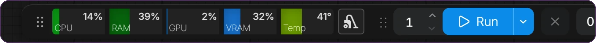

<p align="center">
  
</p>

<p align="center">
  <a href="https://github.com/Deno2026/comfyui-deno-custom-nodes/releases/latest"></a>
  <a href="https://registry.comfy.org/publishers/deno2026/nodes/deno-custom-nodes"></a>
  <a href="https://github.com/Deno2026/comfyui-deno-custom-nodes/actions/workflows/ci.yml"></a>
  <a href="../LICENSE"></a>
  <a href="https://www.youtube.com/@Denoise-AI"></a>
</p>

<p align="center">
  <b>覆盖整个制作流程的实用 ComfyUI 节点。</b><br>
  准备输入、引导模型、比较结果、完成画面风格，并让大型工作流图保持清晰易读。
</p>

<p align="center">
  <a href="../README.md">English</a> · <a href="README.ko.md">한국어</a> · <a href="README.ja.md">日本語</a> · 简体中文 · <a href="README.es.md">Español</a> · <a href="README.pt-PT.md">Português (PT)</a> · <a href="README.pt-BR.md">Português (BR)</a> · <a href="README.id.md">Bahasa Indonesia</a>
</p>

<p align="center">
  <a href="#快速开始">快速开始</a> · <a href="#工作流地图">工作流地图</a> · <a href="#网页工具">网页工具</a> · <a href="#包含的节点">节点参考</a> · <a href="#安全与隐私">安全</a> · <a href="https://github.com/Deno2026/comfyui-deno-custom-nodes/releases/latest">最新版本</a>
</p>

> [!NOTE]
> **v0.7.126 新增：**[`(Deno) MiniMax H3 Tiled Sampler`](#deno-minimax-h3-tiled-sampler) 以重叠分块的方式完成放大后的 MiniMax H3 视频+音频 latent，使 16GB GPU 也能运行最后的高分辨率阶段。
>
> **v0.7.125** 收紧了 Local LLM 服务器地址、Easy Model Download Helper 链接以及 Ideogram Director 的图像保存。节点 ID、输入和已保存的工作流均未改变。详见 [CHANGELOG](../CHANGELOG.md)。

## 快速开始

请先准备好可正常运行的 ComfyUI。

1. 打开 **ComfyUI Manager**，搜索 `Deno Custom Nodes` 并安装。
2. 重启 ComfyUI，并刷新其浏览器页面。
3. 双击画布空白处，搜索 `(Deno) Resize Box` 并添加。
4. 添加标准的 `Load Image` 节点并选择一张图像。将它连接到 Resize Box，再把 Resize Box 的 `image` 输出连接到 `Preview Image`。选择尺寸并运行工作流，即可看到缩放后的图像。

这个入门示例不需要任何生成模型。各个模型节点和 RTX 节点会在下文列出各自的要求。如果不使用 Manager，请参阅[手动安装](#安装)。

大多数 Deno 节点的右上角都有一个小的绿色 `i` 按钮，可在不离开画布的情况下查看节点说明。有新版本的 Deno Custom Nodes 时，按钮会变为黄色并显示一个小 `!` 徽标。

## 工作流地图

<p align="center">
  
</p>

每个 Deno 节点都属于 ComfyUI 制作流程中的某一步。请从你正在进行的步骤开始查找。

### 01 · 准备

在模型运行之前，把每张图像、参考和尺寸都准备妥当。

<p align="center">
  &nbsp;&nbsp;
  
</p>

| 节点 | 功能 | 需要 |
| --- | --- | --- |
| [Resize Box](#deno-resize-box) | 按比例、百万像素和裁剪缩放，带实时、可拖动的裁剪预览 | — |
| [Multi Image Loader](#deno-multi-image-loader) | 一个有序图库、一根连线；点击卡片即可跳过它而无需删除 | — |
| [Advanced Image Source Loader](#deno-advanced-image-source-loader) | 文件夹上传、串联批次以及混合尺寸的 `image_list` 输出 | — |
| [MiniMax H3 Multi Reference Image Loader](#deno-minimax-h3-multi-reference-image-loader) | 最多 9 张图像和 3 个音频文件，各自保持原始尺寸 | ComfyUI 0.30.0+ |

### 02 · 生成

用布局、参考、提示词和 LoRA 引导模型，并让它们在画布上保持清晰易读。

<p align="center">
  
</p>

| 节点 | 功能 | 需要 |
| --- | --- | --- |
| [Ideogram Director](#deno-ideogram-director) | 绘制 bbox 布局，并构建可直接供模型使用的 Ideogram 4 JSON 描述 | Ideogram 4 工作流 |
| [MiniMax H3 Acc LoRA Loader](#deno-minimax-h3-acc-lora-loader) | 无需转换即可加载 Alibaba 官方的 8 步 H3 Acc-LoRA | 官方 Acc-LoRA 权重 |
| [MiniMax H3 Tiled Sampler](#deno-minimax-h3-tiled-sampler) | 在 16GB GPU 上以重叠分块的方式完成放大后的 H3 视频 | 带原生 H3 的 ComfyUI 0.30.0+ |
| [MiniMax H3 R2V Audio Reference workflow](#minimax-h3-r2v-audio-reference-workflow) | `(Deno) Audio Transcript` 与 `(Deno) Audio Analysis Finalizer` 把源音频转化为提示词方向 | VideoHelperSuite、LM Studio |
| [LTX Model Loader](#deno-ltx-model-loader) | 在一个紧凑节点中提供 Checkpoint、KJ 与 GGUF 加载方式 | 这些模式需要 KJNodes 或 ComfyUI-GGUF |
| [LTX Sequencer](#deno-ltx-sequencer) | 多图 guide 排序，可逐图设置帧与强度 | — |
| [LTX Multi LoRA Loader](#deno-ltx-multi-lora-loader) | Power-LoRA 风格的多行加载，视频与音频强度可分别设置 | — |
| [LTX Prompt Guide](#deno-ltx-prompt-guide) | LTX 提示词编码，并根据引号内对白计算最小长度 | — |
| [LTX Tiled Spatial Upscaler](#deno-ltx-tiled-spatial-upscaler) | 以重叠空间分块的方式放大视频 latent | LTX latent 放大模型 |
| [LTX High resolution Tiled Sampler](#deno-ltx-high-resolution-tiled-sampler) | 通过融合的空间分块进行高分辨率 LTX AV 精修 | — |
| [Bernini Prompt Guide](#deno-bernini-prompt-guide) | 在一个节点中提供指令式的 positive 与 negative 提示词 | 原生 Bernini conditioning |
| [Multi LoRA Loader](#deno-multi-lora-loader) | 最多 64 个 LoRA，可逐槽设置开关、强度和备注 | — |
| [Easy Model Download Helper](#deno-easy-model-download-helper) | 官方模型链接，并精确检查目标路径 | — |
| [Text Encoder Unload](#deno-text-encoder-unload) | 提示词编码之后可选择启用的 VRAM 释放点 | — |
| [Prompt Text](#deno-prompt-text) | 用于长提示词的、易读的多行 STRING 来源 | — |
| [Local LLM Loader and Reviewer](#deno-local-llm-loader-and-deno-local-llm-reviewer) | 在 ComfyUI 中调用本地 LLM 生成提示词，并在保存前进行审查把关 | 本地 LLM 服务器 |

### 03 · 比较

在保存之前，先在画布上看清差异。

<p align="center">
  &nbsp;&nbsp;
  
</p>

| 节点 | 功能 | 需要 |
| --- | --- | --- |
| [Image Compare](#deno-image-compare) | 在节点内提供滑块、并排、差异和切换视图 | — |
| [Video Compare](#deno-video-compare) | 逐帧精确的 A/B 视频播放，带音频，并提供无损的对比输出 | — |
| [Video Preview](#deno-video-preview) | 在图中任意位置内嵌显示全分辨率 H.264 预览 | PyAV（当前 ComfyUI 已自带） |

### 04 · 收尾

确定最终的画面风格和分辨率。

<p align="center">
  &nbsp;&nbsp;
  
</p>

| 节点 | 功能 | 需要 |
| --- | --- | --- |
| [Film Grain](#deno-film-grain) | 面向照片和视频的 CPU 胶片颗粒，并与分辨率自动匹配 | — |
| [RTX Video Super Resolution](#deno-rtx-video-super-resolution) | NVIDIA VSR、High Bitrate、Denoise 和 Deblur，缩放选项清晰明了 | Windows、NVIDIA RTX、`nvidia-vfx` 0.2+ |
| [RTX Video Super Resolution (2 Pass)](#deno-rtx-video-super-resolution-2-pass) | 为完整视频工作流提供清理阶段和放大阶段 | Windows、NVIDIA RTX、`nvidia-vfx` 0.2+ |

### 05 · 整理

让大型工作流图保持清晰易读，并随时掌握机器状态。

<p align="center">
  
</p>

<p align="center">
  
</p>

| 工具 | 功能 | 需要 |
| --- | --- | --- |
| [Visual Fold](#deno-visual-fold) | 把选中的节点或组折叠成一个紧凑标签，无需使用子图 | — |
| [Resource Monitor](#deno-resource-monitor) | 在顶部栏显示 CPU、RAM、GPU、VRAM 和温度仪表，并提供模型清理 | 读取 GPU 数据需要 NVIDIA NVML |
| [Floating Tools](#deno-floating-tools) | 释放 VRAM、查看 ComfyUI Stable 更新状态，以及可直接交给 GPT/Gemini 的 Error Help | 默认关闭 |
| [Node info button](#node-info-button) | 在每个 Deno 节点上提供快速说明和更新记录 | — |

## 网页工具

直接在浏览器中运行，无需安装。

- [Deno Video Compare](https://deno2026.github.io/comfyui-deno-custom-nodes/video-compare/) - 用滑块、并排、差异和切换视图比较两个渲染视频，并可将对比结果保存为 MP4。
- [Deno Video to GIF/WebP](https://deno2026.github.io/comfyui-deno-custom-nodes/video-to-gif/) - 裁剪、截取、缩放短视频，并导出为 GIF 或更小的 WebP 文件。
- [Deno Discord Media Compressor](https://deno2026.github.io/comfyui-deno-custom-nodes/video-to-discord/) - 压缩视频或图片以便在 Discord 分享，尽可能使文件小于 10 MB。该工具的界面仅提供韩语。

## 包含的节点

按工作流顺序排列的完整参考。每一节开头先说明节点的功能；边界情况和兼容性说明请展开 **详细信息**。

### 01 · 准备

#### `(Deno) Resize Box`

ComfyUI 的分辨率辅助与图像缩放节点。


主要功能：

- `Preset Ratio` 与 `Manual Input` 模式
- 常用比例预设
- 基于百万像素的尺寸计算
- `divisible_by` 对齐
- `Center Crop (Fill)`、锁定比例且可缩放的 `Crop Position (Fill)`，以及 `Fit (Letterbox/Pillarbox)` 缩放模式
- 默认 `lanczos` 插值
- 实时比例预览；`Crop Position (Fill)` 显示连接的完整源图，可拖动裁剪框调整位置，也可拖动任意角点缩放，同时保持输出比例和百万像素数不变
- 输出：`image`、`width`、`height`

#### `(Deno) Multi Image Loader`

为批量 guide 工作流设计的多图加载器。灵感来自 **WhatDreamsCost** 的原始工作流思路，并按 Deno 的工作流风格做了调整和完善。


主要功能：

- 固定高度的可滚动图库，节点高度不会无限增长
- 拖拽排序，插入位置稳定
- 点击缩略图即可禁用/启用图像而无需删除；只输出已启用的图像，并按卡片顺序编号为 1、2、3……，数量和编号即时更新
- 已禁用的图像及其位置会随工作流一起保存；运行前请至少启用一张图像
- 上传按钮、拖放上传和粘贴图像
- `Input Folder` 浏览器，可重复使用 ComfyUI `input` 中已有的图像
- `Keep Input Ratio`、`Preset Ratio` 或 `Manual Input` 尺寸模式，可使用比例预设、百万像素、divisible-by 尺寸，或直接设置宽高
- 可选择缩放方法和插值方式，并可在导出时选择裁剪或适配缩放
- 输出：`multi_output`、`width`、`height`

<details>
<summary>详细信息</summary>

- 支持浏览 input 子文件夹，提供文件夹图块、双击进入和 `Parent` 按钮
- 可添加嵌套在 input 中的图像，并保留其 ComfyUI 子文件夹路径
- 出于安全考虑，会跳过指向 ComfyUI `input` 文件夹之外的外部符号链接或联接点；请改为把这些图像上传到 `input`
- 按文件修改时间由新到旧排序 input 图像
- 响应式的 input 文件夹缩略图，图像很多时浏览更流畅

</details>

#### `(Deno) Advanced Image Source Loader`

高级图像来源加载器，支持上传的图像、ComfyUI input 文件夹、连接的 IMAGE 批次，并可输出混合尺寸的图像列表。对于常规的 ComfyUI `input` 文件夹工作流，标准的 `(Deno) Multi Image Loader` 仍然是更简单的推荐选择。


主要功能：

- 保留熟悉的 Deno 图像加载器图库工作方式
- 支持浏览已有的 ComfyUI `input` 文件夹，以及相对路径的 `Input Path` 输入
- `Upload Folder` 可把浏览器中选择的文件夹导入 ComfyUI input
- 在浏览器允许的情况下支持上传、拖放、粘贴和文件夹上传，并提供可见的 `Paste` 按钮以及常规的 Ctrl+V 图像粘贴
- 点击缩略图即可禁用/启用来源而无需删除；只有已启用的卡片才会获得连续的输出编号
- 拖动缩略图卡片可调整输出顺序
- 可选的 `images` 输入可把上游的图像批次/列表串联到同一输出流
- 输出缩放后的 `batch` 张量供常规批次工作流使用，并输出 `image_list` 供逐图列表处理
- 输出：`batch`、`image_list`、`width`、`height`、`image_count`

<details>
<summary>详细信息</summary>

**从 0.7.120 或更早版本迁移：**不再读取外部文件夹或下载图像 URL。请使用 `Upload` 或 `Upload Folder`，然后把每个启用的旧来源替换为上传后的 input 路径。已保存的来源、顺序、启用状态和连接都会保留。已禁用的旧来源不会阻止执行。`DENO_EXTERNAL_IMAGE_ROOTS` 不再授予访问权限。ComfyUI input 内已保存的绝对路径仍可执行；选择其相对 input 路径即可恢复缩略图。

- 支持文件夹图块、嵌套文件夹浏览和 `Parent` 按钮
- 使用 `Refresh previews` 重试缩略图，不会改变来源、启用状态或顺序；把鼠标悬停在失败的预览上可查看提示
- 已禁用的来源仍可读取，并随工作流一起保存，直到重新启用或移除；切换或重新排序会即时更新输出编号
- 在经典画布和 Nodes 2.0 中，图库都会跟随节点的可用高度
- 缩略图采用瀑布流排布，混合的竖图/横图参考更容易浏览
- `recursive_folders` 选项可加载嵌套文件夹中的图像
- `Keep Input Ratio`、`Preset Ratio` 或 `Manual Input` 尺寸模式，可使用比例预设、百万像素、divisible-by 尺寸，或直接设置宽高
- 可选择缩放方法和插值方式，包括居中、顶部或底部裁剪填充模式
- `Original Size` 列表模式可在 `image_list` 中保留混合的源分辨率
- `Match Batch Size` 列表模式使 `image_list` 与缩放后的批次尺寸一致

</details>

#### `(Deno) MiniMax H3 Multi Reference Image Loader`

面向 MiniMax H3 工作流的参考加载器，用一根连线传出图像，并分别输出各个音频。


主要功能：

- 与 `(Deno) Multi Image Loader` 相同的上传、粘贴、拖放、Input Folder、卡片排序和清除操作
- 通过一个专用接口传入最多 9 张有序参考图
- 保留每张解码图像自身的尺寸和宽高比，不做缩放、裁剪、填充或加黑边处理
- 每张预览卡片都按源图自身的宽高比显示，因此混合的横图和竖图参考都能完整显示，不会被预览裁剪
- 点击缩略图即可禁用/启用参考；已启用的卡片会立即重新编号，对应 `<Picture 1>`、`<Picture 2>` 等，只有这些图像会传到两个输出
- 已禁用的图像会保存在原来的卡片位置，并仍占用 9 个图库位置中的一个；运行前请至少启用一张图像或一个音频参考
- 连接到 `(Deno) MiniMax H3 Reference to Video` 上唯一的 `ref_images` 输入
- 同时以 `image_list` 输出相同的有序来源，可直接连接到 `(Deno) Local LLM Loader` 的 `image` 输入
- H3 节点保留 ComfyUI 原生的参考视频、成对视频音频和独立音频 Autogrow 输入

图像图库下方可折叠的音频区域最多接受 3 个音频文件，可通过 `Add audio`、Input Folder 或拖入文件添加。每个文件都有波形、实测时长、预览播放、独立的 Use 开关、排序手柄和移除按钮。播放不会改变该文件是否用于生成。此加载器不接受视频文件。

这两个 MiniMax H3 节点需要 ComfyUI 0.30.0 或更高版本。完整的原生 H3 流程请参阅便携式的 [MiniMax H3 多参考图工作流](workflows/minimax-h3-multi-reference.json)，其中两个标准 `Load Image` 节点已替换为这个一线连接的 Deno 加载器。

<details>
<summary>详细信息</summary>

每登记一个音频，就会在现有两个图像输出之后增加一个独立的 `AUDIO` 输出。把这些输出连接到 `(Deno) MiniMax H3 Reference to Video` 不断增长的独立音频输入，并连接 `audio_vae` 来编码声音。只有已启用的音频卡片才会按卡片顺序获得 `<Audio 1>`、`<Audio 2>` 等编号。例如，已登记三个文件且前两个被禁用时，第三个文件会显示并编码为 `<Audio 1>`。已禁用的文件及其连线仍会保存；它们普通的下游音频分支会被跳过。重新排序时，每根连线仍连接同一个文件；移除文件时只会移除该文件的音频连线。也支持只加载音频。

添加音频文件时节点会自动增高，使每个音频行都可见而无需内部滚动条。移除文件或折叠音频区域会释放这部分空间。手动增加的高度和宽度会保留，重新打开较早的紧凑型工作流时，节点会展开到足以显示其已保存的音频行。

为了让显示的标签与 H3 参考保持一致，请把同一个 DENO 加载器上所有已启用的音频输出连接到同一个 DENO H3 节点。不想连接的文件请关闭。使用这些 DENO 音频输出时，该 H3 节点上必须断开其他独立音频来源和参考视频的音轨；节点会说明编号冲突，而不会悄悄分配不同的标签。只使用其他音频加载器的现有工作流保持原有的标准输入行为。

音频文件从 ComfyUI 的 input 文件夹读取。支持的扩展名有 WAV、MP3、FLAC、OGG/OGA、Opus、M4A、AAC、AIF 和 AIFF，具体取决于已安装的 PyAV 解码器。加载限制为每个文件 256 MiB、解码后的 PCM 128 MiB，以及 30 秒的 CPU 解码时间。预览失败时提供 Retry 操作，不会改变已保存的文件及其连接。

专用的 H3 接口是有意为之：普通的 ComfyUI `IMAGE` 批次要求统一的宽高，因此无法保留混合的参考尺寸。额外的 `image_list` 是列表输出而不是同尺寸批次，所以在供支持列表的节点再次使用时，原始尺寸、顺序和宽高比仍各自独立。MiniMax H3 在正常的 `ref_image_size` 处理中仍可能缩小参考图，但会保持其宽高比。

在支持可选 H3 VAE 的 ComfyUI 版本中，`(Deno) MiniMax H3 Reference to Video` 也接受未连接的 `vae` 或 `audio_vae` 输入。两者都连接时，保持现有的参考编码行为。

- 未连接 `vae` 时，参考图像和视频仍会传给文本/视觉编码器，但会省略它们经 VAE 编码的参考 latent。
- 未连接 `audio_vae` 时，不会编码实际的参考声音。文本编码器保留的是 `<Audio 1>` 这类标签，而不是音频波形；要参考某个人声或声音，请连接 `audio_vae`。省略它并不会关闭生成的音频。

与参考视频配对的音频（`ref_video_audio`）需要同时连接 `vae` 和 `audio_vae`，才能编码参考视频及其声音；独立的参考音频（`ref_audio`）只需要 `audio_vae`。

这些选择仅适用于本节点中的参考编码。请保留下游视频和音频解码节点所需的 VAE。原生 H3 节点要求两个 VAE 的旧版 ComfyUI 仍需连接两者；要使用可选的参考编码，请更新 ComfyUI。

</details>

### 02 · 生成

#### `(Deno) Ideogram Director`

用于结构化 JSON 描述和 bbox 布局编辑的 Ideogram 4 可视化提示词构建器。[观看 Ideogram Director 工作流演示](https://youtu.be/Z8s27skkIDM)。


上方的背景图是用同样的四个方框在本地由 Ideogram 4 生成的结果。

主要功能：

- 直接在 ComfyUI 画布上绘制和编辑 bbox 区域
- 可临时禁用单个 bbox 元素，无需删除或改变顺序
- 双击 bbox 可在指针旁编辑；也可在重叠处反复 `Alt`+点击，轮流选中下方的方框
- 从 Local LLM Loader 或其他 STRING 来源导入 JSON 提示词
- 可选连接 Summary 和 Background STRING 输入，在本次运行中覆盖画板上的这两个字段；未连接的输入继续使用已保存的画板文本
- 替换现有画板前先确认，也可切换为始终替换
- 明确拒绝格式错误的 JSON，而不是把损坏的提示词文本传给下游
- 带轻量预览缩略图的 style 与 layout 预设图库
- Language 视图可用你自己的语言阅读和编辑画板说明，而最终输出仍是可供模型使用的英语。招牌、Logo、标题等 TEXT 框内的文字会原样保留
- 输出：`prompt`、`width`、`height`、`seed`、`bboxes`

<details>
<summary>详细信息</summary>

现有的 `bboxes` 输出既可连接标准 `BBOX` 消费者，也可连接 `Ideogram4_MultiLora_BoundingBoxNode_Fedor` 等节点的 `BOUNDING_BOX` 输入；该节点的区域行数跟随 Director 中已启用的方框数量，无需增加 Director 的保存字段。目前它只同步数量，不跟踪方框身份，因此删除或重排中间的方框后，请检查各 LoRA 行的分配。

翻译仅使用内置的 Google、MyMemory 和 LibreTranslate 服务。参见[文件与翻译访问](SECURITY_CONFIGURATION.md)。

</details>

#### `(Deno) MiniMax H3 Acc LoRA Loader`

直接加载 Alibaba PAI 官方的 [MiniMax-H3-Acc-LoRAs](https://huggingface.co/alibaba-pai/MiniMax-H3-Acc-LoRAs)，无需转换或复制 safetensors 文件。

1. 下载官方 FL2VA 或 Ref2VA 的 `Acc-8Step.safetensors` 文件，放入常规的 `ComfyUI/models/loras/` 文件夹，或专用的 `ComfyUI/models/minimax_h3_acc_loras/` 文件夹。
2. 将匹配的原生 MiniMax H3 diffusion model 连接到 `model`；支持完整版本和 Comfy-Org 的 `*_pruned_*` 版本。
3. 选择匹配的 Acc-LoRA：FL2VA/T2VA 使用 FL2VA，Ref2VA 使用 Ref2VA。
4. 将本节点唯一的 `model` 输出连接到常规的 guider 路径。
5. 使用 ComfyUI 标准节点搭建采样路径。推荐从 `BasicScheduler: simple, steps: 8` 和 `KSamplerSelect: euler` 开始，并把它们连接到 `SamplerCustomAdvanced`。

Deno Custom Nodes 不附带 LoRA 权重或工作流。请从 Alibaba 下载权重，并自行搭建或调整原生 ComfyUI 工作流。

<details>
<summary>详细信息</summary>

节点会应用静态 LoRA 权重以及 checkpoint 中 32 个随时间变化的 PDD 输出头。采样时，它读取 ComfyUI 提供的实际 sigma 边界，并自动融合对应区间的 PDD 输出头。这样 sampler、scheduler 和步数仍由常规 ComfyUI 节点控制。官方的 8 步 Simple/Euler 配置仍是推荐配置，也是训练时使用的配置；无需更换此 loader，即可选择 4 至 12 步的任意 Simple Scheduler 步数；其他降序 schedule，或用于 latent 放大工作流的分段 sigma pass，可用于实验，但不保证提升质量。请保持原生 MiniMax H3 的 video/audio sigma shift 为 `12.0 / 3.0`，LoRA 强度为 `1.0`。

未裁剪的完整模型，包括原生 ComfyUI INT8 版本，通过 ComfyUI 常规的量化感知 LoRA 路径应用完整的 adapter。对于 curve-pruned 模型，loader 会在 `models/diffusion_models/` 下寻找已存在的匹配未裁剪 MiniMax H3 checkpoint，只读取其中较小的 FP32 time-embedder 部分，并在内存中推导出 bridge，把全部 50 项完整宽度的 AdaLN LoRA 更新转换到裁剪后的 8 维曲线上。此计算不会加载整个 checkpoint。如果未安装匹配的完整 checkpoint，loader 仍可在兼容模式下使用：它只警告一次，跳过这 50 项 AdaLN 更新，并继续应用其余所有 LoRA 更新和 PDD 输出头。

使用 v0.7.92-v0.7.94 三输出 loader 保存的标准、启用状态的 UI 工作流，会在 ComfyUI 画布上加载时迁移。现有的 model 连线保持不变，原先的 sampler 和 sigmas 连线会移到可编辑的标准 `KSamplerSelect: euler` 与 `BasicScheduler: simple, steps: 8` 节点。打开后请保存一次 UI 工作流。当前的单输出工作流不会改变。已静音/已 bypass 的节点、未知的自定义布局以及格式损坏的图会保持原样，不做猜测。原始 API prompt JSON 不会执行这种前端迁移，请从迁移后的 UI 工作流重新导出。如果文件是在原来的 sampler/sigmas 连线消失之后才保存的，请手动重新连接这些标准节点。

</details>

#### `(Deno) MiniMax H3 Tiled Sampler`

以重叠分块的方式完成放大后的 MiniMax H3 视频+音频 latent，使 16GB GPU 也能运行最后的高分辨率阶段。每一步中，所有分块读取同一帧，它们的预测在重叠区域按余弦权重混合，然后进行一次共享的更新。模型只为所有分块加载一次，原始音频 latent 原样传递。


在原生 H3 图中的典型位置：

```text
First pass: SamplerCustomAdvanced with SplitSigmas high_sigmas
-> MiniMax H3 Latent Upscale With Model (ComfyUI 0.44.0+) or another H3 latent upscaler
-> (Deno) MiniMax H3 Tiled Sampler with SplitSigmas low_sigmas
-> VAE Decode for video, audio decode for sound
```

- `model`：已经过 LoRA、sigma shift 以及任何注意力或内存节点处理的 H3 模型。H3-Optimizations 的稀疏注意力和内存优化可放在本节点之前使用。ComfyUI 核心的 `BlockSparseAttention` 目前会被拒绝并给出提示。
- `positive`：与第一阶段相同的 positive conditioning。R2V 参考图像保持全局有效。关键帧 conditioning 会按每个分块裁剪并分别准备。区域 conditioning 和 ControlNet 会被拒绝。
- `latent`：放大后的 H3 latent，不带 noise mask。
- `sigmas`：仅取第一阶段 schedule 的最后 1-3 步，例如 `SplitSigmas` 的 `low_sigmas`。其他 schedule 会被拒绝并给出提示。
- `seed`：用于把放大后的 latent 带回这些 sigma 中第一个的噪声。
- `Tile width`、`Tile height`、`Overlap X`、`Overlap Y`：以 32 的倍数表示的像素尺寸。重叠必须小于分块。分块数量由帧尺寸决定。分块不小于帧时，会整帧一次运行。

默认值（896 x 704 的分块，重叠至少 256 x 320）是经过测试的 16GB 设置。在 16GB GPU 加 32GB 系统内存的环境中，一段 15 秒、1920 x 1088 的片段以 6 个分块运行，其最后一步耗时约 520 秒。更大的分块会减少重复的重叠计算，但需要更多 VRAM。高于这些默认值的尺寸，DENO 尚未实测。

每次运行都会在控制台输出分块数量、网格、尺寸、每个分块的耗时以及 PyTorch 峰值内存，并把同样的报告加入节点的输出文本，方便你或代理选择下一组尺寸。需要支持原生 MiniMax H3 的 ComfyUI（0.30.0 或更高版本）；已在 ComfyUI 0.41.3 至 0.44.0 上测试。

#### MiniMax H3 R2V Audio Reference workflow

[新手音频参考工作流](workflows/minimax-h3-r2v-audio-reference.json)保留了 ComfyUI 标准 MiniMax H3 的参考音频路径，并增加了自动的提示词导演流程：

- `(Deno) Audio Transcript` 使用本地 OpenAI Whisper 生成歌词或对白、分段时间、检测到的语言和置信度摘要。用户可选输入的歌词仍以用户文字为准。
- `(Deno) Audio Analysis Finalizer` 只保留 ComfyUI `TextGenerate` 结果中已文档化的声学分析字段，并可在分析后卸载该 CLIP 模型。
- `(Deno) Local LLM Loader` 通过可选的 `audio_context` STRING 输入接收转录和声学报告。原始 AUDIO 不会发送给本地 LLM，上游的分析结果被视为数据而不是指令。
- 选中的源音频片段既是 H3 的 `<Audio 1>` 参考，也是混入最终 MP4 的音频。此工作流不会解码 H3 内部生成的音频。

要求：

- 支持 MiniMax H3 以及可处理音频的 `TextGenerate` 的最新 ComfyUI Stable
- [ComfyUI-VideoHelperSuite](https://github.com/Kosinkadink/ComfyUI-VideoHelperSuite)，用于 `Load Audio (Upload)`
- 放在 `ComfyUI/models/text_encoders/` 中的 `gemma4_e4b_it_fp8_scaled.safetensors`，用于声学分析
- 加载了 `google/gemma-4-12b-qat` 且 Local Server 正在运行的 LM Studio，用于最终的提示词导演步骤

`openai-whisper` 会作为节点依赖安装。所选的 Whisper checkpoint 会在首次运行 `(Deno) Audio Transcript` 时从 OpenAI 下载，由官方 Whisper loader 校验 checksum，并缓存在 `ComfyUI/models/stt/whisper/` 下。

#### `(Deno) LTX Model Loader`

把常见的 LTX 2.3 模型加载方式整合到一个紧凑的加载器中。


主要功能：

- `Checkpoint Style`、`KJ Style` 和 `GGUF Style` 模式
- 输出：`model`、`clip`、`video_vae`、`audio_vae`
- 尽可能使用 ComfyUI 内置的 checkpoint / diffusion / DualCLIP 加载路径
- 对分离的 video/audio VAE 工作流使用 KJNodes 的 `VAELoaderKJ`
- 对 GGUF 工作流使用 ComfyUI-GGUF 的 UNet 加载；这两个包只有在 ComfyUI 加载它们之后才会被使用，已安装但未加载的包会得到清楚的提示
- 提供更清晰的依赖错误提示，并在混合的 ComfyUI/KJNodes 环境中提供音频 VAE 兼容回退

#### `(Deno) LTX Sequencer`

针对多图工作流调整的 LTX guide 排序器。灵感来自 **WhatDreamsCost** 的 LTX 工作流思路，并由 Deno 针对日常易用性做了调整。


主要功能：

- 配合 `(Deno) Multi Image Loader` 的 batch 输出使用
- 尽可能根据已连接的加载器自动填充 `num_images`
- 保留现有的同步式工作方式
- 需要时可只让 `strength` 值脱离同步，改为手动控制
- `bypass` 开关会原样传递 `positive`、`negative` 和 `latent`，便于快速进行 A/B 测试

#### `(Deno) LTX Multi LoRA Loader`

面向 LTX 工作流的 Power-LoRA 风格多 LoRA 加载器。


主要功能：

- 在一个紧凑节点中添加多个 LoRA
- 逐槽启用开关
- 逐槽的 `strength`、`video` 和 `audio` 强度控制
- 逐槽的触发词和 LoRA 备注编辑器
- 可从 LoRA 行复制已保存的触发词
- 输出修补后的 `model` 和 `clip`
- 设计上贴近熟悉的 Power LoRA Loader 工作方式，同时加入适合 LTX 的 A/V 控制和轻量的 LoRA 参考备注

#### `(Deno) LTX Prompt Guide`

整合了 LTX 提示词编码、可选的 negative 提示词处理、内置的 LTX conditioning 以及对白长度规划的提示词辅助节点。


主要功能：

- positive 提示词文本编码
- 可选的可折叠 negative 提示词
- 带 `frame_rate` 的内置 LTX conditioning
- 根据引号内对白估算最小视频长度
- 支持 Auto、Korean、English、Japanese 和 Chinese 的对白估算
- 输出：`positive`、`negative`、`frame_rate`

#### `(Deno) LTX Tiled Spatial Upscaler`

用于高分辨率 LTX video latent 二次处理的辅助节点。它把每一帧切成带重叠区域的空间分块，逐块运行 LTX latent 空间放大器，再把结果混合回一个 latent。

请用于只含视频的 LTX latent。如果你的工作流使用的是视频/音频合并的 latent，请先分离音频路径，并在分块视频处理之后重新合并。

#### `(Deno) LTX High resolution Tiled Sampler`

用于高分辨率 LTX AV 精修阶段的 sampler。它保持一条全局的 sampler 轨迹，同时通过重叠的空间分块计算视频预测，并在 sampler 更新之前将其融合。

完整的音频 latent 会作为上下文传给每个视频分块，而在 `freeze` 模式下返回的音频 latent 保持不变。

#### `(Deno) Bernini Prompt Guide`

KJ 风格的 Bernini 提示词辅助节点，把 positive 与 negative 提示词编码整合到一个对新手友好的节点中。


上图所示的 `Official Wan2.2` negative 预设是用中文写成的。

主要功能：

- `System Prompt` 选择器，提供 `Text to Video`、`Image to Video` 和 `Reference Video Edit` 等易读的模式
- 直接在节点顶部显示当前 system prompt 的前缀
- 以指令式书写提示词，例如 `Replace the jacket with the shirt from image0. Keep the camera motion, background, lighting, and shadows unchanged.`
- 参考模式会在内部自动加入简短的 `image0`、`image1`、`image2` 命名提示
- 可折叠的 negative 提示词区域
- negative 预设会填充可见的 negative 提示词框；直接编辑该框即可更改最终编码的 negative 提示词
- 输出：`positive`、`negative`

此节点只准备文本 conditioning。请把它的 `positive` 和 `negative` 输出连接到 ComfyUI Stable 原生的 `(Bernini) Conditioning` 节点，以构建 Bernini 的视觉/context-latent conditioning。当前的 ComfyUI 已包含[已合并的原生 Bernini 后端](https://github.com/Comfy-Org/ComfyUI/pull/14216)，因此不再需要旧版的 preview-backend 更新器；如果找不到原生 conditioning 节点，请更新 ComfyUI Stable。

#### `(Deno) Multi LoRA Loader`

用于普通 ComfyUI diffusion 工作流的通用多 LoRA 加载器。


最多可把 64 个 LoRA 应用到已连接的 `MODEL` 和可选的 `CLIP`，可逐个启用或禁用已保存的槽位而不丢失其选择，分别设置 model 与 CLIP 强度，在每个 LoRA 旁保存触发词和备注，调整槽位顺序，并把修补后的 `model` 和 `clip` 传给下游。需要时使用 `+ Add LoRA` 添加槽位。已有的八槽工作流和 API prompt 会保留其已保存的选择、强度、触发词、备注和连接。

#### `(Deno) Easy Model Download Helper`

基于预设的推荐模型文件安装辅助工具。内置预设涵盖 LTX 2.3 8GB VRAM GGUF 入门文件组，以及官方 LTX 2.5 Distilled INT8 两阶段模型组。


主要功能：

- 在浏览器中打开官方模型链接，而不是用 Python 下载文件
- 包含两阶段工作流所需的 LTX 2.5 diffusion model、带 projection 的 Gemma 4 text encoder、video 和 audio VAE，以及 x2 spatial upscaler
- 显示检测到的 ComfyUI 模型根目录，并可复制所选的根目录
- 在工作流内保存 creator 预设，并在页面重新加载后从浏览器存储中恢复
- 支持 Hugging Face 直接链接以及 Civitai 页面/下载链接，不在 Python 端发起网络请求
- 检查 ComfyUI 已注册的模型文件夹，包括来自 `extra_model_paths` 的自定义文件夹名称
- 在这些已注册的模型文件夹内，精确检查每个预设的目标路径，不扫描无关的嵌套项目文件夹
- 显示目标 ComfyUI 模型子文件夹，让用户清楚文件应放在哪里

下载 LTX 2.5 文件前需要 Hugging Face 账号，并完成 **Agree and Access**。此工具不会绕过该限制，也不会自动下载文件。请先阅读 [LTX-2 Community License](https://github.com/Lightricks/LTX-2/blob/main/LICENSE.md)，在[官方 LTX 2.5 仓库](https://huggingface.co/Lightricks/LTX-2.5)申请访问权限，然后使用该工具提供的浏览器链接，把下载的每个文件移动到所显示的 ComfyUI 模型文件夹中。

<details>
<summary>Creator 预设链接指南</summary>

- Hugging Face：右键点击目标文件旁的小下载图标，选择 `Copy link address`，然后把该文件的直接链接粘贴到预设的 `URL` 字段。
- Civitai：从浏览器地址栏复制模型页面 URL，粘贴到预设的 `URL` 字段，然后点击编辑器中的 `Civitai` 按钮，将其转换为浏览器直接下载链接。如果 URL 中看不到文件名，请手动输入下载后的文件名。
- 对于 Civitai 页面，除非你有意提供直接的 API 下载 URL，否则不要复制蓝色 `Download` 按钮的链接。
- `File name` 仅用于目标路径检查。它应与磁盘上已下载的文件一致，对 Civitai/API 链接尤其如此。


[Civitai 模型页面示例（含中文模型文本）](images/easy-model-download-helper-civitai-link.png)。


</details>

#### `(Deno) Text Encoder Unload`

适用于常见的仅 positive 或 positive/negative 提示词流程、可选择启用的内联 VRAM 屏障节点。


- 通过 `Positive Conditioning` 连接 positive conditioning；它是必填的，并会原样传递
- 可选择通过 `Negative Conditioning` 连接已编码的 negative 提示词或 `Conditioning Zero Out`；它同样会原样传递
- 将上游 text encoder 实际使用的 `CLIP` 连接到 `Text Encoder (CLIP)`
- 仅使用 positive 的 guider 工作流可将 `Negative Conditioning` 留空
- 只通过 ComfyUI 的模型管理卸载该 CLIP/text encoder、它的 clone 及其受管组件；diffusion model、VAE 和 ControlNet 不会被全局卸载
- 遵循 ComfyUI 常规的输入缓存，因此未改变的预览采样可以复用，而 conditioning 或 CLIP 路径发生变化时仍会触发卸载

<details>
<summary>详细信息</summary>

Dynamic VRAM 会根据显存压力移动权重，可能有意保留部分 text encoder 页面。此节点提供一个确定的、需主动启用的释放时点，但无法让整个进程变成 `0 MiB`：CUDA context、conditioning 张量、其他模型、自定义节点的显存占用以及其他应用的占用彼此独立。它本身也不会提高采样质量；它提供的是额外的 VRAM 空间，可减少模型 offload 或避免 out-of-memory 错误。之后再次 text encode 时必须重新加载模型，而 `--gpu-only` 无法把 encoder 移出 VRAM。

</details>

#### `(Deno) Prompt Text`

一个小型多行 STRING 来源，用于 system prompt、user prompt、模板或 JSON 文本。当一段较长、可重复使用的提示词需要在独立节点中保持易读，并在不改动文字的情况下连接到 Ideogram Director、Local LLM Loader 或其他 STRING 输入时使用。


#### `(Deno) Local LLM Loader` and `(Deno) Local LLM Reviewer`

用于调用已经在你 PC 上运行的模型，并用文本审查来控制保存内容的 Local LLM 工作流辅助节点。

<p>
  &nbsp;&nbsp;
  
</p>

主要功能：

- 在 ComfyUI 中调用本地的 Ollama、LM Studio、llama.cpp、vLLM、Custom OpenAI-compatible、llama-swap 或 Unsloth Studio 模型
- 默认仅限 localhost 的服务器安全策略：使用 `127.0.0.1` 或 `localhost`，或通过 `DENO_LOCAL_LLM_ALLOWED_HOSTS` 明确允许一个私有局域网 `IP:port`
- 在节点中刷新各 provider 专属的模型列表
- 在卸载模型之前停止正在运行的本地 LLM 请求
- 通过一次节点运行连接提示词批次，使本地模型在批次完成前保持加载
- 可选择为支持 vision 的本地模型调用附加一张 IMAGE
- 直接在节点上预览 Thinking 和 Result 文本
- 只要 Local LLM 节点执行，就把节点最终的 Result 嵌入保存的 PNG/工作流 metadata，重新打开文件时会在节点内恢复；Thinking/reasoning 只用于预览，不会保存
- 将具名的 System Prompt 预设保存在 ComfyUI 用户数据中，清理浏览器配置文件后依然保留
- 把一个正数 FLOAT 连接到 `video seconds`，即可在每条 LLM 用户提示词后追加类似 `This is an 8-second video.` 的句子，而不改变已保存的 Prompt 文本
- 在 Save 节点之前使用 `(Deno) Local LLM Reviewer` 作为把关：根据审查文本结果放行或阻止 IMAGE 与 AUDIO 输出，一次性批准当前已审查的结果，或重新运行 reviewer 之前的路径

<details>
<summary>服务器地址、API 密钥与 provider 说明</summary>

Custom、llama.cpp、vLLM、llama-swap 和 Unsloth 的服务器字段只接受服务器地址和端口，并可带可选的 `/v1`，例如 `http://127.0.0.1:8000/v1`；带 query 或其他路径的地址会被拒绝并给出提示。Ollama 和 LM Studio 的 Refresh Models、Unload 和 Stop 始终使用其固定的本地服务器，即节点运行时使用的同一个服务器。服务器出错时，会显示服务器返回的 JSON 错误信息，而不是原始响应。

- 在多次刷新和切换 provider 时只保留一个检测到的模型选择器，并移除旧前端会话留下的已知重复选择器，同时保留当前选择的模型
- 使用 llama-swap 的实时运行状态与管理 API 进行手动卸载或运行后卸载；llama-swap 服务器上配置的任何超时仍负责自动卸载
- 仅在使用 Unsloth Studio 服务器时才使用 `Unsloth` provider（默认 `http://127.0.0.1:8888/v1`）；如果 Unsloth 的 GGUF 是在 LM Studio 中运行，请选择 `LM Studio`
- 列出 Unsloth Studio 模型，发送不含 tool 定义或 tool-choice 字段的 OpenAI 兼容 chat 请求，并使用 Unsloth Studio 的管理 API 进行手动或运行后卸载；`Keep for minutes` 不会安排定时的 Unsloth 卸载
- 浏览器中已有的 System Prompt 预设可一次性导入，浏览器中的副本保持不变作为备份
- 在节点和编辑器中显示实际应用的 System Prompt 预设名称；经过编辑而无法匹配的文本显示为 `Custom`

API 认证从 ComfyUI 主机的环境变量中读取：

| Provider | API 密钥环境变量 |
| --- | --- |
| LM Studio | 可选 `DENO_LOCAL_LLM_LM_STUDIO_API_KEY`；未设置专用密钥时回退到 `DENO_LOCAL_LLM_API_KEY` |
| llama.cpp, vLLM, Custom, llama-swap | 可选 `DENO_LOCAL_LLM_API_KEY` |
| Unsloth | 必需 `DENO_LOCAL_LLM_UNSLOTH_API_KEY`；不使用通用密钥 |
| Ollama | 不发送通用密钥 |

请在启动 ComfyUI 之前设置相应的变量，修改后需重启 ComfyUI。密钥会以 Bearer token 的形式发送，用于模型发现、chat，以及 provider 支持的管理请求，包括 LM Studio 卸载和 llama-swap 管理。未配置密钥时，可选认证的 provider 仍可在没有认证头的情况下工作。密钥绝不会保存到工作流或 PNG metadata 中。

对于同一台 PC 上由 Docker 托管的 LLM 服务器，请把服务器端口发布到主机的 loopback 上，并使用相应的本地 URL。认证不会改变 localhost/私有局域网的 URL 规则；请只使用可信的服务器，因为配置的密钥会发送给所选的受支持 provider。

远程 LM Studio 说明：专用的 `LM Studio` provider 目前使用 `http://127.0.0.1:1234/v1`。要调用同一可信局域网内你自己的另一台 PC 上的 LM Studio，请在那台 PC 上启用 **Serve on Local Network**，在启动 ComfyUI 之前设置精确的允许列表（例如 `DENO_LOCAL_LLM_ALLOWED_HOSTS=192.168.1.50:1234`），重启 ComfyUI，然后选择 `Custom`，并把 `http://192.168.1.50:1234/v1` 作为 Custom Server URL。如果该服务器需要认证，还要在重启之前在 ComfyUI 主机上设置 `DENO_LOCAL_LLM_API_KEY`。允许列表只接受精确的私有 IP 与端口组合，并且绝不会保存到工作流或 PNG metadata 中。Custom 不使用 LM Studio 专用的卸载辅助功能，因此请用主机防火墙把该服务器端口限制为仅 ComfyUI 所在的 PC 可访问，并在 LM Studio 中管理远程模型。

LM Studio 兼容性说明：如果 LM Studio 在任何生成输出开始之前就拒绝可选的 reasoning-control 字段，节点会去掉该字段重试一次。之后由所选的服务器和模型决定其默认的 reasoning 行为；Thinking 开关无法强制开启服务器未提供的 reasoning 模式。

音频说明：Local LLM Loader 不会把原始 AUDIO 发送给本地模型。其可选的 `audio_context` STRING 输入可把上游的转录和声学报告作为数据传入，同时保留用户的提示词。当其他文本生成节点（包括 ComfyUI 支持音频的文本生成）产生审查文本时，Reviewer 可以据此把关 AUDIO。

</details>

### 03 · 比较

#### `(Deno) Image Compare`

在 ComfyUI 画布上快速检查两张图像的可视化 A/B 对比节点。


主要功能：

- 直接在节点内比较 `image_a` 与 `image_b`
- 模式：`Slider`、`Side by Side`、`Difference` 和 `Toggle`
- 鼠标悬停移动滑块，便于快速检查前后对比
- 可见的 A/B 标签和 `Swap` 按钮，可检查任意一个方向
- 内部预览区域随节点调整大小，竖图和横图都保持清晰可读
- 仅用于显示的节点，没有输出连接，在只需检查对比时让图保持更整洁

#### `(Deno) Video Compare`

视频的可视化 A/B 对比节点，用于直接在 ComfyUI 画布上检查放大和 FPS 插帧的结果。


主要功能：

- `video_a` / `video_b`（IMAGE 批次）以及可选的 `audio_a` / `audio_b`（AUDIO，例如来自 VHS *Load Video*）
- 模式：`Slider`、`Side by Side`、`Difference`、`Toggle`（定格帧 A/B 翻转），外加 `Swap`
- 悬停移动滑块、点击 = 播放/暂停、拖动进度条、逐帧步进、速度、循环；悬停在预览上可听到所选一侧的声音
- 节点会按片段的宽高比调整大小；滚轮和鼠标中键拖动会传递给 ComfyUI 画布
- `🏷 Output Badges` 开关：可选择在保存的输出中加入 A/B 和分辨率徽标（默认关闭；节点内预览始终显示它们）
- `comparison`：所选模式（Slider / Side by Side / Difference / Toggle）的全分辨率**无损** IMAGE 输出，可按所选 FPS 直接接入 VHS *Video Combine* 等保存/编码节点。`Toggle` 在整个序列中输出所选的 A/B 一侧。

运行该节点太吃力？可以使用无需安装的浏览器工具：**https://deno2026.github.io/comfyui-deno-custom-nodes/video-compare/**（节点底部也有链接）。

<details>
<summary>详细信息与浏览器工具</summary>

所有合成都是纯张量运算，不使用外部编码器。节点内的播放器在 `<canvas>` 上按虚拟时钟绘制缩小后的 WebP 帧序列（因此 A/B 保持逐帧精确），并通过 WebAudio 播放音频；这些文件写入 ComfyUI 的 temp 目录，由现有的 `/view` 路由提供，并在重启时自动清除。

共享时间轴：输入 A 的帧数和所选 FPS 决定时长（没有 A 时使用 B）。两侧的预览和保存的输出都使用这一时长，包括 `Swap` 之后；B 会在其完整序列上采样，以匹配 A 的输出帧数。在相同长度下，FPS 插帧的结果在预览中仍可能看起来更流畅。

在浏览器工具中，将鼠标悬停在已加载的文件名上可查看完整名称。选择 **Side by Side**，再选择 **Left / Right** 或 **Top / Bottom**，即可预览合成后的布局。**Save MP4** 会以 24、30（默认）或 60 fps 将两个完整视频导出为 H.264 MP4，使用当前的 Swap 顺序、Sync 模式以及所选的 A/B 音频（或静音）。水平输出时两个视频会适配到相同高度，垂直输出时适配到相同宽度，保持各自比例，不做裁剪。输出使用 A 的完整时长：Time sync 在 B 先结束时保持 B 的最后一帧；Ratio sync 会把 B 的完整时长适配到 A，选中时也包括 B 的音频。缩放和预览播放速度不会影响保存的视频。

保存在你的浏览器本地运行；文件绝不会上传。视频引擎首次使用时需要下载约 30 MB，因此准备阶段需要联网。较大或较长的视频可能耗费较多时间和浏览器内存；**Cancel** 可中止导出，已完成的 MP4 可从保存对话框再次下载。

</details>

#### `(Deno) Video Preview`

可直接放入的全分辨率预览，用于在图中任意位置检查真实的编码输出。它在进程内通过 PyAV 以原始分辨率编码实际的 H.264 视频（不启动外部进程），并使用 `+faststart`，让浏览器能可靠地内嵌播放，然后原样传递图像，因此你可以**在多个采样点内联插入**而无需分出连线。


主要功能：

- `images`（IMAGE 批次）输入，`images` 原样直通输出，`frame_rate`，以及可选的 `audio` 输入，会以 AAC 混入预览（兼容 dict / object / `(waveform, sr)` 形式的 AUDIO 以及 `[C,N]` / `[N,C]` 形状；音频无法使用时会记录日志，视频仍可预览）
- 类似 VHS 预览的简洁自动循环节点内播放器：没有控制栏，**悬停可听到音频**，**点击 = 播放/暂停**，带 **Full screen** 按钮，滚轮会传递给 ComfyUI 画布
- 左上角的紧凑信息徽标显示当前预览的分辨率、FPS、帧数和时长
- 节点会贴合片段的宽高比，调整大小时也保持贴合
- 每个节点复用一个临时文件，每次运行都会覆盖，因此反复迭代也不会堆积临时存储
- 需要 PyAV（`pip install av`）；缺少时节点会显示一行清晰的安装提示，而不会让整个图运行失败

### 04 · 收尾

#### `(Deno) Film Grain`

使用 CPU 处理，为照片或解码后的视频 `IMAGE` 批次添加单色胶片颗粒。无需模型或额外安装软件包。默认以 75:25 混合细颗粒与粗颗粒，柔化极端的颗粒，并减少纯黑与纯白附近的颗粒。只有颗粒图案会被模糊；图像细节得以保留。


请将它连接在图像处理链的末端：

- 照片：最终图像 / 缩放 → **Film Grain** → **Save Image**。
- 原生视频：解码后的帧 / 最终缩放 → **Film Grain** → **Create Video** → **Save Video**。请让原始音频和帧率继续连接到 Create Video。
- Video Helper Suite：解码后的帧 → **Film Grain** → **Video Combine**。请保留其音频和帧率设置。

无论 ComfyUI 的语言区域设置如何，面板都使用英语控件和与其他 Deno 节点一致的紧凑绿色样式。它提供 **Strength**、**Grain size**、**Roughness**、**Tone protection** 和一个 **Processing** 选项。**Strength 范围为 0 到 1**：选定的默认值 `0.50` 对应代码中的 amount `6`，`1.00` 对应 amount `12`。**Low RAM**（默认）一次处理一帧，**Balanced** 处理两帧，**Faster** 处理四帧。颗粒输出完全相同；处理更快时可能占用更多临时 RAM。

<details>
<summary>设置、分辨率匹配与内存</summary>

**Advanced** 下的 **Frames at once** 提供精确的 1–4 取值，包括保留的自定义值 3。处理使用 CPU，不会改变上游生成的 VRAM，也不会把保存的视频拆分成多个片段。完整的输出帧批次仍然需要 RAM；参见 Processing 的提示。Seed 和视频分块设置也在 Advanced 下。

已有的工作流会保留其已保存的值和连线。高于面板新最大值的已保存 amount 会保持不变，直到你有意调整滑块。已连接的参数输入控制各自对应的设置；面板会禁用这些控件，并保持其原生接口可见。

新节点默认使用 **Advanced → Grain scale → Match resolution**。Grain size 是相对于画面的：节点先在宽高比一致、**短边为 1536px** 的网格上生成原始颗粒（选定的 2752×1536 参考），然后只把这层单色颗粒重采样到输入尺寸。Strength 和细/粗颗粒的混合比例不变。在 2752×1536 下，结果与原始预设完全相同。已有的已保存工作流保留 **Fixed pixels** 及其之前的结果；选择 Match resolution 即可启用新行为。省略 `grain_scale_mode` 的旧 API prompt 同样保留基于像素的结果。

参考图案在采样到较小的画面时会经过滤波，而不是再放大回相同的逐像素方差。这样，在相同显示尺寸下观看不同分辨率时，颗粒大小和可见强度更一致。极细的颗粒、编解码压缩和播放缩放仍可能造成差异；不保证在所有播放器中外观完全相同。参考网格超过 16,777,216 像素的极端拉伸输入会在分配之前失败，可改用 Fixed pixels。

| 设置 | 默认值 | 作用 |
| --- | --- | --- |
| `enabled` | on | 关闭时原样传递输入，不做复制。 |
| `amount` | `6` | 以 8 位亮度为单位存储/用于 API 的强度。面板强度 `0.5` = amount `6`，`1` = amount `12`；`0` 表示直通。更大的后端范围用于保留旧工作流。 |
| `grain_size` | `1` | 在 Match resolution 下为相对的细/粗尺寸；在 1536px 参考下原始 sigma 为 `0.45 / 1.15 px`。Fixed pixels 在输入分辨率下使用这些 sigma。 |
| `roughness` | `0.25` | 粗颗粒所占比例；默认的细/粗混合为 `75:25`。 |
| `tone_weighted` | on | 强调较暗的中间调，并保护最亮和最暗的两端。 |
| `temporal_mode` | `changing` | 每帧变化图案。`fixed` 重复同一图案，便于对比。 |
| `seed` | `2026100701` | 重现相同的图案和帧序列。 |
| `frame_offset` | `0` | 分别处理视频分块时，第一帧的全局索引。 |
| `processing_batch_size` | `1` | 在 CPU 上一起处理的帧数，范围 1 到 4。1 可将临时 RAM 降到最低。 |
| `grain_scale_mode` | 新节点为 `resolution` | Match resolution 把参考颗粒采样到画面中。`pixels` 保留原有的基于像素的颗粒；旧 API prompt 中省略该项时使用 `pixels`。 |

若要在多次运行之间用相同图案对比各项设置，请保持 `seed` 不变，并把 ComfyUI 的 seed **control after generate** 设为 `fixed`。

临时内存仅限于所选的处理组（1–4 帧），启用后的输出存放在 CPU 上，而不是在 VRAM 中再分配一份完整批次。Match resolution 还需要参考颗粒网格，因此较低分辨率的画面可能比 Fixed pixels 占用更多临时 RAM；Low RAM 会让这部分工作一次只处理一帧。**完整的输出 IMAGE 批次仍然需要 RAM**，此外还有上游输入和 ComfyUI 缓存。对于 float32 RGB，这份输出占用 `frames × width × height × 12` 字节：每个 1080p 帧约 **23.7 MiB**，120 帧约 **2.78 GiB**。此节点不会以流的方式处理整个视频文件，也不会去除上游缓存占用的内存；处理长视频或高分辨率片段时请使用更短的批次。禁用或强度为零的运行会返回同一个输入对象。

尺寸、通道数和 dtype 保持不变；RGBA 的 alpha 不变。节点作用于像素，而工作流 metadata、编码和文件创建仍由 Save Image/Save Video 负责。原生 `VIDEO` 接口应接在 Create Video 之后，而不是直接接到此节点。视频压缩可能会柔化细小的颗粒，或使保存的文件变大。

</details>

#### `(Deno) RTX Video Super Resolution`

可选的 Windows/NVIDIA RTX Video Super Resolution 辅助节点，适合想在 ComfyUI 中试用 NVIDIA VFX、又不想自己费力寻找合适 Python 环境的用户。


此节点有意与 Deno 的核心节点分开。它只在执行放大时才导入 NVIDIA VFX，因此普通的 Deno 节点安装不需要 NVIDIA VFX。ComfyUI Manager 安装节点包时不会自动安装 NVIDIA VFX。

| 如果你的图像是…… | 使用 |
| --- | --- |
| 较小、低分辨率或经过压缩 | `VSR` |
| 已经干净，但需要更大更锐利的输出 | `High Bitrate` |
| 有噪点或颗粒 | `Denoise` |
| 偏软、失焦或轻微模糊 | `Deblur` |

新手安装流程：

1. 安装或更新 `deno-custom-nodes`，然后启动 ComfyUI。
2. 添加 `(Deno) RTX Video Super Resolution`，并用一张图像运行一次。
3. 如果缺少 NVIDIA VFX，或想更新旧版安装，请点击节点上的 `How to install` 按钮。
4. 运行安装程序之前，关闭所有 ComfyUI 窗口/进程。
5. 按照图文网页安装指南操作：从该页面下载 ZIP，把它移动到 `ComfyUI\custom_nodes\deno-custom-nodes\tools`，选择 `Extract All` 并把目标设置为该 `tools` 文件夹本身，然后运行 `tools\install_rtx_vfx.bat`。如果 Windows 创建了 `install_rtx_vfx_bat` 子文件夹，请先把 `install_rtx_vfx.bat` 和 `README_RTX_VFX_EASY_INSTALL.md` 直接移动到 `tools` 中，再运行 BAT。
6. 如果 BAT 询问 `Install RTX VFX here?`，只有当显示的 Windows 路径位于你刚关闭的 ComfyUI 应用内时才输入 `Y`。如果路径看起来不对，请输入 `N` 并停止。
7. 等待绿色的 `INSTALL COMPLETE` 信息。
8. 完全重启 ComfyUI，然后再次使用 `(Deno) RTX Video Super Resolution`。

完整的新手图文教程请打开 [Deno RTX VFX 安装页面](https://deno2026.github.io/comfyui-deno-custom-nodes/rtx-vfx-install/)。
如果教程视频让你在通过 ComfyUI Manager 安装后打开 `tools` 文件夹，请打开 `tools/OPEN_INSTALL_GUIDE.txt`；它指向同一个当前的安装页面。

<details>
<summary>运行环境要求、升级与全部功能</summary>

推荐的 NVIDIA 运行环境：`nvidia-vfx 0.2.0.0` 或更高版本（VFX SDK 1.3）；当前的安装程序至少要求此版本。在我们的 Windows 对比中，`0.2.0.0` 避免了 `0.1.0.1` 中出现的 NVIDIA 更新检查进程反复累积的问题。这是在测试环境中得到的结果，并不保证适用于每一台 PC。

当前的运行环境请使用 Windows 10/11 x64、受支持的 NVIDIA RTX GPU 以及 Python 3.10 或更高版本。建议使用 CUDA 13 或更高版本的 PyTorch，与[当前 Comfy Org 的 NVIDIA 节点](https://github.com/Comfy-Org/ComfyUI_Nvidia_VFX_Nodes#requirements)保持一致。NVIDIA x64 Windows 驱动的最低版本为 570.65（TCC 设备为 595）。安装程序会在你实际的 ComfyUI 环境中检查 NVIDIA effect，不会自动替换 PyTorch 或更新驱动；如果验证失败，请按其提示操作。NVIDIA 软件包已包含其 VFX 运行时，因此此次安装不需要另行安装 VFX SDK 安装程序或 CUDA Toolkit。

已经在使用 `nvidia-vfx 0.1.x`？仅更新 DENO Custom Nodes 不会更新这个可选的 NVIDIA 库。请完全关闭 ComfyUI，并从上面同一份指南重新运行最新的安装程序。现有的工作流连接和设置保持不变，但升级库之后 NVIDIA 的处理结果可能不同。如果需要精确重现之前的渲染，请保留你之前的环境。

NVIDIA 官方参考：

- [Video Super Resolution filter](https://docs.nvidia.com/maxine/vfx/latest/Filters/VideoSuperResolution.html)
- [NVIDIA VFX Python bindings](https://docs.nvidia.com/maxine/vfx-python/latest/index.html)
- [Current NVIDIA package requirements and release history](https://pypi.org/project/nvidia-vfx/)
- [Current VFX SDK Windows requirements](https://docs.nvidia.com/maxine/vfx/latest/WindowsVFXSDK/GetStartedonWindows.html)
- [VideoSuperRes Python API](https://docs.nvidia.com/maxine/vfx-python/latest/api.html)

主要功能：

- 使用 NVIDIA 官方的 `nvidia-vfx` / `nvvfx.VideoSuperRes` 软件包路径
- 节点界面提供指向 NVIDIA 官方 Video Super Resolution 文档的链接
- 显示紧凑的 RTX 面板，包含 effect 按钮、独立的 quality 选择器、模式提示行，以及仅适用于所选 effect 的缩放控件
- 单遍与 2-pass 的 RTX 面板会把鼠标滚轮滚动传递给 ComfyUI 画布，因此指针位于节点上时仍可正常缩放画布
- 安装程序以当前 ComfyUI 安装所用的 Python 为目标
- 如果 ComfyUI 仍在使用该 Python 运行，安装程序会拒绝继续
- 安装到检测到的 Python 之前，安装程序会先询问
- 如果检测不到 NVIDIA GPU，安装程序会停止，除非用户明确覆盖该检查
- 用户确认目标 Python 后，安装程序会干净地重新安装 `nvidia-vfx >= 0.2.0.0`，包括从较旧的 `0.1.x` 安装升级
- 安装程序首先验证当前 ComfyUI Python 所用的常规 `nvvfx` 软件包路径
- 仅当常规 `nvvfx` 路径验证失败时，安装程序才使用 ASCII Windows 运行时回退路径
- 仅当该回退路径确实被选用时，节点启动才会优先使用记录的 ASCII 回退路径
- 如果另一个 NVIDIA VFX 原生模块已从冲突的路径加载，节点会停止并要求完全重启 ComfyUI，而不是尝试重新加载该原生扩展
- 安装程序会验证安装后确实能创建 NVIDIA 的 `VideoSuperRes` effect
- 如果 NVIDIA VFX 报告不支持的运行时功能，节点会显示易读的 GPU/驱动/运行时路径提示，而不是原始堆栈跟踪
- 如果来自另一个 RTX 节点的 NVIDIA Broadcast/NGX VFX DLL 已被加载，节点会把该原生运行时冲突与 GPU/驱动支持问题分开报告
- 如果另一个基于 Broadcast 的 RTX 节点正常而 Deno 失败，应视为原生运行时冲突，而不是 Deno 安装已损坏的证据
- 安装程序 BAT 和 ZIP 保存在 GitHub 上而不是 Manager 软件包内，节点界面则提供 `How to install` 按钮，用于打开图文网页安装页面，并提供 `Copy steps` 辅助功能
- 在 Manager 安装中保留一个小的 `tools/OPEN_INSTALL_GUIDE.txt` 文件，使按照旧教程视频操作的用户仍能找到 `tools` 文件夹
- 提供四个清晰的 effect 按钮：Video SR、High Bitrate、Denoise 和 Deblur
- 显示紧凑的模式提示行，用通俗的语言说明所选 effect
- 将 Low、Medium、High 和 Ultra 质量保留为单独的选择器
- 对于 Video SR 和 High Bitrate，支持 `Scale`、`Keep Ratio`、`Manual` 和 `Preset Ratio` 缩放选项
- `Keep Ratio` 和 `Preset Ratio` 使用目标百万像素；`Manual` 使用宽度和高度
- 为可缩放的模式提供 `divisible_by` 对齐，默认值为 `1`，使 1920x1080 等标准视频尺寸保持精确
- 当工作流明确需要强制输出为 N 的倍数时，仍可使用 `32` 等更高的对齐值
- 当 manual、preset-ratio 或带对齐的 keep-ratio 缩放可能改变宽高比时，显示 `Center Crop (Fill)` / `Fit (Letterbox/Pillarbox)`
- `Denoise` 和 `Deblur` 保持原始尺寸并隐藏缩放控件，与 NVIDIA 的同尺寸 VSR 模式一致
- Easy Upscale 输出：`images`
- 该节点只显示控件。请将它的 `images` 输出连接到 Preview Image 或 Image Compare 来查看处理结果。

</details>

#### `(Deno) RTX Video Super Resolution (2 Pass)`

面向完整视频工作流的两阶段 RTX 收尾节点。它可以先运行可选的同尺寸 `Denoise` 或 `Deblur` 阶段，再运行可选的 `VSR` 或 `High Bitrate` 放大阶段。


示例工作流：[RTX 2-pass 放大工作流](workflows/deno-rtx-lowram-metabatch.json)

主要功能：

- 示例工作流同时包含 `Low System Memory` 和 `High System Memory` 两条路线
- 低内存路线使用 VHS Meta Batch，使较长的视频可以按较小的帧块处理
- 使用 `VHS_VideoInfoSource` 把源 FPS 传递到 `VHS_VideoCombine`
- 通过 VHS 加载/合成路径保留源音频
- 适用于对实际编码的视频输出做最终收尾，而不仅仅是测试单个图像批次
- 输出：`images`

### 05 · 整理

#### Deno Visual Fold

Deno Visual Fold 是用于整理大型 ComfyUI 图的、仅作视觉用途的辅助功能。安装或更新到最新的 Deno Custom Nodes 软件包后会自动启用。


选择两个或更多节点时，ComfyUI 原生的选择工具栏会显示一个易读的绿色 `Fold` 徽标。点击后，所选节点会折叠成一个紧凑的视觉组；使用 `Unfold` 可恢复。

你也可以选择一个普通的 ComfyUI 组并使用 `Fold Group`，折叠该组内的节点，而工作流逻辑保持不变。选择两个或更多组时，同一工具栏还会增加易读的 `Align` 徽标，用于左/右/上/下对齐以及水平/垂直间距。

这与 ComfyUI Subgraph 不同。Subgraph 会把节点移入子图，功能强大，但当工作流依赖于在主图中保留 `Get` / `Set` 节点或父子图结构时，可能不太合适。Visual Fold 仅用于简单的视觉整理。它不会把所选节点变成子图，也不会改变工作流逻辑。

#### Deno Resource Monitor

Deno Resource Monitor 会在 ComfyUI 顶部栏加入紧凑的 CPU、RAM、GPU、VRAM 和 GPU 温度仪表，以及一个模型/缓存清理按钮。这两项功能相互独立，在 `Settings > DENO > Tools > Resource Monitor` 下默认都是 **Auto**。


拖动六点手柄，可把 DENO 栏移动到窗口中的任意位置。拖动时，其顶部栏位置会出现 **Dock to top** 目标；在此处放开即可吸附回去。浮动栏的旋转按钮可在水平和垂直布局之间切换，并保持标签直立。位置和方向会记录在此浏览器中。在 `Settings > DENO > Tools > Resource Monitor` 下，`DENO resource monitor placement` 提供 `Top / Floating`，包括把放错位置的栏恢复到顶部的方法。

<details>
<summary>Auto 模式、Crystools、清理与布局</summary>

这些仪表与 Crystools 默认的水平外观一致：60 × 30 px 的条、5 px 的间距、相同的标签/数值位置和颜色，温度填充会从绿色渐变为红色。DENO 的清理按钮与它们并排显示；窗口较窄时会使用单独的紧凑行，而不移动现有的工具栏控件。

| 现有设置 | Auto 下的资源仪表 | Auto 下的清理按钮 |
| --- | --- | --- |
| 已加载 Crystools，已有的完整清理按钮可见 | 保持 Crystools 不变 | 保留现有按钮 |
| 已加载 Crystools，缺少完整清理按钮 | 保持 Crystools 不变 | 仅添加 DENO 按钮 |
| 无 Crystools，已有的完整清理按钮可见 | 添加 DENO 仪表 | 添加 DENO 按钮；同时保留现有按钮 |
| 两者都没有 | 添加 DENO 仪表 | 添加 DENO 按钮 |

没有 Crystools 时，无论是否有其他清理按钮，默认都使用完整的 DENO 栏（仪表和清理按钮）。只有存在 Crystools 时，Auto 才会使用已有的、可见的完整清理按钮，而不是添加 DENO 的按钮。显式设为 Off 的设置仍然优先。

Auto 不会改动其他扩展的设置、元素和事件处理程序。它也尊重用户有意隐藏的 Crystools，并且在 Crystools 已注册时不会启动 DENO 的硬件轮询。如果扩展检测失败，Auto 会保守地不加入仪表。仅凭桌面版/便携版标签和 Manager 启动参数并不能决定结果：先看 Crystools 是否存在，然后看实际可见的顶部栏。仅卸载模型的按钮不等同于完整的模型和执行缓存清理。

`DENO resource monitor` 提供 `Auto / DENO / Off`；`DENO` 会明确替换 Crystools 的仪表。`DENO memory cleanup button` 另外提供 `Auto / Show / Off`。把两者都设为 `Off` 即可同时停用这两项功能。清理使用 ComfyUI 内置的 `/free` 端点，当队列繁忙、状态未知或 ComfyUI 设置中禁用了手动卸载时会被阻止。通知只确认请求已发出，不保证释放了多少 VRAM。它不会删除模型文件或磁盘缓存。

GPU 读数目前使用 NVIDIA NVML；不支持或不可用的 GPU 字段会被隐藏，而 CPU/RAM 和清理功能仍可使用。在多 GPU 系统上，该栏显示 NVIDIA GPU 索引 0（或第一个可用的 GPU），不一定是用于生成的 GPU。监控仅在其浏览器标签页可见时采样，不会运行常驻的广播线程。仅按钮模式不会发出任何 DENO 遥测请求。资源监控行为和 NVIDIA 指标的选择改编自采用 MIT 许可证的 ComfyUI-Crystools；参见 [Third-Party Notices](../THIRD_PARTY_NOTICES.md)。

垂直布局是一条 44px 宽的侧栏，小标签位于居中的等宽数字读数之上，单位符号更小，并带有细的使用率线。其手柄以及清理/旋转按钮构成紧凑的一列，便于将监控放置在画布的某一侧。

在 Top 模式下，窗口狭窄或拥挤时，只有 DENO 控件会移到顶部栏下方的紧凑行；现有控件保持原位。窗口变宽、空间足够时，DENO 会回到顶部栏。Floating 模式会保持所选位置，并在调整大小后让该栏适配窗口。停靠时始终显示水平栏。

</details>

#### Deno Floating Tools

Deno Floating Tools 是位于 `Settings > DENO > Tools` 下的可选辅助功能，默认关闭。

启用后，ComfyUI 画面上会出现一个可拖动的小型 Deno 图标。面板可通过 ComfyUI 内置的内存清理端点释放 ComfyUI 的 VRAM，以只读方式显示 ComfyUI Stable 核心版本的当前/最新状态，并在运行失败时打开 Error Help 报告。

Error Help 会生成可直接交给 GPT/Gemini 的报告，其中包含当前工作流、Python 可执行文件与环境类型、软件包版本、GPU 详情、最近的 traceback/日志上下文以及自定义节点摘要。它是只读的，先打开报告窗口，只有在你点击 `Copy Report` 时才会复制。token、cookie、password、private key 和 URL 凭据等常见敏感信息在复制前会被遮蔽。

Floating Tools 不会安装、更新、重启、修复或修改工作流。仅在工具开启期间，它才会挂接 ComfyUI 的请求函数。

#### Node info button

大多数 Deno 节点的右上角都有一个小的绿色 `i` 按钮。点击它即可在不离开画布的情况下查看节点的用途、关键设置和当前的发布说明。有新版本的 Deno Custom Nodes 时，按钮会变为黄色并显示一个小 `!` 徽标。


## 安全与隐私

Deno Custom Nodes 默认从严限制文件、网络和密钥的处理。

- **文件：**图像加载器只读取 ComfyUI 的 `input` 文件夹。在重新打开使用过外部路径或 URL 的工作流之前，请先上传外部图像。Ideogram Director 的 Save Image 只复制图像文件。
- **Local LLM：**服务器默认仅限 localhost。私有局域网服务器只有通过精确的 `DENO_LOCAL_LLM_ALLOWED_HOSTS` 允许列表才能使用，API 密钥从 ComfyUI 主机的环境变量读取，绝不会保存到工作流或 PNG metadata 中。
- **翻译：**Ideogram 翻译仅使用内置的 Google、MyMemory 和 LibreTranslate 服务。
- **模型链接：**Easy Model Download Helper 在浏览器中打开官方网页链接，绝不会用 Python 下载文件。
- **报告：**Error Help 是只读的，先显示报告再复制，并遮蔽 token、cookie、password 和 private key 等常见敏感信息。
- **遥测：**Resource Monitor 仅在其浏览器标签页可见时采样；仅按钮模式不会发出任何 DENO 遥测请求。

具体规则请参阅[文件与翻译访问](SECURITY_CONFIGURATION.md)。

## 项目缘起

这些节点的目的，是减少实际 ComfyUI 制作中反复出现的设置摩擦。目标不是追求庞大的功能清单，而是让人们每天重复的工作流变得更快、更清爽、更容易教学。

## 搜索提示

- 在 ComfyUI Manager 或 Registry 中，搜索 `Deno Custom Nodes`。
- 在画布上，搜索 `(Deno)` 或节点名称，例如 `Resize Box`。
- 利用[工作流地图](#工作流地图)查找工具及其要求。

## 安装

推荐的 Manager 安装方式请参阅[快速开始](#快速开始)。

<details>
<summary>手动安装和更新</summary>

手动安装时，请在 `custom_nodes` 文件夹中 clone，并使用启动 ComfyUI 的同一个 Python 可执行文件安装依赖：

```bash
git clone https://github.com/Deno2026/comfyui-deno-custom-nodes.git
cd comfyui-deno-custom-nodes
python -m pip install -r requirements.txt
```

手动更新时，运行 `git pull --ff-only`，用同一个 Python 重新安装 `requirements.txt`，然后重启 ComfyUI。通过 Manager/Registry 安装时，软件包依赖会自动处理。

</details>

## 许可证

本仓库中由 Deno 拥有的节点、文档、示例、工作流和项目内素材，采用 GNU GPL v3.0（`GPL-3.0-only`）发布。你可以在 [GPL-3.0 条款](../LICENSE)下使用、学习、修改和再分发，包括用于商业用途。分发修改版本时必须遵循 GPL-3.0，并保留所需的许可证和版权声明。

第三方模型、checkpoint、LoRA、库、工具和服务仍适用各自的许可证和条款。在使用、分享或销售特定模型或素材的输出之前，请确认适用的许可证。资源监控的行为改编自采用 MIT 许可证的 ComfyUI-Crystools；参见 [Third-Party Notices](../THIRD_PARTY_NOTICES.md)。

## 发布说明

更新内容请参阅[最新版本](https://github.com/Deno2026/comfyui-deno-custom-nodes/releases/latest)和 [CHANGELOG.md](../CHANGELOG.md)。

## 链接

- YouTube: https://www.youtube.com/@Denoise-AI
- GitHub: https://github.com/Deno2026/comfyui-deno-custom-nodes
- Registry: https://registry.comfy.org/publishers/deno2026/nodes/deno-custom-nodes
